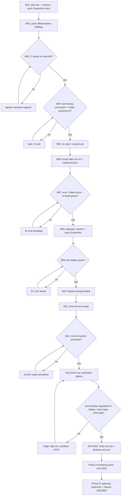

# SUPERB: offline-banner legs+ladder — deploy chain & hardening (Pareto plan)

**Created:** 2026-11-10 00:12 CET
**Author:** agent session (continuation of 2026-11-09 evening arc)
**Source:** docs/status/2026-11-10_00-01_offline-banner-independent-legs-phase-ladder-status.md §f (50-item list, condensed here)
**Owning commit (already built, unpushed):** upstream `offline-banner` `432fbaa` — independent icmp/tcp/dns legs + smart phase ladder, all 9 flake checks green.

---

## EXECUTING (instance, timestamp, HEAD)

**EXECUTING (crush agent session, 2026-11-10 00:12 CET, SystemNix HEAD 973665ffa / offline-banner HEAD 432fbaa):** this session executes Phases A–E below. A PARALLEL LOCK-FLOAT SESSION is actively mutating `flake.lock` + `flake/expected-locks.nix` (live-verified 00:12: ~12 input bumps dirty, 2 fresh commits) — Phase D (deploy) is GATED on that session's sweep committing and a ≥4×60s quiescence window (AGENTS deploy-vs-executor rule, 2026-10-25 gen-949 class). Phases A/B/C1 run regardless.

---

## 1. The situation (context for every task below)

The user's evening was polluted by the offline banner crying "OFFLINE — down for 15 s" every few seconds while the network was perfectly usable. Root cause (live-proven 2026-11-09 21:49–22:0x): **new-flow ICMP policing** upstream of/beside the ISP gateway (192.168.1.1, Compal/Vodafone) — single pings drop ~30–50 % with the full 3 s timeout, dense single-flow bursts pass 100 %, TCP instant, DNS resolving, NIC/kernel clean. The banner's old single-leg probe (ICMP only, 2-failure debounce @5 s) honestly reported those losses as OFFLINE.

The fix exists and is fully machine-tested **upstream** (`offline-banner 432fbaa`): four independently-debounced legs (link/icmp/tcp/dns) + a phase ladder — **degraded** (a leg down, another up) now renders a slim info-blue strip naming the down legs, no sound, no ledger entry, auto-fades after 15 s, re-shows only on a NEW down-leg set; **offline** requires link death or TCP+DNS both down. What is NOT done: **everything that puts it on the screen** — push, SystemNix input bump, deploy, live verification — plus a hardening tail.

Hard constraint from the shared tree: a **parallel lock-float session** is sweeping `flake.lock`/`expected-locks.nix` right now (12+ input bumps dirty, live 00:12). The 2026-10-25 gen-949 incident (two deploy batteries lost to a mid-run lock float; root-level lock files MUST be in the quiescence heat-check) forbids deploying or pin-bumping while that session is mid-sweep. Phases below are sequenced around it. **Verschlimmbesser guard:** no deploy until quiescence; no fix-forward of the banner's live behavior via config hacks (no `failuresToShow` raising, no banner disable) — the real fix is the bump.

## 2. Pareto breakdown

### The 1% that delivers ~51% — GET THE FIX ON THE SCREEN
Push `offline-banner 432fbaa` → bump the SystemNix pin (flake.nix rev + expected-locks) → eval gates → quiesced deploy → anchor check → live verification in the ACTIVE evening-flap window (degraded strip, silence, state file). One evening of annoyance → gone, permanently, with the diagnostic bonus (the strip now *names* the policed leg instead of lying "offline").

### The 4% that delivers ~64% — and make it honest + documented
1% + the three cheapest credibility items: a **rendered-netProbe-command execution gate** (the real `bash /dev/tcp`+`timeout`+`getent` line is currently only ever stubbed in CI — a quoting typo detonates at first live boot as permanent degraded legs), **`docs/agents/desktop.md` §Offline banner contract sync** (new options/env/phases), and the **post-deploy close-out** written into the monitoring `[watch]` row (assert WHICH evidence answers WHICH question — the deployed-ladder, not a local check log).

### The 20% that delivers ~80% — and make the test suite complete
4% + upstream test-suite completion (waybar fabricated-state tests for degraded, vm-smoke legs assert, sticky-dwell test, link-scenario re-anchor, FEATURES row fixes), the two AGENTS.md hard-rule lessons (binding-staleness; capture-then-assert pixels), upstream TODO_LIST harvest + status snapshot.

### The remaining 20% to 100% — judgment calls, monitoring, and debt
Gateway-side ICMP diagnosis (router capture, ties into the OpenWrt plan), IPv6 legs design, website sync, ledger `phase` field, per-leg timeouts, port fallback chain, CI aarch64 watch, downgrade compat sweep, post-green-days watch-row closure.

## 3. Phase plan (30–100 min tasks, sorted by importance/impact/effort/customer-value)

| # | Task | Size | Impact | Effort | Customer value | Phase | Blocking |
|---|------|------|--------|--------|----------------|-------|----------|
| T1 | **Deploy chain**: push offline-banner → wait out the parallel lock sweep → bump pin (flake.nix + expected-locks) → eval gates → quiesced `nix run .#deploy` → anchor check | 90 min | **highest** | med | **THE fix live** | D | lock-sweep session |
| T2 | **Live banner verification battery** in the evening-flap window: journal tokens, state-file legs shape, `niri msg layers`, degraded strip visible + fades, NO false OFFLINE, sound silence while degraded | 60 min | highest | low | proof, not hope | E | T1 |
| T3 | **Rendered-netProbe execution gate** in offline-banner `checks` (sh -n + deterministic stubbed-env run of the REAL command string) | 60 min | high | med | deploy-confidence | H1 | push (post-push ok) |
| T4 | **SystemNix doc sync**: `docs/agents/desktop.md` §Offline banner contract (options/env/phases) + monitoring-row close-out evidence | 45 min | high | low | future sessions correct | E | T2 |
| T5 | **Upstream test completion**: waybar fabricated-state tests (degraded), vm-smoke legs/phase assert, `degradedDwellSeconds=0` sticky test, link-scenario re-anchor | 90 min | med-high | med | regression-proof | H1 | push |
| T6 | **Upstream docs/living-harvest**: FEATURES rows 65/68 + ledger semantics, AGENTS.md lessons (binding staleness, capture-then-assert), TODO_LIST harvest (owed rows), docs/status snapshot | 60 min | med | low | repo hygiene | H2 | push |
| T7 | **Gateway ICMP diagnosis session**: router-side capture in an evening window (ties into OpenWrt pareto plan) | 100 min | med | high | root fix of the underlying loss | G | owner/router access |
| T8 | **Website sync** (phase ladder + options) | 60 min | low-med | low | public docs | H2 | push |
| T9 | **IPv6 legs design** (v6 literals / ahostsv6 fallback; now spans 3 legs) | 60 min | low-med | med | future-proofing | H3 | decision |
| T10 | **CI watch + regex tighten** (aarch64 emulated run after push; per CI-timing doctrine) | 30 min | med | low | green pipeline | H1 | push |
| T11 | **Ledger `phase` field** decision + implementation | 45 min | low | low-med | richer forensics | H3 | decision |
| T12 | **Downgrade-compat sweep**: waybar contrib + any consumer on pre-`phase` state files | 45 min | low | low | robustness | H3 | — |

## 4. Micro-tasks (≤12 min each — ALL todos, execution checklist)

| # | Micro-task (≤12 min) | Parent | Phase | Done-when |
|---|----------------------|--------|-------|-----------|
| M01 | Write this plan doc + commit + push SystemNix docs | — | A | pushed |
| M02 | `git push` offline-banner master (432fbaa) | T1 | B | origin/master == 432fbaa, CI triggered |
| M03 | Watch offline-banner CI (aarch64 emulated) to green | T10 | B | Checks ✓ on GitHub |
| M04 | Quiescence poll loop: `git status` clean + no eval-relevant mtime <5 min + lock-sweep session committed, ≥4×60 s rounds | T1 | C1 | 4 clean rounds logged |
| M05 | Re-read `flake.lock`/`expected-locks.nix` post-sweep; content-pin HEAD | T1 | C1 | revs noted |
| M06 | Edit `flake.nix` offline-banner url → `?ref=<new rev>`-less master pin per pin-audit convention; bump `expected-locks.nix` offline-banner line | T1 | C2 | 2-file diff |
| M07 | Eval gate: `nix eval --raw .#nixosConfigurations.evo-x2.config.system.build.toplevel.drvPath` + `nix flake check --no-build` | T1 | C2 | both green |
| M08 | Pathspec commit (flake.nix + expected-locks.nix + flake.lock if swept-clean) with detailed message; push SystemNix | T1 | C2 | pushed |
| M09 | Pre-deploy: `scripts/pre-deploy-check.sh` + §11 preview if FODs appear | T1 | D | green |
| M10 | `nix run .#deploy` (background; nh) | T1 | D | switch done |
| M11 | Wait full process tree (`pgrep -f 'nh os|switch-to-configuration'` empty) | T1 | D | empty |
| M12 | Anchor: `readlink /run/current-system` == newest `system-N-link`; repair procedure if unanchored | T1 | D | anchored |
| M13 | Journal battery: `journalctl --user -u offline-banner` — new tokens present (`banner phase=`, `leg down/ok`), unit active, no restart loop | T2 | E | tokens seen |
| M14 | State file battery: `legs`/`phase`/`degradedLegs`/`degradedVisible` keys, heartbeat fresh | T2 | E | jq shape ok |
| M15 | `niri msg layers` — `systemnix:offline-banner` namespace present when degraded | T2 | E | layer seen |
| M16 | Live flap-window observation: during evening ICMP policing, strip stays hidden OR shows DEGRADED (blue) naming icmp; NO yellow alarm | T2 | E | evidence captured |
| M17 | Sound silence: no cue while degraded (journal `sounds` absence during phase=degraded) | T2 | E | no cue logged |
| M18 | Waybar consumer: degraded widget text while strip visible (if waybar runs it) | T2 | E | widget state ok |
| M19 | Update monitoring `[watch]` row with close-out evidence (deployed gen, journal excerpt, verdict) | T4 | E | row updated |
| M20 | Sync `docs/agents/desktop.md` §Offline banner (options/env/phases + SystemNix verification recipes for the ladder) | T4 | E | doc updated |
| M21 | netProbe gate: extract rendered command from eval → `sh -n` + stubbed-env deterministic run in a new check | T3 | H1 | check green |
| M22 | Waybar fabricated-state tests: degraded visible/hidden/missing-keys | T5 | H1 | tests green |
| M23 | vm-smoke: add state-file `phase`/`legs` assert; run `nix build .#vm-smoke` | T5 | H1 | VM green |
| M24 | Sticky dwell test (`DEGRADED_DWELL=0` stays visible) in probe-transitions | T5 | H1 | test green |
| M25 | Link-scenario re-anchor: control-net ok before link instance | T5 | H1 | comment+truth match |
| M26 | FEATURES rows 65/68 fixes + ledger semantics sentence in README | T6 | H2 | drift gates green |
| M27 | AGENTS.md: binding-staleness + capture-then-assert hard rules | T6 | H2 | written |
| M28 | offline-banner TODO_LIST harvest (owed rows: M21–M25 items, IPv6, live-monitor proof, website) | T6 | H2 | rows queued |
| M29 | offline-banner docs/status snapshot | T6 | H2 | written |
| M30 | Website phase-ladder + options sync | T8 | H2 | built |
| M31 | Gateway capture prep (what to log, where; OpenWrt plan linkage) — requires owner router access | T7 | G | runbook drafted |
| M32 | IPv6 leg design note (v6 literal probeHost/tcpProbeHost, ahostsv6) | T9 | H3 | note written |
| M33 | Ledger `phase` field decision recorded | T11 | H3 | decision row |
| M34 | Downgrade-compat: waybar contrib on pre-`phase` state file | T12 | H3 | verified |
| M35 | SystemNix consumer sweep: grep state-file consumers before relying on new keys | T12 | H3 | sweep clean |
| M36 | Post-green-days: close the monitoring `[watch]` row | T7 | G | row closed |

## 5. Execution graph

**Hard lanes:** H (M21–M30) runs independently of the deploy chain, after push. G (M31/M36) is owner-gated.

## 6. Verschlimmbesser guards (explicit)

1. **No deploy while the lock-float session is mid-sweep** — root-level lock files in the quiescence heat-check (2026-10-25 rule). If their sweep is still open at the end of this session, the bump+deploy is LEFT FOR THE NEXT WINDOW and this plan is updated with the state — not forced through.
2. **No config-hack mitigation** of the banner on evo-x2 (no failuresToShow raising, no disable) — the real fix exists; a hack would mask the diagnostic value of the new ladder.
3. **No reverts of the parallel session's sweep** — their bumps are intentional work; my pathspec commits must not include their files until they have committed.
4. **drv-equality probe before any re-deploy** (equal ⇒ skip, differ ⇒ proceed).
5. **Anchor check after switch**; repair procedure on UNANCHORED, then re-verify.
