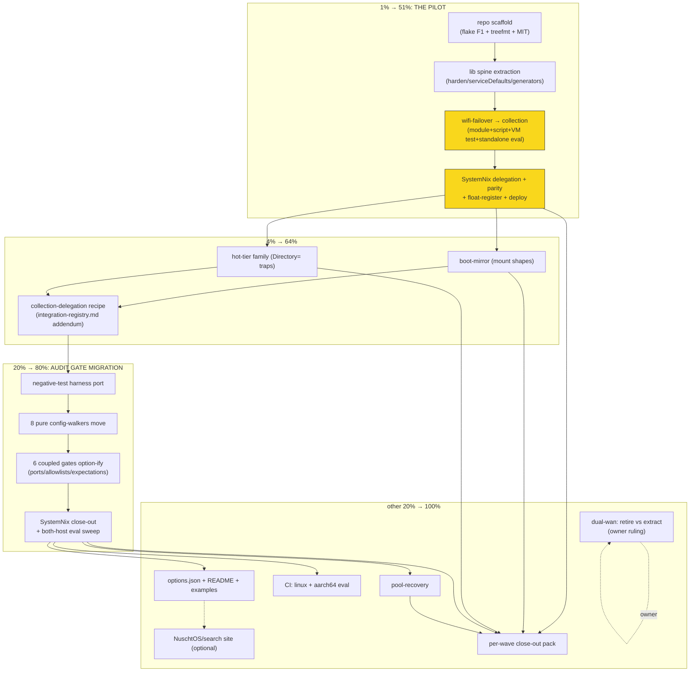

# SUPERB — LarsArtmann NixOS Module Collection (`github:LarsArtmann/nixos-modules`)

**Created:** 2026-11-10 05:07
**EXECUTING (instance owner GO directive 2026-11-11: execute whole list; repo create+push sanctioned (dms-paste precedent), 2026-11-11 00:47 CET, HEAD `3d7ad3978`):** executing (see AGENTS.md plan-execution tombstone)
**Status:** PLANNED (not executing — marker protocol per docs/CONTRIBUTING + AGENTS.md plan-execution tombstone applies before ANY execution of this file)
**Author:** collection-design session (trigger: owner question "how much code is wifi-failover / worth a dedicated repo?" → "nixosModules sound interesting, how would that look?" → "REALLY STUDY the NixOS ecosystem, then present a plan")
**Sibling plans:** `2026-11-08_03-30_SUPERB-own-project-module-upstreaming-completion.md` + `2026-11-08_10-44_SUPERB-upstreaming-completion-phase2.md` (project-owned modules → product repos). THIS plan is the complement: **project-LESS pattern modules, the audit gates, and the systemd lib spine → ONE dedicated collection repo.**

---

## 0. Context

### Why a collection repo (and why NOT one-repo-per-module)

The 2026-11-08 upstreaming doctrine moves a service module into the repo that OWNS the service (monitor365.nix → monitor365 repo). But three classes of SystemNix code have **no owning product**:

1. **Pattern modules** — wifi-failover (419 LoC incl. test), boot-mirror (249), hot-tier family (hot-db 527 + journal-hot 78 + caddy-logs-hot + hot-user-caches, ~700 + 4 VM tests), pool-recovery (535 + test), dual-wan (233, fleet-disabled).
2. **Eval-time audit gates** — the prevention layers. Coupling census (this session, grep-verified): **8 of 14 are pure config-walkers with ZERO fleet references** (systemd-shape, mount-gating, memory-watermark, start-limit, timeout, dynamic-user, capability-grant, tmp-cleaner); 6 carry fleet inputs that are trivially option-ifiable (port-registry ← `lib/ports.nix`, gatus-coverage ← registry, deploy-restart ← registry+deploy.sh, stray-unit ← hardcoded allowlist, script-port ← `scripts/` tree, otel-endpoint ← expectations attrset).
3. **The systemd lib spine** — `lib/default.nix` (731 LoC) + `lib/systemd.nix` + `service-defaults.nix` + `types.nix` + `port-guard.nix`: `harden`, `serviceDefaults*`, `onFailure*`, unit generators (`mkPoolDirUnit`, `mkSqliteBackupUnit`, `mkMetricTextfileCollector`). Pure nixpkgs-lib, battle-tested through 3 months of incidents — genuinely reusable by any fleet.

A single-module repo per pattern (wifi-failover repo, boot-mirror repo, …) multiplies lock nodes, CI surfaces, and README maintenance for near-zero reuse each. One collection batches them the way `lib/lars-packages.nix` batches the Go tools. Honest cost: extraction touches ~2,500 LoC across the tiers + every consumer-side thin layer, serialized on pushes/deploy. Honest payoff: the audit gates are the publicly novel part — no known collection ships this class of eval-time guard.

### Ecosystem research (primary-source verified this session, 2026-11-10)

| Concern | NuschtOS/nixos-modules (the living canonical collection) | nix-community/srvos | nix-community/impermanence | NixOS/nixos-hardware |
|---|---|---|---|---|
| Outputs | `nixosModule` (aggregate, imports all + injects libS) **and** `nixosModules.<name>` per module | modules via `import ./`; dev outputs from a PRIVATE dev flake (flake-compat) so dev inputs never enter consumer locks | `nixosModules.default` alias + singular `nixosModule` alias | explicit flat attrset (400+ hand-listed) |
| Discovery | auto: `readDir modules/` | n/a (roles) | single module | none (explicit list) |
| Shared lib | **libS pattern**: flake `lib` output `args -> attrs`, injected `_module.args.libS = mkOverride 1000` (their lib needs `config`) | internal | `lib = import ./lib.nix { inherit lib; }` — relative import, no module args | none |
| nixpkgs | consumer `follows` guidance in README; CI evals stable+unstable | pinned unstable-small, dev-only | unstable | channels tarball, test-only |
| Tests | `checks = import ./tests {}` | dev flake | `pkgs.testers.runNixOSTest` per system; **assertions DERIVED from the evaluated option tree** | `tests/nixos-tests.nix` + `run-tests` package |
| Deprecation | — | — | assertion-fail module on removed output | **`builtins.trace` warn wrapper → `throw` on removal** (two-stage) |
| Docs | **options search site** (NuschtOS/search, self-hostable, static) | — | README | README |
| Design rule | "modules never change the configuration without setting an option" | — | — | — |

Cross-cutting findings (verified against fetched sources AND SystemNix's own pinned nixpkgs rev `1d060086` by the research sessions; anything unverifiable is flagged):

- **F1 — the `import` keyword kills declaration provenance.** Options rendered from `nixosModules.x = import ./x.nix` lose their "declared in" links; path-typed references preserve them (NuschtOS/search README "Missing declaration"; nixos-hardware's `import = path: path` trick exists for exactly this). **Our flake must reference module PATHS, not import-applied modules.** Note: SystemNix's current wrapper shape (`_: { flake.nixosModules.x = {…}: …}`) has the same property — the collection keeps per-dir `default.nix` referenced as path.
- **F2 — docs pipeline is `nixosOptionsDoc`**: `(lib.evalModules { modules = [...]; }).options` → `pkgs.nixosOptionsDoc` → `options.json` (+ `literalExpression`/`defaultText` conventions for computed defaults). The search site is an optional static consumer of that JSON.
- **F3 — dev-input quarantine** (srvos/nixos-hardware flake-compat split) exists to keep treefmt/dev deps out of consumer lock graphs. At our scale (nixpkgs + treefmt-nix only) it is unnecessary IF SystemNix `follows` both — net lock growth **+1 node** (the collection itself).
- **F4 — collections float on master; consumers pin by rev.** No exemplar tags releases. Matches the LarsArtmann pin-policy default (float + probe-before-lock + documented pins).
- **F5 — rename machinery is verified at our pinned rev and has a house style.** `lib.mkRenamedOptionModule` / `mkRenamedOptionModuleWith { sinceRelease }` / `mkChangedOptionModule` / `mkRemovedOptionModule` are MODULES applied via `imports` (all present in `lib/modules.nix` at `1d060086`). nixpkgs policy: renames live INSIDE the module while it exists; `nixos/modules/rename.nix` only for fully-deleted modules. **NuschtOS keeps a migration-ledger module** (`modules/default.nix` with 8 real `mkRemovedOptionModule [...] "reason"` entries); srvos leaves `mkRemovedOptionModule` tombstones for deleted roles. Aliases are effectively permanent (2023 removals still present in 2026 rename.nix). Caveats: renames don't work across `types.raw`; the `to` option must already be declared.
- **F6 — the CI eval-matrix recipe (NuschtOS `.github/workflows/flake-check.yaml`)**: `strategy.matrix` over nixpkgs branches (stable + unstable), each leg `nix eval --override-input nixpkgs github:NixOS/nixpkgs/<branch> .#checks.x86_64-linux.no-config -L --show-trace`; the FULL `nix flake check` runs only against the pinned lock. Eval-only matrix — no exemplar builds VM tests across the matrix.
- **F7 — the test-harness recipe (NuschtOS `tests/default.nix`)**: per scenario `lib.nixosSystem { modules = [ self.nixosModule installation-cd-minimal.nix scenario ]; }`, and each check is `toplevel // { inherit (value) config options; }` — a derivation ANNOTATED with the evaluated config+options, so `nix eval` forces deep evaluation (incl. option docs) without building. Test configs set `nixpkgs.pkgs = pkgs` to avoid re-instantiating nixpkgs per eval (srvos, nixos-hardware). Prefer `pkgs.testers.runNixOSTest` (not the legacy `nixosTest`) for VM legs — both exist at our rev.
- **F8 — no import-everything `default` output.** Both research sessions converge: `nixosModules.default` should point at a safe core subset (if anything), never the aggregate — opinionated modules fight each other, consumers lose per-module opt-out, eval cost scales with the whole collection. NuschtOS/impermanence keep the legacy singular `nixosModule` purely for ancient consumers; we have none — skip it.
- **F9 — docs recipe is disko's `doc.nix`**: `lib.evalModules { modules = [...]; }` → `pkgs.nixosOptionsDoc { options; }` → `optionsCommonMark` (+ `optionsJSON` for search frontends), wired INTO checks so doc regressions fail CI. `warningsAreErrors` (default true) doubles as a description lint. Advanced: home-manager scrubs pkgs (`scrubDerivations`) before doc eval so docs never instantiate derivations. NOTE: standalone tools named `nixos-options-doc` / `renderOptions` DO NOT EXIST (GitHub 0 results / not in nixpkgs) — the supported entry point is `pkgs.nixosOptionsDoc` only.
- **F10 — `types.enumOf` does not exist** (only `lib.types.enum [ ... ]` at our rev); `mkEnableOption` takes a string, defaults false, and has NO default-true form — explicit `mkOption` when default-true is genuinely wanted. Package options via `mkPackageOption` (overlays in modules slow nixpkgs eval — manual quote).
- **F11 — the dead-ref anti-pattern**: `github:numtide/nixos-modules` — long cited as THE canonical collection — is DELETED (404, absent from the org listing, zero Wayback snapshots; a private Forgejo copy exists but serves a login page to every content URL). Never cite it as a pattern source; treat consumer-facing flake refs as load-bearing public surface once published.

### Local coupling inventory (what actually moves, wave by wave)

| Asset | LoC | Coupling to sever | Destination |
|---|---|---|---|
| `scripts/wifi-failover-watch.sh` + module + test | 419 | `networking.local.gateway` (→ option with default null = derive from config.networking.defaultGateway.options), `options ? services.integration` guard (already correct), repo-lib import (path swap only) | modules/wifi-failover/ |
| `platforms/nixos/system/boot-mirror.nix` + scripts + checks | ~350 | host ESP paths (→ options), `boot-mirror-sync` path unit, pre-reboot-check integration (SystemNix-side stays) | modules/boot-mirror/ |
| hot-db + journal-hot + caddy-logs-hot + hot-user-caches + 4 tests | ~900 | `/mnt/hot` Samsung paths (→ options), `*Directory=`/chown ExecStartPre doctrine comments travel, wants-not-requires | modules/hot-tier/ |
| pool-recovery + test | ~600 | pool device paths, restartUnits registry (→ options) | modules/pool-recovery/ |
| dual-wan + retired scripts | 233 | none hard — but fleet-disabled | **[decision]** retire vs extract (dead code's public value ≈ 0) |
| 8 pure audit gates + their selftests | ~1,400 | none (config-walkers) | modules/audits/ |
| 6 coupled audit gates | ~1,200 | registry/ports/allowlist inputs → options | modules/audits/ (option-ified) |
| lib spine (harden, serviceDefaults, generators) | ~900 | `/mnt/pool` default in mkPoolDirUnit (parameterized already), mkOidcGate/mkDnsGate (dnsblockd-budget semantics — **stay SystemNix**, wave-4 revisit) | lib/ |

---

## 1. Pareto Breakdown

### The 1% that delivers 51%: THE PILOT — wifi-failover end-to-end
One module, every hard decision at once: repo scaffold + flake shape (F1), lib-spine import path, module relocation + test travel, SystemNix delegation layer, parity proof, probe-before-lock re-lock, deploy. If the pilot's seven shims are right, every later module is recipe repetition. If they are wrong, NOTHING else should start.

### The 4% that delivers 64%: WAVE-1 COMPLETION + THE RECIPE ADDENDUM
boot-mirror and hot-tier carry the two coupling classes the pilot lacks (fstab/mount shapes; `*Directory=` implicit-Requires traps — the caddy-logs-hot VM-test-proven pattern). Landing them + distilling the **collection-delegation recipe** into `docs/agents/integration-registry.md` (sibling of the existing 8-step extraction recipe) converts the remaining 90% of work from design into execution.

### The 20% that delivers 80%: THE AUDIT GATE MIGRATION
8 pure config-walkers move nearly verbatim; the 6 coupled ones get option surfaces (`portRegistry.ports`, allowlists, expectations). SystemNix then FEEDS the options — the gates keep firing on every evo-x2 eval exactly as today (proven by the negative-test harness). This is the bulk of the public value (no known collection ships this class) and the largest dedup (audits currently import repo lib 115-wide via the shared spine).

### The other 20% to reach 100% (the tail that keeps it true)
Deploy waves + anchor discipline per delegation; pool-recovery + dual-wan decision; mkOidcGate/mkDnsGate portability ruling; options.json + search site + examples/ + adoption README; negative-test harness port; runbook headers (`docs/services/*.md` owning-module lines); TODO-library upkeep per wave (upstream.md rows); parallel-session coordination (pimsync scaffold + offline-banner executor were live on this tree today); CHANGELOG; license (MIT — NuschtOS/nixos-hardware precedent); the rpi3-dns second-host consumption check (audits must reach BOTH NixOS hosts after the move). **Skipping the tail is how a doctrine becomes a ritual.**

---

## 2. Comprehensive Plan (30–100 min tasks, sorted by impact → effort)

| # | ID | Task | Impact | Effort | Value | Gate |
|---|----|------|--------|--------|-------|------|
| 1 | R1 | **Pilot: repo scaffold** — `gh repo create LarsArtmann/nixos-modules`, flake.nix (path-typed outputs per F1, auto-discovery over `modules/*/`, nixpkgs + treefmt-nix inputs ONLY), treefmt (treefmt-nix, alejandra — same stack as SystemNix), MIT LICENSE, README skeleton, .gitignore | 🔴 gates all | 60m | foundation | owner push-norm (see D2 open [decision] row; dms-paste precedent = create+push OK) |
| 2 | R2 | **Pilot: lib spine extraction** — copy `lib/default.nix` → collection `lib/` (harden/serviceDefaults/onFailure/generators/serviceTypes/mkPortGuard), keep mkOidcGate/mkDnsGate OUT (SystemNix stays owner), collection-internal relative imports, `nix flake check` green standalone | 🔴 | 90m | the reusable spine | R1 |
| 3 | W1a | **Pilot: wifi-failover moves** — `modules/wifi-failover/{default.nix,README.md}` + script colocated; `networking.local.gateway` → `gateway` option (default derives from `config.networking.defaultGateway` when null); VM test relocates (`checks.x86_64-linux.wifi-failover`); standalone `nixosSystem` eval-proof of the module alone | 🔴 the 1% | 90m | first collection module | R2 |
| 4 | W1b | **Pilot: SystemNix delegation** — flake input (+ nixpkgs/treefmt follows, lock delta = +1 node verified), module → `imports = [ inputs.nixos-modules.nixosModules.wifi-failover ]` + layer (integration entry, system-health, ports n/a), rendered-unit parity diff + harden-bounds, float-register re-lock, deploy + anchor + FAILOVER smoke (journalctl markers) | 🔴 proves the loop | 100m | doctrine live | W1a, push, deploy |
| 5 | X0 | **Recipe addendum** — "Collection delegation" section in integration-registry.md: the 7 shim decisions, parity method, expected audits, deltas-doc template | 🟠 multiplies all | 30m | repeatability | W1b |
| 6 | W2a | boot-mirror extraction (ESP paths → options; sync script + path unit travel; `boot-mirror-activate` + pre-reboot-check integration stay SystemNix-side) + VM/path-trigger checks port | 🟠 | 90m | 2nd pattern class (mount shapes) | X0 |
| 7 | W2b | boot-mirror delegation + parity + re-lock (fstab render diff included) | 🟠 | 60m | dedup | W2a |
| 8 | W3a | hot-tier extraction: hot-db engine + journal-hot + caddy-logs-hot generalized behind `services.hot-tier.*` options (mount root, cow flag, ownership-heal ExecStartPre doctrine); 4 VM tests travel | 🟠 | 100m | 3rd pattern class (`*Directory=` traps) | X0 |
| 9 | W3b | hot-tier delegation ×3 (crush-hot-db, journal, caddy-logs) + parity | 🟠 | 90m | dedup | W3a |
| 10 | A0 | **Audit harness port** — negative-test methodology moves to the collection (`tests/negative/` fixture-flake harness, the copy-mutate-prove method from `scripts/negative-test-lints.sh`); every moved audit gets a fail-on-bug-shape leg | 🔴 gates wave-3 truth | 90m | gates stay honest | R2 |
| 11 | A1 | 8 pure audit gates move verbatim (config-walkers; selftests travel); SystemNix imports them from the collection; evo-x2 + rpi3-dns eval green | 🔴 the 20% | 100m | public value core | A0 |
| 12 | A2 | 6 coupled gates option-ify: `port-registry-audit` reads `services.port-registry.ports` option; stray-unit allowlist → option; deploy-restart/gatus-coverage/script-port/otel-endpoint → option inputs; SystemNix feeds them from ports.nix/registry | 🔴 | 100m | public value core | A1 |
| 13 | A3 | Audit-wave SystemNix close-out: delete moved audit files, layer files feed options, negative-test-lints.sh re-points at the collection harness, full `nix flake check --no-build --all-systems` | 🟠 | 60m | dedup complete | A2 |
| 14 | P1 | pool-recovery extraction + delegation (options: pool devices, restart set) | 🟡 | 90m | dedup | X0 |
| 15 | D1 | dual-wan ruling (owner): retire from SystemNix (dead code) vs extract to collection as standby-reference. Default proposal: retire; the wifi-failover assertion text already documents the doctrine | 🟡 | 15m | truth | owner |
| 16 | C1 | CI: collection GitHub Actions — F6 recipe: eval-only matrix over {nixos-26.05, nixos-unstable} via `--override-input`, full `nix flake check` against the pinned lock only, aarch64 eval leg; cache keyed on lock+sources | 🟡 | 45m | guard | R1 |
| 17 | C2 | Docs: F9 recipe — `nixosOptionsDoc` → `optionsCommonMark` wired INTO checks (doc regressions fail CI; `warningsAreErrors` as description lint), `options.json` drift check; per-module README with example consumption snippet; examples/ minimal host | 🟡 | 90m | adoptability | W1b |
| 18 | C3 | Optional: NuschtOS/search static options site on GitHub Pages (F2; defer until ≥5 modules make it worth it) | 🟢 | 45m | discoverability | C2 |
| 19 | Y1 | Per-wave close-out pack: runbook headers, upstream.md rows, CHANGELOG (both repos), TODO prune + WARN recount, EXECUTED flips | 🟢 truth | 30m/wave | queue truth | per wave |
| 20 | Z1 | Coordination standing task: pathspec commits; quiescent-tree evals (pimsync + offline-banner sessions were live today); deploy only at 4×60s clean polls; content-pin before edits | 🟢 guard | 15m/wave | no races | always |

## 3. Micro Breakdown (≤12 min tasks; ALL TODOs; sorted by impact → effort within waves)

**Wave R — scaffold (tasks 1–2):**

| µID | Task | Est | Dep |
|-----|------|-----|-----|
| R1a | Owner confirmation / dms-paste precedent check for repo create+push (the open [decision] row docs/todo/desktop.md:116) | 5m | — |
| R1b | `gh repo create LarsArtmann/nixos-modules --public` + local clone under ~/projects | 10m | R1a |
| R1c | flake.nix: inputs nixpkgs(unstable)+treefmt-nix; outputs: auto-discovered `nixosModules.<name>` from `modules/*/` via PATH references (F1), perSystem checks/formatter scaffold | 12m×2 | R1b |
| R1d | treefmt.nix (alejandra + nixpkgs-fmt parity decisions — copy SystemNix module config), .gitignore, MIT LICENSE, README skeleton (usage + follows snippet per NuschtOS README shape) | 12m | R1c |
| R1e | `nix flake check --no-build` green on empty module set; first commit + push; lock-audit-style check: exactly 2 inputs | 10m | R1d |
| R2a | Copy lib/systemd.nix + service-defaults.nix + types.nix + port-guard.nix; fix relative imports | 12m |
| R2b | Split lib/default.nix: portable half moves, mkOidcGate/mkDnsGate/buildcache/filesystems/ports stay — document the split in collection lib/README.md | 12m×2 | R2a |
| R2c | Collection-side lib smoke: eval a fixture module using harden+serviceDefaults; unit-shape render assertion | 12m | R2b |
| R2d | SystemNix compat decision: lib/default.nix re-exports collection lib (during migration) vs stays forked (kill later) — implement re-export shim + eval | 12m | R2c |
| R2e | Migration-ledger scaffold `modules/_renames.nix` (empty imports list + comment policy) + cross-module `no-config` smoke check (F7 harness: collection alone + minimal profile, toplevel-annotated) | 12m | R2d |

**Wave W1 — the pilot (tasks 3–5):**

| µID | Task | Est | Dep |
|-----|------|-----|-----|
| W1a-1 | Read wifi-failover module+script+test full; mark portable vs layer blocks (recipe step 1, stop-gate) | 12m | R2 |
| W1a-2 | Write modules/wifi-failover/default.nix: gateway option (null → defaultGateway-derived), interfaces/poll/trust options unchanged, lib import path swap, harden/serviceDefaults from collection lib | 12m×2 | W1a-1 |
| W1a-3 | Colocate script + module README (runbook content moves; SystemNix docs/services/wifi-failover.md becomes a pointer + layer notes) | 12m | W1a-2 |
| W1a-4 | Port VM test to checks (stateVersion pin pattern from SystemNix tests/default.nix:29; F7 harness shape — `runNixOSTest`, `nixpkgs.pkgs = pkgs`, toplevel+options-annotated smoke alongside); green locally | 12m×2 | W1a-3 |
| W1a-5 | Standalone eval proof: `nixosSystem` with ONLY the collection module (the isolated-VM eval class the module already handles) | 10m | W1a-4 |
| W1a-6 | Collection commit + push + `nix build github:LarsArtmann/nixos-modules/<rev>` probe (probe-before-lock) | 10m | W1a-5 |
| W1b-1 | SystemNix flake input + follows (nixpkgs, treefmt-nix); verify lock node delta == +1 (lock-audit terms) | 10m | W1a-6 |
| W1b-2 | float-register re-lock wave | 10m | W1b-1 |
| W1b-3 | Rewrite SystemNix wifi-failover.nix as delegation layer: imports + integration entry (guarded) + system-health + runbook pointer | 12m | W1b-2 |
| W1b-4 | Parity: baseline = last commit without marker (`git log -S`); render wifi-failover.service both sides; harden-bounds check (CAP_NET_ADMIN, MemoryMax 64M, NoNewPrivileges=false) | 12m | W1b-3 |
| W1b-5 | Eval audits green (port-registry n/a, systemd-shape, io-tier); delete-or-keep decision for the old script path (script-port-audit) | 10m | W1b-4 |
| W1b-6 | Deploy at quiescence + anchor by NUMBER + FAILOVER smoke: journalctl markers on carrier events (veth trick in VM only; live = passive marker check) | 12m+sudo | W1b-5 |
| X0a | Distill pilot into "Collection delegation" recipe (7 shims: flake shape, lib path, registry guard, ports feed, parity, probe, deploy) | 12m×2 | W1b-6 |
| X0b | Land recipe in docs/agents/integration-registry.md + CHANGELOG + runbook header | 10m | X0a |

**Wave W2/W3 — boot-mirror + hot-tier (tasks 6–9):** same XR shape per module as W1 (read+inventory 12m, extract 12m×3, tests 12m×2, standalone eval 10m, push+probe 10m, follows re-lock 10m, delegation 12m×2, parity 12m, deploy 12m) — boot-mirror adds: ESP path options + fstab render diff + path-trigger check port (12m×2); hot-tier adds: option surface design for the family (12m×2) + `*Directory=` neutralization comments travel verbatim (12m) + 3 delegation layers instead of 1 (12m×3).

**Wave A — audits (tasks 10–13):**

| µID | Task | Est | Dep |
|-----|------|-----|-----|
| A0a | Port the negative-test harness method: collection `tests/negative/` runner (copy tracked file set → mutate ONE thing → `nix build --impure` expect-fail) | 12m×3 | R2 |
| A0b | Fixture: minimal host config that trips each audit class (oneshot+Restart, port literal, watermark incoherence, …) — the existing negative-test-lints cases are the source list | 12m×2 | A0a |
| A1a | Move systemd-shape + start-limit + timeout + tmp-cleaner (simplest 4) verbatim + their test files; eval SystemNix with collection imports | 12m×2 | A0b |
| A1b | Move mount-gating + memory-watermark + dynamic-user + capability-grant; rpi3-dns eval too (audits are host-agnostic) | 12m×2 | A1a |
| A1c | SystemNix: delete originals, add collection imports in host assembly, full flake check --all-systems | 12m | A1b |
| A2a | Option-ify port-registry-audit: `services.port-registry-audit.ports` (listOf int) + allowPorts; SystemNix feeds from lib/ports.nix | 12m×2 | A1c |
| A2b | Option-ify stray-unit (allowlist option) + otel-endpoint (expectations option) | 12m×2 | A2a |
| A2c | Option-ify gatus-coverage + deploy-restart + script-port (registry/script-tree inputs become options; SystemNix feeds) — the hardest three, each gets a fail-on-bug negative leg FIRST | 12m×3 | A2b |
| A3a | Re-point scripts/negative-test-lints.sh at the collection harness (or retire in favor of it); CI negative-tests.yml updated both repos | 12m | A2c |
| A3b | Full sweep: evo-x2 + rpi3-dns toplevel evals, `nix flake check --no-build --all-systems` ×2 repos, CHANGELOG both | 12m | A3a |

**Tail (tasks 14–20):** P1 (pool-recovery: read 12m, options 12m, extract 12m×3, test 12m×2, delegate 12m, parity 12m) · D1 (owner ruling 15m + retire-or-extract 12m×2) · C1 (CI yaml 12m×3 + first green run 12m) · C2 (options.json check 12m×2 + README examples 12m + drift leg 12m) · C3 (search site 12m×3) · Y1 per wave (12m×2) · Z1 standing (15m/wave).

---

## 4. Execution Graph (mermaid)

## 5. Design Decisions (locked unless evidence contradicts during execution)

1. **Plain flake, not flake-parts** — 2 inputs total (nixpkgs, treefmt-nix); SystemNix `follows` both → +1 lock node. flake-parts would add eval weight and a second lock-node class for zero benefit at 10–20 modules. Revisit at 30+ modules.
2. **No aggregate output; `nixosModules.<name>` only** (F8) — explicit per-module imports match the delegation doctrine (`inputs.X.nixosModules.<name>`) and preserve per-module opt-out; an import-everything aggregate invites cross-module option fights and whole-collection eval cost. A `default` pointing at a safe-core subset MAY come later for one-import ergonomics. No legacy singular `nixosModule` (we have no ancient consumers).
3. **lib via relative import, NOT `_module.args`** — our spine needs only nixpkgs lib (impermanence pattern). libS-style module args exist for config-dependent libs; ours isn't. Consumer-facing `lib` flake output for direct use.
4. **Modules reference paths, never `import`-applied** (F1) — declaration provenance survives into options.json.
5. **Collection code uses plain/mkDefault only — mkForce is a CONSUMER right** (inverts the CPUQuota trap lesson: upstream plain beats downstream mkDefault, so upstream must leave priority headroom).
6. **Enable-doctrine**: every module inert unless `services.<name>.enable = true` (NuschtOS design rule; already house style).
7. **Option namespaces keep the existing names** (`services.wifi-failover.*`) — renames would break the parity diff. Future evolution via the F5 machinery, kept in a NuschtOS-style migration-ledger module (`modules/_renames.nix`) so every break carries a reason string. `types.enum` (not the nonexistent `enumOf`), `mkEnableOption` string-arg for service-like modules (F10).
8. **ports.nix, integration.nix, gatus, sops, tiles, manifest stay SystemNix** — they ARE the fleet. Collection modules receive values via options.
9. **Versioning: float on master** (F4) + SystemNix probe-before-lock on every re-lock; no tags until an external consumer asks.
10. **Docs floor**: per-module README + example snippet mandatory at merge; options.json in checks mandatory; search site optional at ≥5 modules.

## 6. Verschlimmbessern-Guardrails (non-negotiable)

1. **Rendered-unit parity diff** per delegation vs the last commit WITHOUT the execution marker; harden-bounds check (the 2026-11-08 silently-dropped-bounds class).
2. **A moved audit must still FAIL on its bug shape** — negative-test legs travel with every gate or the migration is a no-op ritual (A0 gates wave 3).
3. **Probe-before-lock + float-register** for every collection re-lock (the daemon-push-channel lesson; the collection is a NEW such channel — its CI being green is not assumed).
4. **Lock graph growth budget: +1 node** — verify after wiring the input; no new infra dup classes (lock-audit terms).
5. **SystemNix originals deleted only after parity + deploy** — land the replacement first (the glm-5.3 lesson generalized).
6. **PATHSPEC commits, quiescent-tree evals, content-pin before edits** — parallel sessions were live on this tree today (pimsync 04:27, offline-banner executor 01:11).
7. **No `import`-applied modules** (F1) — checked in CI via a flake-output introspection leg.
8. **Deploy only at 4×60s clean polls + green drvPath probe** (the gen-949 race doctrine).

## 7. Self-Harvest Note

New TODO rows this plan surfaces (not yet in any library): collection-repo creation [decision — push-norm ruling, rides the open dms-paste row docs/todo/desktop.md:116]; wave-0 scaffold [ready after ruling] into `docs/todo/upstream.md` (the module-upstreaming domain owns it) + TODO_LIST one-liner; dual-wan retire-vs-extract [decision] into `docs/todo/services.md`. Execution tasks are push/deploy-gated per the TODO-system contract — library entries, not queue spam. Status-report discipline: the executing session self-harvests §f follow-ups at authoring time.
