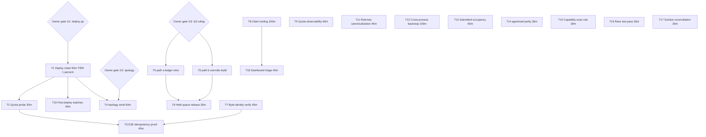

# SUPERB — Send-Hardening Closure Pareto Plan

**Date:** 2026-11-11 01:10 CET · **Status:** PLANNED (not executing — owner gates embedded) · **Author:** the 2026-11-10/11 send-claims + email-native-dedup sessions
**Directive:** owner pareto directive (20%/4%/1% breakdown, 30-100min plan → ≤12min micros, table views, no verschlimmbessern).
**Scope:** the send-hardening / mail-storm work-stream ONLY — the residue of the 2026-11-10 [CATCHALL] incident chain. Inputs read: `docs/status/2026-11-11_00-58_email-native-dedup-verdict-transport-identity-self-review.md` (§a-g), `docs/status/2026-11-10_23-30_at-most-once-send-claims-implementation-self-review.md`, the open CV/SystemNix TODO rows for this chain. Foreign domains (siblings' audible-sync, sca-handoff, module-collection plans) are OUT of scope.
**Errata/verification (skill step 0):** flake.lock pins CV `24c6b1a1c` ≠ CV HEAD → deploy premise CONFIRMED open. Quota-reset probe row live (TODO_LIST + services.md). Transport hardening + claims are on origin (pushed outside the session) but NOT deployed. No newer plan collides (latest: 2026-11-10_05-07 module-collection).

## Pareto verdict

- **The 1% that delivers 51%:** T1 — DEPLOY. Every guarantee this chain built (send-claims ledger, stable identity, Resend key, boundaries) exists only in git; prod still runs the at-least-once code that manufactured the storm.
- **The 4% that delivers 64%:** T1 + T2 + T3 + T4 + T5 — deploy, quota-reset proof, E2E net proof, apology, 165-row triage. These five close every owner-visible wound: never-again live, quota restored + proven, the missed net proven end-to-end, sender reputation repaired, the catchall backlog resolved.
- **The 20% that delivers 80%:** the 4% set + T6–T10 — held-queue release, byte-identity verify/soften (honesty of the shipped claim), claim-resolution tooling (operator can actually resolve AMBIGUOUS rows), quota observability (the invisible-quota class never repeats silently), post-deploy watches.
- **The other 20% to reach 100%:** T11–T18 — durability and polish: key canonicalization, cross-process race backstop, submitted-occupancy, agentmail parity, capability-scan rule, race tests, surface reconciliation, dashboard triage.

**Owner gates (embedded, blocking):** G1 deploy go (T1; push leg moot — origin current), G2 apology send/rest (T4), G3 ledger-wins vs override (T5 path a/b). All three restated in 00-58 §g.

## Level-1 plan — tasks 30-100 min (sorted by tier, then impact/effort)

| # | Task | Tier | Est | Impact | Effort | Deps | Value |
| --- | --- | --- | --- | --- | --- | --- | --- |
| T1 | **Deploy the hardening chain**: flake lock `--update-input cv` → vendorHash (`buildflow -s nix-hash-fix --fix`) → hermetic package probe → pressure-gated `nix run .#deploy` → anchor check (gen by NUMBER, full process tree) → post-deploy claims verification (`send.claimed` in stream, `ApprovedPendingSend` excludes claims, 961 shadow-append warns stop) | **1% → 51%** | 90m | Catastrophic-class killer goes live | M | **G1** | The entire chain is inert until this |
| T2 | **Resend quota-reset acceptance probe** (CET morning): smtplib via 127.0.0.1:25 From applications@artmann.tech → expect `250`; `550` at DATA = Resend dashboard re-add (owner) | **4% → 64%** | 30m | Proves outbound mail restored | S | quota reset (~07:00 CET) | Unblocks T3/T4 sends |
| T3 | **E2E idempotency-net proof**: same-key probe pair through the relay → verify collapse or `invalid_idempotent_request`; observe delivered-header visibility; Date-header presence verdict; record + adjust claim wording | **4% → 64%** | 45m | Converts "plausible backstop" into proven net | S | T1, T2 | Closes 00-58 §b.2 |
| T4 | **Apology (Q2)**: pull ~71 affected recruiters from incident ledger → draft short EN note from applications@artmann.tech → owner review → send → verify + reputation note | **4% → 64%** | 60m | Repairs sender reputation + owner's stated concern | S | **G2**, T1 | Owner-visible |
| T5 | **165-row triage (Q3)**: enumerate rows with real-contact overlap vs ledger → path (a) ledger-wins: mark portal-only + annotate + tick surfaces, or path (b) design+build deliberate Reapply/override command with own event + tests | **4% → 64%** | 90m | Resolves the catchall backlog honestly | M | **G3**, T1 | Owner-visible |
| T6 | **Held postfix queue release**: inspect 20 held storm-night self-mails (recipients = own addresses only), `postsuper -H`, flush watch, verify no recruiter mail | **20% → 80%** | 30m | Closes the frozen-queue state | S | T5 | Hygiene |
| T7 | **Byte-identity verify/soften**: render same application twice → sha256 attachment diff; if nondeterministic, soften CHANGELOG/ADR to "header-identical + fail-closed rejection" + pin | **20% → 80%** | 45m | Shipped claim matches evidence (honesty) | S | — | 00-58 §d.2 |
| T8 | **Claim-resolution operator tooling**: `SendClaimed()` triage surface — `cv claims` CLI (list/release/force-send) or dashboard tile + AMBIGUOUS journal recipe; tests | **20% → 80%** | 100m | AMBIGUOUS rows become resolvable (not parked forever) | M | T1 | Unblocks real ops |
| T9 | **Quota observability**: postfix `550 …quota` deferral textfile metric + Gatus check (the quota died invisibly for hours) | **20% → 80%** | 60m | The invisible-quota class never repeats silently | S | — | Rowed (13:29 §f) |
| T10 | **Post-deploy watches + hygiene**: cv-scan watch; `2026-11-10_17-55-57.log` final-line verify; attribution record for carrier `40a399451`; foreign-red flags to owning sessions | **20% → 80%** | 45m | Verifies the deploy actually healed prod | S | T1 | Evidence discipline |
| T11 | **Role-key token canonicalization**: sort tokens in `NormalizeRoleKey` + parity test ("Azure Cloud Architect" ≡ "Cloud Architect Azure"); dedupe advisory unaffected | rest | 45m | Kills a false-distinct-project class | S | — | Rowed (23:30 §e.2) |
| T12 | **Cross-process ledger race backstop**: two processes claiming same pair in one instant have no stream conflict — design (store-level unique index vs claim arbitration), implement, test | rest | 100m | Closes the last known double-mail window | M-L | — | Rowed (23:30 §e.1) |
| T13 | **`application.submitted` live occupancy**: portal-manual submit + auto-send duplicate inside ONE process still double-mails until restart — fold-time occupancy hook + test | rest | 60m | Closes residual window #2 | M | — | Rowed (23:30 §e.1) |
| T14 | **agentmail parity decision**: the API transport gets none of the new nets — decision memo (+ conditional key mapping) | rest | 30m | Consistency across transports | S | — | 00-58 §f.12 |
| T15 | **Capability-scan rule codified**: every transport/provider integration scans + records idempotency/retry/quota/dedup semantics in its ADR at build time (funnel.md trap register + ADR template note) | rest | 30m | Makes the 17-month Resend miss structurally impossible | S | — | 00-58 §e.1 |
| T16 | **Targeted `go test -race`** over claim/identity/sender tests; fix or adjudicate finds | rest | 30m | Concurrency confidence | S | — | Rowed (23:30 §f) |
| T17 | **Cross-surface reconciliation**: verify every follow-up obligation from the five incident reports (12:30→00-58) is rowed/ticked consistently in both repos' TODO surfaces | rest | 30m | No drift between reports and queues | S | — | House rule |
| T18 | **Dashboard claim-triage surface**: event summaries/badges landed — verify the tile renders claim ratchets; add triage action link if tooling (T8) lands as CLI | rest | 45m | Operator visibility | S | T8 (soft) | Polish |

## Level-2 breakdown — micros ≤ 12 min (same order; each parent's micros execute sequentially)

| Micro | Task (≤12 min each) | Min | Tier |
| --- | --- | --- | --- |
| T1.1 | drv-equality pre-check: `nix eval …toplevel.drvPath` vs current-system deriver (expect drift) | 8 | 1% |
| T1.2 | `nix flake lock --update-input cv` + verify lock rev = CV HEAD | 8 | 1% |
| T1.3 | `buildflow -s nix-hash-fix --fix` (vendorHash) + FOD green | 12 | 1% |
| T1.4 | Hermetic package probe `nix build .#nixosConfigurations.evo-x2.config.services.cv-server.package` | 10 | 1% |
| T1.5 | Quiescence poll (tree clean + eval-relevant mtimes ≥5min old ×4 polls) | 10 | 1% |
| T1.6 | Pressure-gated `nix run .#deploy` (PSI <20%, flock held) | 12 | 1% |
| T1.7 | Anchor check: full process tree gone, `readlink /run/current-system` = newest gen BY NUMBER | 8 | 1% |
| T1.8 | `scripts/post-deploy-check.sh` + journal: claim behavior live, 961 shadow-append warns stopped | 12 | 1% |
| T2.1 | Quota probe: smtplib MAIL FROM + DATA via 127.0.0.1:25 | 10 | 4% |
| T2.2 | Verdict classify: `250` = resolved; `550` at DATA = Resend dashboard re-add (owner action, report) | 6 | 4% |
| T2.3 | Tick BOTH surfaces + 12:30 report b.1 annotation | 8 | 4% |
| T3.1 | Probe pair: two sends, same `Resend-Idempotency-Key`, via relay | 12 | 4% |
| T3.2 | Journal + Resend dashboard verdict: collapsed (cached response) vs `invalid_idempotent_request` | 10 | 4% |
| T3.3 | Delivered-header visibility: inspect probe mail at catchall (key header present? stripped?) | 10 | 4% |
| T3.4 | Date-header presence verdict (Resend stamps one? postfix won't) | 8 | 4% |
| T3.5 | Record verdicts; adjust byte-identity wording if attachment bytes differed | 10 | 4% |
| T4.1 | Extract ~71 affected recruiters from incident reports/store ledger | 12 | 4% |
| T4.2 | Draft short apology (EN; one per recruiter; From applications@artmann.tech) | 12 | 4% |
| T4.3 | Owner review gate (paste draft, wait) | 5 | 4% |
| T4.4 | Send via relay; journal verify | 10 | 4% |
| T4.5 | Delivery verify + reputation follow-up note (bounce watch) | 10 | 4% |
| T5.1 | Enumerate 165 rows: real-contact overlap vs ledger occupancy join | 12 | 4% |
| T5.2 | Path (a): mark ledger-blocked rows portal-only + annotate per-row reason | 12 | 4% |
| T5.3 | Path (a): tick TODO surfaces + incident report addendum | 10 | 4% |
| T5.4 | Path (b): design Reapply command (own event, audit trail) | 12 | 4% |
| T5.5 | Path (b): implement + tests | 12 | 4% |
| T5.6 | Path (b): execute re-dispatch for eligible rows + verify | 12 | 4% |
| T6.1 | Inspect held set (`postqueue -j` held; recipients = own addresses ONLY) | 8 | 20% |
| T6.2 | Release (`postsuper -H`) + flush watch | 10 | 20% |
| T6.3 | Journal verify: zero recruiter mail flushed; surfaces tick | 10 | 20% |
| T7.1 | Render-determinism probe: same application rendered twice → sha256 both attachments | 12 | 20% |
| T7.2 | Verdict: deterministic bytes or not | 5 | 20% |
| T7.3 | If nondeterministic: soften CHANGELOG/ADR wording + adjust test comment (no behavior change) | 12 | 20% |
| T8.1 | Design choice: `cv claims` CLI vs dashboard tile (recommend CLI first) | 12 | 20% |
| T8.2 | `cv claims list` (SendClaimed rows + reason + age) | 12 | 20% |
| T8.3 | `cv claims release <app>` (definitive non-delivery only) with audit event | 12 | 20% |
| T8.4 | `cv claims resend <app>` (force path, own event, bypasses nothing silently) | 12 | 20% |
| T8.5 | AMBIGUOUS journal recipe → cv.md runbook section | 10 | 20% |
| T8.6 | Tests + docs tick | 12 | 20% |
| T9.1 | Postfix `550.*quota` journal regex + textfile collector unit | 12 | 20% |
| T9.2 | Gatus check + badge wiring | 12 | 20% |
| T9.3 | Eval gate leg + fixtures | 12 | 20% |
| T10.1 | cv-scan watch post-deploy | 10 | 20% |
| T10.2 | `2026-11-10_17-55-57.log` final-line verify | 5 | 20% |
| T10.3 | Attribution record: code rode carrier `40a399451` | 10 | 20% |
| T10.4 | Foreign-red flags → owning sessions (templ drift, TODO drift rows) | 10 | 20% |
| T11.1 | Token-sort in `NormalizeRoleKey` | 12 | rest |
| T11.2 | Parity test (order-insensitive same key) | 12 | rest |
| T11.3 | Dedupe advisory regression run | 10 | rest |
| T12.1 | Design memo: unique ledger index vs stream arbitration (pick one, justify) | 12 | rest |
| T12.2 | Implement backstop | 12 | rest |
| T12.3 | Two-process race test | 12 | rest |
| T13.1 | Seam analysis: where submitted-events enter vs tracker mutex | 12 | rest |
| T13.2 | Occupancy hook at fold/apply time | 12 | rest |
| T13.3 | One-process double-mail test (portal-manual + auto-send) | 12 | rest |
| T14.1 | Decision memo: agentmail parity (yes/no + key mapping sketch) | 12 | rest |
| T14.2 | Conditional: implement mapping | 12 | rest |
| T15.1 | Rule text in funnel.md trap register + ADR template note | 12 | rest |
| T15.2 | Retro-annotation in the send-claims ADR ("this rule exists because…") | 8 | rest |
| T16.1 | `go test -race` targeted (eventstore + sender + applyflow claim tests) | 12 | rest |
| T16.2 | Adjudicate/fix finds | 12 | rest |
| T17.1 | Grep every §f obligation across the five reports → checklist | 12 | rest |
| T17.2 | Reconcile queues vs checklist; fix drift | 12 | rest |
| T18.1 | Verify dashboard renders send-claimed ratchets (event summaries landed) | 10 | rest |
| T18.2 | Wire triage action link if T8 CLI landed | 12 | rest |

**Totals:** 18 tasks / 66 micros · Tier 1%: 1 task (8 micros) · Tier 4%: 4 tasks (19 micros) · Tier 20%: 5 tasks (17 micros) · Rest: 8 tasks (22 micros).

## Execution graph

## Execution mode

When the owner says go: execute in tier order (T1 first — one owner word activates the whole 1%), verify each micro before the next (the session discipline), respect the pressure gates (deploy queue-not-race), and mark this file with the EXECUTING tombstone (`scripts/plan-marker.sh`) before the first action. Do NOT verschlimmbessern: T7 is wording-only unless proven; T5 path choice is the owner's, not the executor's; no drive-by fixes to sibling-owned reds (T10.4 flags them, never touches them).

New tasks this plan surfaced beyond existing rows: none — all 18 trace to rowed TODOs or the 00-58 report's self-harvested §f.
