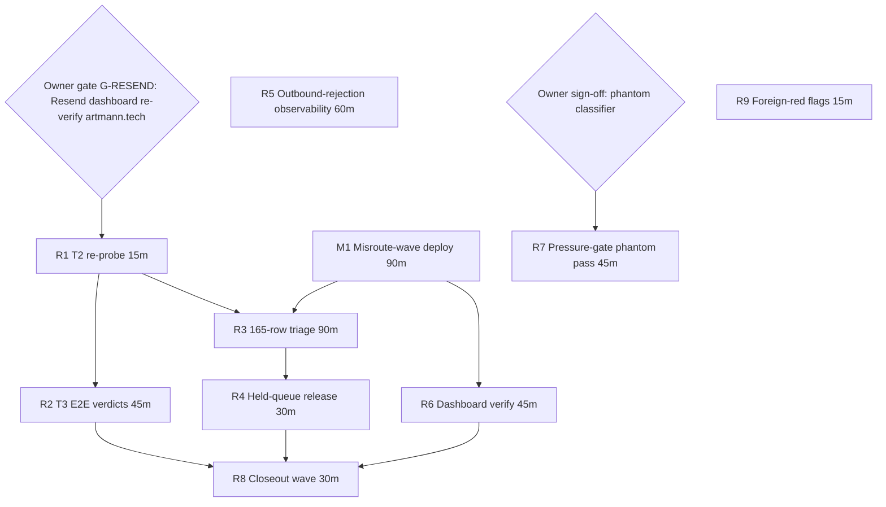

# SUPERB — Send-Hardening Residue & Mail-Restore Closure Pareto Plan

**Created:** 2026-11-11 11:38 CET
**EXECUTED (instance residue-continuation session (gated remainder delegated to rowed items), 2026-11-12 23:31 CET, HEAD `e2502ab38`):** execution finished
**Status:** PLANNED (owner gate embedded at the head — G-RESEND is theirs)
**Author:** the 2026-11-11 send-hardening closure session (supersedes the residue sections of `docs/status/2026-11-11_09-20_send-hardening-closure-full-session-status.md` §f).
**Scope:** the send-hardening / mail-restore residue ONLY. The at-most-once chain is LIVE (gen-1000, anchored, exit 0, shadow-warns zero) — this plan ships the REMAINDER: the misroute tooling, the Resend domain restore, the triage execution, and the observability/polish. Foreign reds (crm-server CPU, node-exporter journal-rate, portalapply lint, ateam cookie.go, portal-probe binary churn) are FLAGGED to owning sessions, never planned here.
**Errata/verification:** live state re-verified at authoring time: current-system == system-1000 (anchor OK), `deploy exited code=0 at 2026-11-11 10:34:25`, cv-300bb9e live, Resend refusal reproduced 07:54–07:59 (`550 The artmann.tech domain is not verified` — journal), quota-probe rows annotated, ship-rows ticked (`5b8098f46`). The misroute wave (CV `def2cd74e`+carriers: `application.misrouted` + `cv misroute` verb + dashboard summaries) is committed on CV master but NOT in the SystemNix lock (pins `300bb9e77`).

## Pareto verdict

- **The 1% that delivers 51%:** G-RESEND — the OWNER re-verifies artmann.tech in the Resend dashboard (DNS records already live, domains repo `resend_artmann_tech`; dig-verified 2026-11-10). Every mail-path outcome hangs behind it: T2's honest `status=sent`, T3's collapse/header/Date verdicts, T5's re-drives actually delivering, and the funnel's outbound generally.
- **The 4% that delivers 64%:** G-RESEND + M1 (misroute-wave deploy) + R1 (T2 re-probe) + R2 (T3 E2E verdicts). Domain restored + proof, the G3 tooling live, the missed net PROVEN end-to-end.
- **The 20% that delivers 80%:** the 4% set + R3 (165-row misroute triage) + R4 (held-queue release) + R5 (quota observability — the invisible-quota class never repeats silently).
- **The other 20% to reach 100%:** R6 (dashboard claim-triage verify), R7 (pressure-gate phantom auto-classification — owner sign-off first, it weakens a freeze gate), R8 (closeout: tombstone EXECUTED, artifacts disposition, reconciliation), R9 (foreign-red flags to owning sessions).

**Owner gate (embedded, blocking):** G-RESEND (dashboard domain re-verify). G2/G3/deploy-force were answered in-session (rest / model-mistakes / authorized-and-done) — no longer gates.

## Level-1 plan — tasks 30–100 min (sorted by tier, then impact/effort)

| # | Task | Tier | Est | Impact | Effort | Deps | Value |
| --- | --- | --- | --- | --- | --- | --- | --- |
| M1 | **Ship the misroute wave**: `nix flake lock --update-input cv` → FOD probe/shim check (source-churn re-hash expected — the ZfCh3W9k treadmill) → float-register proof → pressure-gated deploy → anchor check → `cv misroute --help` smoke on the host | **4% → 64%** | 90m | G3 tooling goes live (the 165-row triage becomes executable) | M | — | The owner's steered design reaches prod |
| R1 | **T2 re-probe (post-domain)**: smtplib From applications@artmann.tech via 127.0.0.1:25 → expect postfix `status=sent` in the JOURNAL (the end-of-DATA hop, not the client 250 — the d.1 lesson); tick both surfaces | **4% → 64%** | 15m | Proves outbound mail actually restored | S | **G-RESEND** | The verdict that inverted once stays inverted honestly |
| R2 | **T3 E2E idempotency verdicts**: same-key pair through the relay → journal + delivered-mail inspection for (a) collapse-or-`invalid_idempotent_request`, (b) `Resend-Idempotency-Key` header visibility at the receiver, (c) Date-header presence (Resend stamps? postfix won't); record verdicts in the ADR + tick CV residue row items 2+3 | **4% → 64%** | 45m | Converts the transport net from plausible to proven | S | R1 | Closes 00-58 §b.2 + §f.2 |
| R3 | **165-row misroute triage execution (T5)**: enumerate [CATCHALL] rows → per-row evidence check → `cv misroute <app> --reason catchall --to applications@artmann.tech --note <evidence>` (store-direct: stop cv-server first or post-deploy window; rows with REAL recruiter contact keep their ledger occupancy — misroute vacates only the catchall pair) → re-drive eligibility pass | **20% → 80%** | 90m | The backlog resolves honestly, re-drives become possible | M | M1, G-RESEND (re-drives deliver) | The owner's G3 answer executed |
| R4 | **Held postfix queue release (T6)**: inspect 20 held self-addressed storm mails (`postqueue -j` held), `postsuper -H` + flush watch, journal verify zero recruiter mail flushed (needs owner shell or a deploy-carried oneshot — sudo is dead in agent shells) | **20% → 80%** | 30m | Closes the frozen-queue state | S | R3 | Hygiene |
| R5 | **Quota/rejection observability (T9)**: postfix `550`/quota/bounce journal regex → textfile collector unit (pattern-match existing collectors) + Gatus check + eval-gate leg where applicable — the domain-unverified outage was invisible for HOURS while every send silently bounced | **20% → 80%** | 60m | The invisible-outbound class never repeats silently | M | — | Directly paid for by this session's d.1 |
| R6 | **Dashboard claim-triage verify (T18)**: the deployed dashboard renders send-claimed ratchets (claims-era summaries live since gen-999) and misroute summaries (after M1); add the triage action link only if the operator wants it (CLI is the sanctioned surface) | **20% → 80%** | 45m | Operator visibility of the guarantee | S | M1 | Polish with a real check |
| R7 | **Pressure-gate phantom auto-classification** (owner sign-off FIRST — it weakens a freeze gate): idle disks + zero D-state + ghostty-scope io.pressure ≈ 100% → WARN-and-pass instead of refuse; the 09:14 deploy needed a force through a 1.1%-busy-disk phantom | rest | 45m | Deploys stop being hostage to terminal accounting | S | owner | e.2 improvement |
| R8 | **Closeout wave**: flip the 01-10 plan tombstone to EXECUTED; apology artifacts disposition (`~/.cache/send-hardening/` — keep or trash per G2=rest); final cross-surface reconciliation (every row touched by this chain consistent in both repos); CHANGELOG synthesis | rest | 30m | History matches reality | S | R1-R6 | House discipline |
| R9 | **Foreign-red flags to owning sessions**: crm-server sustained 177–201% CPU (§18, both deploys), prometheus-node-exporter 468–599 lines/min, portalapply godoclint ×2 + predeclared ×1, ateam cookie.go unused import (rowed), portal-probe 8.8 MB tracked binary churn | rest | 15m | The smoke baseline stays honest, attribution explicit | S | — | Flag-only, never touch |

## Level-2 breakdown — micros ≤ 12 min (same order; each parent's micros execute sequentially)

| Micro | Task (≤ 12 min each) | Min | Tier |
| --- | --- | --- | --- |
| M1.1 | Lock-free FOD probe at the misroute-wave tip rev (expect re-hash; capture got-hash) | 12 | 4% |
| M1.2 | cv.nix shim update (treadmill annotation) if the probe mismatches | 8 | 4% |
| M1.3 | `nix flake lock --update-input cv` + registry check | 8 | 4% |
| M1.4 | `nix run .#float-register` (proof; daemon may land the pair — verify content either way) | 12 | 4% |
| M1.5 | Pressure-gated `nix run .#deploy` (phantom discipline: if IO-PSI phantom recurs, collect disk-busy evidence and decide force-vs-wait with the owner) | 12 | 4% |
| M1.6 | Anchor check (full process tree gone; current-system == newest gen BY NUMBER) | 8 | 4% |
| M1.7 | Host smoke: `cv misroute --help` + `cv claims` render on the deployed binary | 8 | 4% |
| M1.8 | Tick the re-pin surface notes (docs/services/cv.md rev breadcrumb if the house wants one) | 6 | 4% |
| R1.1 | smtplib probe via 127.0.0.1:25 From applications@artmann.tech | 8 | 4% |
| R1.2 | JOURNAL verdict: `status=sent` at the relay hop (not the client 250); any 550 = back to the owner with the exact text | 8 | 4% |
| R1.3 | Tick both surfaces + annotate the 09-20 report's §0 line | 6 | 4% |
| R2.1 | Same-key identical-payload pair through the relay; journal both | 12 | 4% |
| R2.2 | Receiver-side inspection (owner mailbox or pbx admin): ONE copy vs two; header visibility | 12 | 4% |
| R2.3 | Date-header presence verdict (delivered mail headers) | 8 | 4% |
| R2.4 | Record verdicts in the ADR E2E paragraph + soften/confirm wording | 10 | 4% |
| R2.5 | Tick CV residue row 1985 items 2+3; both-surface consistency pass | 8 | 4% |
| R3.1 | Enumerate the 165 rows from the store/funnel (catchall `sentTo`, folded applied, no employer contact) | 12 | 20% |
| R3.2 | Cross-check each row against the 51-recipient storm list (real-contact rows keep occupancy — annotate, don't misroute those pairs blind) | 12 | 20% |
| R3.3 | Batch-run `cv misroute` per row with evidence notes (stop cv-server first — lease; or a maintenance window) | 12 | 20% |
| R3.4 | Rehydration verify: statuses folded ready, ledger pairs vacated, notes stamped | 10 | 20% |
| R3.5 | Re-drive eligibility pass: which corrected rows re-approve → send (requires R1 green) | 12 | 20% |
| R3.6 | Tick surfaces + status report addendum with the row-count verdict | 8 | 20% |
| R4.1 | `postqueue -j` inspect: 20 held, recipients own-addresses ONLY | 8 | 20% |
| R4.2 | `postsuper -H ALL` + flush watch (owner shell / oneshot) | 10 | 20% |
| R4.3 | Journal verify zero recruiter mail flushed; tick surfaces | 10 | 20% |
| R5.1 | Postfix rejection-regex textfile collector script (match existing collector patterns; port-literate) | 12 | 20% |
| R5.2 | systemd unit/timer wiring + eval-gate legs (mount/shape audits as applicable) | 12 | 20% |
| R5.3 | Gatus check + badge wiring | 12 | 20% |
| R5.4 | Selftest/fixture where the house pattern demands + pre-commit green | 12 | 20% |
| R6.1 | Dashboard render check: claimed-state ratchets + misroute summaries on the deployed build | 12 | 20% |
| R6.2 | Decide (with owner if wanted): CLI-link tile vs CLI-is-the-surface | 8 | 20% |
| R6.3 | Tick T18 row both surfaces | 5 | 20% |
| R7.1 | Owner sign-off question (weakens a freeze gate — deliberate or never) | 5 | rest |
| R7.2 | Implement the phantom classifier in deploy.sh (idle disks + no D-state + ghostty-scope ≥ 90 → WARN-pass, logged loud) | 12 | rest |
| R7.3 | Fixture/selftest leg + one live dry-run against a real phantom window | 12 | rest |
| R8.1 | `scripts/plan-marker.sh <01-10 plan> done` + commit | 5 | rest |
| R8.2 | Apology artifacts disposition (owner taste; default trash after G2=rest) | 5 | rest |
| R8.3 | Full cross-surface reconciliation sweep (queue vs libraries vs reports) | 12 | rest |
| R8.4 | CHANGELOG synthesis row for the closure wave | 10 | rest |
| R9.1 | File flags: crm CPU + node-exporter journal-rate (smoke-baseline integrity) to owning sessions | 10 | rest |
| R9.2 | File flags: portalapply lint + cookie.go + portal-probe binary churn (CV side) | 8 | rest |

**Totals:** 10 tasks / 41 micros · Tier 4%: 3 tasks (15 micros) · Tier 20%: 4 tasks (18 micros) · Rest: 3 tasks (8 micros).

## Execution graph

## Execution mode

Owner says go → M1 first (no gate), R1 the moment G-RESEND lands, then tier order. The d.1 lesson is codified in R1.2/R2.1: transport verdicts come from the JOURNAL relay hop and the DELIVERED mail, never the client's 250. No verschlimmbessern: R3.2 refuses to misroute real-contact pairs blind; R6.2 does not build a dashboard bypass unasked; R7 never lands without the explicit owner sign-off. Parallel sessions stay un-touched (R9 flags, never fixes).

New tasks this plan surfaced beyond existing rows: R7 (pressure-gate phantom classifier — improvement e.2) and R5's widened scope (rejection observability, not just quota — the domain outage was the paying incident). All other tasks trace to rowed TODOs or the 09-20 report's §f.
