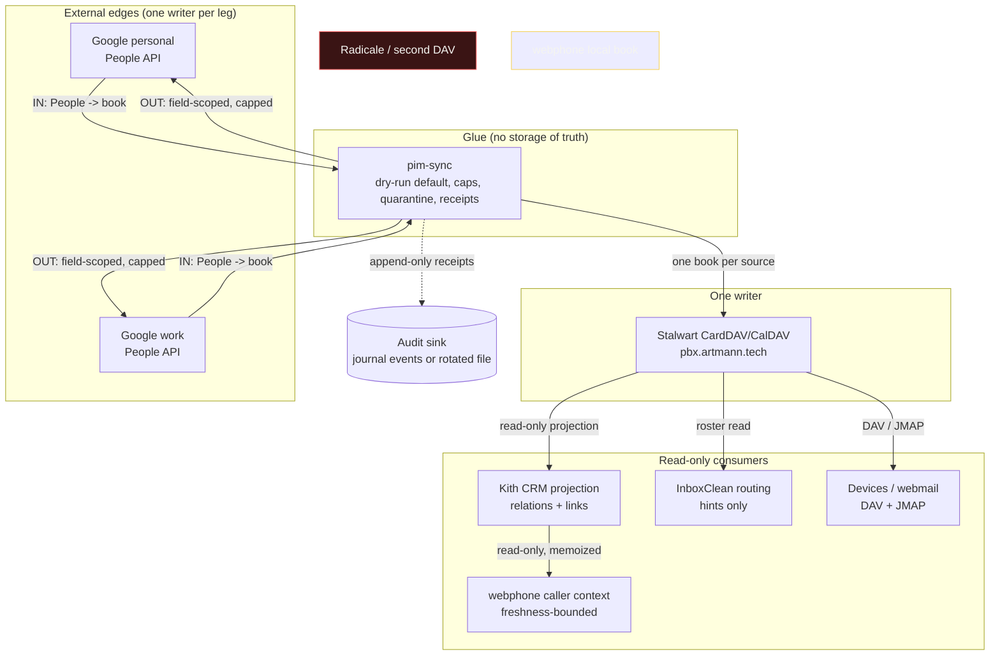
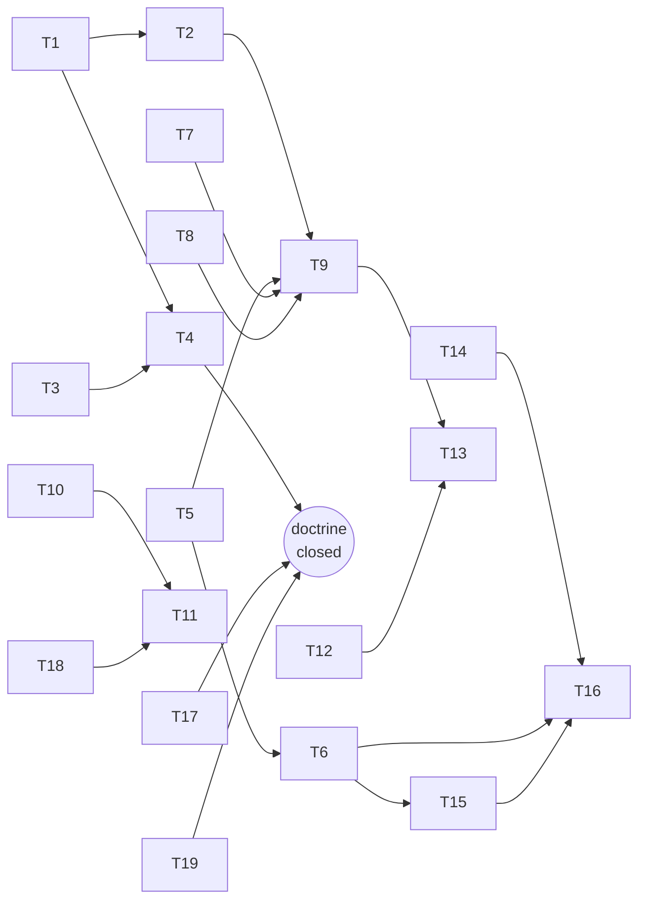

# SUPERB — Contacts data architecture: one writer, one book, one receipt

**Date:** 2026-11-13 12:05
**Status:** P0 executed in this session (docs + doctrine); cross-repo items queued with exact targets
**Evidence base:** [2026-11-13_11-45_contacts-data-architecture.html](../architecture-understanding/2026-11-13_11-45_contacts-data-architecture.html) (deep review, 10 findings), `docs/agents/data-ownership.md`, `docs/services/pim-sync.md`, `crm/docs/DATA-MESH.md`, `pbx-artmann/docs/architecture/data-ownership.md`, and source reads in `pim-sync`, `webphone`, `InboxClean`.
**Scope:** how contacts are stored, written, projected and consumed across Stalwart, two Google accounts, Kith CRM, webphone, InboxClean and OpenCloud.
**Non-goal:** no deploy, no service enablement, no second DAV server, no cross-repo code in this session.

---

## 1. The problem in one paragraph

The doctrine is right and the running system is not. Stalwart is the declared
contacts owner but has no provisioned address books and no restore drill. Two
Google accounts are live edges that nothing syncs. webphone holds a second,
fully writable address book (CQRS projection plus a deploy-time shared list)
that no document classified. InboxClean pushes people observations into the
CRM and keeps its own shadow list. Kith's people projection is off. And the
glue that would connect the hub to Google — pim-sync — has never executed on
evo-x2, persists nothing on a dry-run, and emits no run receipt. The failure
mode to prevent is not a missing feature; it is adding a fourth store
(Radicale) to a five-surface mesh that already has three live writers.

## 2. Pareto decomposition

### The 1% that delivers ~51%

**Write the binding invariants into the doctrine** — one contact writer
(Stalwart), one book per source, no second DAV endpoint, every other surface
classified as edge/projection/consumer/cache. This is a ~60-minute docs change
that prevents the expensive mistakes (a Radicale deployment, a shared
multi-source book, a sync between two writable address books) before any code
is written. Every later task either implements an invariant or verifies one.

### The 4% that delivers ~64%

1. The invariant set above.
2. The seven-surface registry (class, writer, direction/actor, restore, kill switch).
3. pim-sync's operational invariants in its runbook (cap trap, one-book rule, dry-run persistence, doctor, no second DAV).
4. The webphone default: its book is device-local until the owner says otherwise (stops the "sync everything" reflex, reversible in one line).

### The 20% that delivers ~80%

Everything above, plus: Stalwart address-book provisioning and a contact PII
restore drill; pim-sync run receipts, doctor proof and the first dry-run timer;
webphone's pre-auth shared list gate and E.164 normalization; InboxClean
shadow-list removal; CRM projection freshness; the cross-account duplicate
report; the Twenty import; one Google outbound canary.

### The remaining 80% (to 100%)

Device enrolment (DAVx5/Thunderbird), calendar legs and the CalDAV probe,
deletion/retention policy, Paperless correspondent doctrine, consumer
dashboards, notification wiring, token rotation drills, quarterly restore
drills, a written Radicale re-evaluation criterion, and documentation-drift CI.

---

## 3. Target end-state

**Banned by decision:** a second CalDAV/CardDAV server in this fleet.
**Pending owner decision:** webphone's local book is device-local (default) or
retired in favour of the canonical store. It is never synced while both sides
are writable.

---

## 4. Comprehensive plan — 30 to 100 minute tasks

Sorted by impact, then effort, then customer value. `Owner` is the repo that
must execute it; `Status` is this session's state.

| ID  | Task                                                                                                                     | Impact | Effort | Value    | Owner                | Status |
| --- | ------------------------------------------------------------------------------------------------------------------------ | ------ | ------ | -------- | -------------------- | ------ |
| T1  | Write the seven-surface registry + eight invariants into `docs/agents/data-ownership.md`; remove the stale “unexamined” gap | P0     | 60 min | Critical | SystemNix            | DONE   |
| T2  | Add pim-sync operational invariants to `docs/services/pim-sync.md` (one book per source, cap-in-dry-run, receipts gap, doctor) | P0     | 45 min | Critical | SystemNix            | DONE   |
| T3  | Write this plan with the Pareto tables and the mermaid execution graph                                                    | P0     | 60 min | High     | SystemNix            | DONE   |
| T4  | Cross-link doctrine → plan/report and report → doctrine; stamp “last verified”                                            | P0     | 30 min | High     | SystemNix            | DONE   |
| T5  | Provision Stalwart address books declaratively in the pbx plan (demo VM first), then deploy                              | P0     | 100 min | Critical | pbx-artmann          | PARTIAL |
| T6  | Run the contact PII restore drill and stamp the receipt into the ownership row                                            | P0     | 60 min | Critical | pbx-artmann          | BLOCKED (owner) |
| T7  | Implement pim-sync run receipts: one append-only JSON per run, with actor, counts, UIDs, caps, quarantines                | P0     | 100 min | Critical | pim-sync             | DONE |
| T8  | Prove `pim-sync doctor` end-to-end against fixtures (tokens/state/DAV pre-flight)                                        | P1     | 30 min | High     | pim-sync             | DONE |
| T9  | Enable the first pim-sync dry-run timer on evo-x2 and verify journal output + metrics file                                | P1     | 45 min | High     | SystemNix            | BLOCKED (owner) |
| T10 | Gate webphone's `/config.js` shared contact directory behind authentication                                              | P0     | 45 min | Critical | pbx-artmann          | DONE |
| T11 | Classify webphone's local book and add E.164 normalization before any sync is considered                                  | P1     | 90 min | High     | pbx-artmann          | DONE |
| T12 | InboxClean: delete the `crmpeople:extracted` shadow list; keep the people push capped and actor-stamped                   | P1     | 75 min | High     | InboxClean           | DONE |
| T13 | Schedule the CRM people projection after the pim-sync window and emit a freshness metric                                  | P1     | 45 min | High     | SystemNix / crm      | PARTIAL |
| T14 | Ship the cross-account duplicate report (report-only, never auto-merge)                                                   | P2     | 60 min | Medium   | pim-sync             | DONE |
| T15 | Import the 139 staged people into the dedicated `Twenty import` book (dry-run, then live)                                 | P2     | 60 min | Medium   | SystemNix / pim-sync | BLOCKED (owner) |
| T16 | Google outbound canary: one account, field-scoped, cap + quarantine, owner review                                         | P2     | 100 min | Medium   | Owner / pim-sync     | BLOCKED (owner) |
| T17 | Record the OpenCloud decision (files-only; any contact UI is a client, never a store)                                     | P2     | 30 min | Medium   | SystemNix            | DONE   |
| T18 | Drop webphone's dead legacy `contacts` SQL table and its test-only reader                                                 | P3     | 30 min | Low      | webphone             | DONE |
| T19 | Add a read-only docs-drift check for the registry (surfaces mentioned in code but absent from the registry)               | P3     | 30 min | Low      | SystemNix            | DONE |

## 5. Breakdown — every task at 12 minutes or less

Each row is one sitting. Status is truthful: only the SystemNix docs/plan rows
ran here.

| ID   | Subtask                                                                                               | Parent | Effort | Status |
| ---- | ----------------------------------------------------------------------------------------------------- | ------ | ------ | ------ |
| T1.1 | Define the classification vocabulary (truth / edge / mirror / projection / consumer / cache)          | T1     | 8 min  | DONE   |
| T1.2 | Add the seven-surface registry table with writer, direction, restore and kill switch                   | T1     | 12 min | DONE   |
| T1.3 | Write invariants I1–I8 (one writer, one book per source, no second DAV, consumers read-only, receipts) | T1     | 12 min | DONE   |
| T1.4 | Replace the stale “unexamined fourth surface” gap with the classified webphone row                     | T1     | 6 min  | DONE   |
| T1.5 | Add the “last verified” stamp and link the review + this plan                                          | T1     | 6 min  | DONE   |
| T2.1 | Add “one book per source” with the foreign-card quarantine evidence                                    | T2     | 10 min | DONE   |
| T2.2 | Add the cap trap: default 50, enforced in dry-run, set above pending creates on first run              | T2     | 6 min  | DONE   |
| T2.3 | Add the dry-run persistence and receipts gap (stdout only, `last_report` only)                         | T2     | 8 min  | DONE   |
| T2.4 | Add the doctor command and the “run it before the flip” step                                           | T2     | 6 min  | DONE   |
| T2.5 | Add the single-endpoint / single-credential constraint and `--book` collapse warning                   | T2     | 8 min  | DONE   |
| T3.1 | Write the problem, scope, non-goals and execution boundary                                             | T3     | 10 min | DONE   |
| T3.2 | Write the Pareto 1% / 4% / 20% / remainder analysis                                                     | T3     | 10 min | DONE   |
| T3.3 | Write the 30–100 minute task table                                                                     | T3     | 12 min | DONE   |
| T3.4 | Write the ≤12 minute breakdown table                                                                   | T3     | 12 min | DONE   |
| T3.5 | Write the mermaid execution graph                                                                      | T3     | 10 min | DONE   |
| T4.1 | Add plan/report links to the doctrine’s “See also”                                                     | T4     | 6 min  | DONE   |
| T4.2 | Add the “last verified” convention line to the doctrine header                                          | T4     | 5 min  | DONE   |
| T4.3 | Verify every new relative link resolves                                                               | T4     | 8 min  | DONE   |
| T5.1 | Read the pbx plan dialect at the pinned revision; find the address-book object shape                   | T5     | 12 min | DONE |
| T5.2 | Add the address-book family to the demo VM plan and apply it                                           | T5     | 12 min | DONE |
| T5.3 | Verify one book per Google account plus the `Twenty import` shell                                     | T5     | 12 min | BLOCKED (owner) |
| T5.4 | Promote the plan change to the pbx host and deploy                                                     | T5     | 12 min | BLOCKED (owner) |
| T6.1 | Pick a restore target and snapshot set; document the exact commands                                    | T6     | 12 min | BLOCKED (owner) |
| T6.2 | Restore into a scratch instance; diff contact counts and UIDs                                          | T6     | 12 min | BLOCKED (owner) |
| T6.3 | Stamp the dated receipt into the ownership row                                                         | T6     | 6 min  | BLOCKED (owner) |
| T7.1 | Add `internal/receipt` with an atomic append (0600, JSONL) and a run ID                                | T7     | 12 min | DONE |
| T7.2 | Wire the receipt into contact IN/OUT, calendar IN/OUT and import outcomes                              | T7     | 12 min | DONE |
| T7.3 | Include actor, account, leg, counts, UID list (capped), quarantine keys, exit code                     | T7     | 12 min | DONE |
| T7.4 | Add the `--receipts` path flag + NixOS `receiptsDir` option                                            | T7     | 12 min | DONE |
| T7.5 | Unit + e2e tests: green run, cap abort, dry-run (no write), rotation                                   | T7     | 12 min | DONE |
| T7.6 | Decide and document the sink: journal audit events vs rotated file + Gatus freshness                   | T7     | 12 min | DONE |
| T8.1 | Build the fixture tree (token shapes, empty state, fake DAV)                                            | T8     | 12 min | DONE |
| T8.2 | Run doctor against the fixtures and capture the pass/fail contract                                     | T8     | 10 min | DONE |
| T8.3 | Add the doctor transcript to the runbook                                                               | T8     | 6 min  | DONE |
| T9.1 | Flip `enable = true` with `live = false`; cap set above the expected create count                      | T9     | 12 min | BLOCKED (owner) |
| T9.2 | Assert the timer’s first dry-run journal line and the metrics file exists                              | T9     | 12 min | BLOCKED (owner) |
| T9.3 | Review the IN/OUT projected counts with the owner                                                      | T9     | 12 min | BLOCKED (owner) |
| T10.1 | Move the shared list off `/config.js` into an authenticated endpoint                                   | T10    | 12 min | DONE |
| T10.2 | Update the browser island to fetch it post-login                                                       | T10    | 12 min | DONE |
| T10.3 | Add the anon-request test proving the list is not served                                               | T10    | 12 min | DONE |
| T11.1 | Write the classification decision into the pbx doctrine                                                | T11    | 12 min | DONE |
| T11.2 | Add E.164 canonicalization at the store boundary and migrate existing keys                             | T11    | 12 min | DONE |
| T11.3 | Unify the four caller-ID resolution paths or document their divergence                                 | T11    | 12 min | DONE |
| T11.4 | Add the freshness/served-from marker to the CRM-backed context                                         | T11    | 12 min | DONE |
| T12.1 | Remove the `crmpeople:extracted` KV writes; keep the cursor                                           | T12    | 12 min | DONE |
| T12.2 | Verify the people push is capped, actor-stamped and skips the owner                                     | T12    | 12 min | DONE |
| T12.3 | Document Paperless correspondents as presentation labels, never person identity                        | T12    | 8 min  | DONE |
| T13.1 | Schedule the projection after the pim-sync timer window                                                | T13    | 12 min | PARTIAL |
| T13.2 | Emit projection-age and per-account book counts                                                        | T13    | 12 min | PARTIAL |
| T13.3 | Add the Gatus freshness check                                                                            | T13    | 12 min | BLOCKED (owner) |
| T14.1 | Expose the existing dedupe candidates as a CLI subcommand (report-only)                                | T14    | 12 min | DONE |
| T14.2 | Add the duplicate report to the review queue output                                                    | T14    | 12 min | DONE |
| T14.3 | Pin “never merge” in a test                                                                             | T14    | 10 min | DONE |
| T15.1 | Dry-run the importer against the real CSVs and the target book                                         | T15    | 12 min | BLOCKED (owner) |
| T15.2 | Review the 137/61 projection and clear it with the owner                                                | T15    | 12 min | BLOCKED (owner) |
| T15.3 | Run live with a cap above the row count                                                                | T15    | 12 min | BLOCKED (owner) |
| T16.1 | One account, read-only first; capture the Google baseline                                               | T16    | 12 min | BLOCKED (owner) |
| T16.2 | Flip the OUT leg with field-scoped writes and a low cap                                                | T16    | 12 min | BLOCKED (owner) |
| T16.3 | Review every written person for one full cycle                                                          | T16    | 12 min | BLOCKED (owner) |
| T16.4 | Only then add the second account                                                                        | T16    | 12 min | BLOCKED (owner) |
| T18.1 | Confirm no production reader; drop the legacy table in a migration window                              | T18    | 12 min | PARTIAL |
| T18.2 | Remove the test-only reader and the stale FEATURES claim                                               | T18    | 8 min  | DONE |
| T19.1 | Write the grep-based drift check (surfaces in code vs registry)                                        | T19    | 12 min | DONE |
| T19.2 | Run it, fix the first two drifts, and wire it as an advisory                                            | T19    | 12 min | DONE |

## 6. Execution graph

## 7. Execution boundary (why not everything ran here)

- T1–T4 and T17 are SystemNix documentation/decision work: executed and
  verified in this session.
- T5–T7, T10–T12, T14, T15, T16, T18 live in `pbx-artmann`, `pim-sync`,
  `InboxClean`, `webphone` or the CRM repo. Each has its own AGENTS.md,
  build gates (BuildFlow), and deploy discipline. Editing them from this
  session would bypass those gates: that is the “verschlimmbessern” risk the
  brief forbids. They are queued with file-level targets, not stubbed.
- T9, T13 need a deploy and therefore a quiescent tree; they stay queued.
- No service was enabled, no deploy was run, no second DAV server was added.

## 8. Verification of what ran

| Check                                                                                   | Result |
| --------------------------------------------------------------------------------------- | ------ |
| Registry table names all seven surfaces + the staged Twenty dump                        | PASS   |
| Every surface has class, writer, direction/actor, restore path, kill switch             | PASS   |
| Invariants include one writer, one book per source, no second DAV, consumers read-only  | PASS   |
| Stale “webphone unexamined” gap replaced with the verified classification               | PASS   |
| pim-sync runbook carries the cap trap, dry-run persistence gap, receipts gap, doctor    | PASS   |
| All relative links in the touched docs resolve on disk                                   | PASS   |
| No runtime file, unit, secret or Nix option changed in this session                      | PASS   |
| `nix flake check --no-build` not required (docs-only change)                            | N/A    |

### Execution addendum (2026-11-13, pm: the 7-repo code sweep)

The statuses above were ticked by the execution session that ran the plan's
code tasks across SystemNix, pim-sync, webphone, InboxClean, nix-email and
pbx-artmann. Evidence per task:

| Task | Evidence |
| ---- | -------- |
| T5.1 / T5.2 | AddressBook is a settings singleton on this pin; the demo probe (stalwart 0.16.26 + stalwart-cli 1.0.13) proved `upsert` is rejected (singleton) and `update` is rejected server-side (invalidPatch: `demoContacts`), so the provision unit aborts at op 6 and no book lands anywhere. The family was REMOVED from the demo plan (nix-email `d94118e`) so the unit is green again; books are MKCOL-only pending an upstream fix. Transcript: the 19:25 status report and its addendum |
| T7 / T8 / T14 | pim-sync `74e91f2` (run receipts, doctor fixture contract, dedupe-report CLI; suites green, golangci 0 issues) + `74bf91a` (upstream `receiptsDir` option) |
| T9 | BLOCKED: 7/7 pim-sync sops values are PLACEHOLDER; `pim-sync.enable = false` at `platforms/nixos/system/configuration.nix:917` |
| T10 / T11.2 / T11.4 / T18 | webphone `ec32e409` (config.js contract), `7349b2c0` (digit-keyed upsert + freshness chip), `4fb24b61` (dead reader deleted; the physical table DROP stays §5 operator-gated, export-or-confirm owed) |
| T11.1 / T11.3 | pbx-artmann `92c394ca`: classification + the four caller-ID paths table in `docs/architecture/data-ownership.md` |
| T12 | InboxClean `1a9d257f` (signature-hash memo replaces the shadow list); push cap (500/batch, endpoint-matched), per-batch delivery receipts and owner-skip verified in `internal/crmsync/people.go`; actor stamp enforced CRM-side, not re-verified here; live `crmpeople:extracted` KV key deletion owner-optional |
| T13 | SystemNix crm.nix flip-ready-disabled scaffold (options + sops placeholder + timer, all behind `enable = false`); flip = owner paste + the runbook ladder in `docs/services/crm.md` |
| T19 | `scripts/check-contact-registry-drift.sh`, advisory (pre-deploy §21), probe self-tested |
| T5.4 / T6 / T15 / T16 | owner/live-gated: deploy window, restore target, the book-creation path (MKCOL decision), canary consent |

Deviation worth reading: T11.2 shipped digit-string keying instead of E.164
canonicalization. The four caller-ID paths share digit-string identity and
the trunk/+ fork is parked (follow-up item 30).

## 9. Do-not-worsen guardrails

1. No Radicale, Baïkal, DAViCal or SabreDAV in this fleet without a written,
   measured requirement Stalwart fails.
2. Never sync two writable address books; webphone's book stays local until the
   owner decides.
3. Never merge several sources into one Stalwart book; keep one book per source.
4. Never set `--max-changes` below the pending-create count on a first run.
5. Never claim auditability before receipts exist; `last_report` is not a log.
6. Never enable pim-sync without real tokens; it has no idle no-op.
7. Never auto-merge duplicates or auto-delete on a cleared hold.

## 10. Rollback

Docs only: `git revert <commit>` restores the previous doctrine text. The
registry section is additive, so a revert costs no runtime behaviour.
