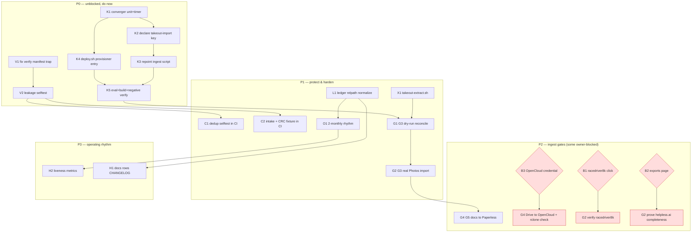

# Takeout fleet completion + Immich key converger — comprehensive plan

**Created:** 2026-11-13 19:27 CET
**EXECUTING (instance takeout-key-converger finish (K3/K5/H1 + 4% tier), 2026-11-14 00:56 CET, HEAD `adee6f18c`):** executing (see AGENTS.md plan-execution tombstone)
**HEAD at authoring:** `c9b5e96b9` (1 commit ahead of origin, 0 behind)
**Supersedes nothing** — this is the execution plan ON TOP of
`docs/planning/2026-11-13_multi-account-takeout-fleet-plan.md` (fleet shape,
modes, source matrix, gates G0–G7). This file owns **the remaining work and
its ordering**.

---

## 1. Context — what is actually true today

- **Data safety:** nothing ingested, nothing deleted. Raw zips are the only
  complete copy. Deletion is NOT on the table (owner directive 2026-11-13).
- **helpless.ai:** 7 parts / 22 GB, `unzip -t` clean, part list UNPROVEN (no
  exports-page save). Drive extracted: 1,300 files / 1,528,919,192 B, indexed
  into the ledger, `balance` BALANCED, 80 content-dup sets / 91,235,063 B
  redundant INSIDE that Drive tree.
- **racedriver8k:** 0/23 parts. Only the owner's browser can download (Google
  re-auth wall proven). Account stays alive ⇒ an expired export is a
  re-request, never data loss.
- **Destinations listening:** Immich 2283, OpenCloud 9500 (+NATS 9233),
  Paperless 2892. Nothing has been sent to any of them.
- **The one unblocked technical item** is the Immich key. Its converger chain
  is now COMPLETE (`472b84e4a` helper+option, unit+timer, `takeout-import`
  declaration, and the 2026-11-14 repoint of `scripts/takeout-ingest-photos.sh`
  at `/var/lib/immich-api-keys/takeout-import.env`) — key material never
  touches the staging directory.
- **Hard constraints:** never worsen the tree (`nix flake check` must stay
  green), no secret in a data dir or on a command line, one transient extract
  at a time, capacity rule `free ≥ 1.2×extract + 500 GB`.

---

## 2. Pareto — what actually moves the needle

### 2.1 The 1% that delivers 51%

**Finish the Immich key converger and repoint the ingest script at it.**

One coherent change (≈20 min of decisions, ≈60 min with verification) solves
two problems at once: (a) the only unblocked gate (G3 Photos→Immich) becomes
runnable, and (b) the API key stops living in a pool data directory — it is
minted directly into Immich's `api_key` table and rendered 0400, never touched
by a human. No other single action unlocks as much.

### 2.2 The 4% that delivers 64%

1% **plus**:

- **Fix the `takeout-verify.sh` product-manifest trap.** Today G2 on the
  account that HAS data would seed racedriver8k's 68-product manifest and
  report confidently wrong coverage.
- **Wire the two existing selftest batteries** (`takeout-dedup` 16 legs,
  `takeout-intake` 7 legs) + a CRC corruption fixture into
  `flake/parts/checks/selftests.nix`. These tools will touch ~3 TB; an
  unnoticed regression is expensive and silent.

### 2.3 The 20% that delivers 80%

4% **plus**:

- `takeout-extract.sh` (member-scoped extraction, `unzip` rc 11 ≠ failure,
  capacity gate) — the current ad-hoc loop hides errors behind `|| true`.
- Ledger relpath normalization (`Takeout/` prefix) **before** a second cycle
  exists — afterwards it is a migration, not an edit.
- G3 dry-run then real Photos import for helpless.ai (5,282 media /
  17.9 GB) with count reconciliation.
- G4 Drive→OpenCloud copy (`rclone copy --files-from dedup/new-files.txt`),
  `rclone check` clean, 1,300 files.
- G6 `balance` reconciliation after each ingest.

### 2.4 The remaining 20% to reach 100%

G5 docs→Paperless, the 2-monthly incrementality rhythm (timer + runbook),
offsite/Borg coverage of the takeout archive, racedriver8k completion,
accounts 3–N onboarding, monitoring/liveness for the takeout pipeline, and the
doc/row hygiene that keeps the queue honest.

---

## 3. Level 1 — comprehensive plan (30–100 min tasks)

Sorted by impact first, then cost. Owner-blocked work is separated (§5) because
no amount of agent effort can start it.

| # | Task | Est | Impact | Effort | Depends on |
| --- | --- | --- | --- | --- | --- |
| K1 | Generate `immich-api-key-provision.service` + daily timer from `services.immich.apiKeys`; guard on non-empty keys; `harden` + `ioTier.background` | 45 | Critical — unblocks G3, kills the key-in-data-dir class | M | — |
| K2 | Declare `immich.apiKeys.takeout-import` (immich-go's documented scope, minus `asset.delete`; `lars:users`, env format, `/var/lib/immich-api-keys/takeout-import.env`) | 30 | Critical | S | K1 |
| K3 | Repoint `takeout-ingest-photos.sh` at the env file (`TAKEOUT_IMMICH_ENV` override, `IMMICH_API_KEY` env fallback, 0400 check, explicit failure pointing at the converger) | 45 | Critical | S | K2 |
| K4 | Add `immich-api-key-provision` to `scripts/deploy.sh` provisioner loop (satisfies `deploy-restart-audit`) | 20 | High — eval gate | S | K1 |
| K5 | Verify K1–K4: `nix eval` the unit + timer, build the wrapper (shellcheck leg), confirm the unit is ABSENT with zero keys, confirm the option renders the right permissions SQL | 60 | High — "works" vs "compiles" | M | K1–K4 |
| V1 | Fix `takeout-verify.sh` `write_products_tsv`: derive a PROVISIONAL inventory from the zips (or from a saved page), loud WARN, never inherit the racedriver8k manifest | 60 | High — G2 correctness | M | — |
| V2 | Extend `takeout-verify.sh --selftest` with a leg proving no manifest leakage across accounts | 30 | High — regression pin | S | V1 |
| C1 | Wire `takeout-dedup.sh --selftest` (16 legs) into `flake/parts/checks/selftests.nix` | 45 | High — protects the 3 TB processing tool | M | — |
| C2 | Wire `takeout-intake.sh --selftest` (7 legs) + a CRC corruption fixture for the rename loop | 45 | Medium-High | M | — |
| X1 | `scripts/takeout-extract.sh`: member-scoped extraction, distinguishes `unzip` rc 11 from real I/O failures, capacity gate | 90 | High — replaces the `|| true` loop | L | — |
| L1 | Normalize ledger relpaths (strip `Takeout/`) + document the schema + an idempotent re-index recovery path | 60 | High while cheap; later = migration | M | — |
| G1 | G3 dry-run: extract `Takeout/Google Photos`, `takeout-ingest-photos.sh --dry-run`, reconcile counts | 90 | Critical for value (photos land) | L | K5, X1 |
| G2 | G3 real run + count reconciliation + album spot-check | 60 | Critical | M | G1 |
| G3 | G4: OpenCloud app password + `rclone` + `rclone copy --files-from dedup/new-files.txt` then `rclone check` | 90 | High | L | owner credential |
| G4 | G5: rate `dedup/other.txt`, select docs, drive-paperless run, count reconciliation | 90 | Medium | L | G4 decisions |
| T1 | `index` progress output + `plan` byte totals + `balance --summary/--preflight` | 60 | Medium (3.9 TB runs become observable) | M | — |
| T2 | `takeout-intake.sh` hardening: account-email match, `--ingest` chaining, `--list` | 60 | Medium | M | V2 |
| T3 | Generic rename-loop wrapper (staging root + expected count from `parts.tsv`) into `scripts/` | 60 | Medium (removes a `~/.cache` script) | M | — |
| O1 | 2-monthly incrementality: timer + runbook + a "what changed" report from the ledger | 90 | Medium (long-term rhythm) | L | L1, T1 |
| H1 | Docs/rows/CHANGELOG pass for everything above (immich.md lifecycle, fleet plan deltas, TODO sync, CHANGELOG entry) | 60 | Medium — prevents drift | M | all |
| H2 | Takeout liveness monitoring (provisioner unit in system-health; staging-size textfile metric) | 60 | Low-Medium | M | K1 |

**Totals:** Level 1 ≈ 19 tasks, ≈ 20 h of nominal work; the agent-executable,
unblocked subset (K1–K5, V1–V2, C1–C2, X1, L1, T1–T3, H1) ≈ 10 h.

---

## 4. Level 2 — execution breakdown (≤12 min per task)

> Every Level-1 task is decomposed; nothing is dropped.

### K1 — converger unit + timer

| # | Micro-task | Est |
| --- | --- | --- |
| K1.1 | Add `immich-api-key-provision` service entry inside the `systemd.services` attrset with `mkIf (cfg.apiKeys != {})` | 8 |
| K1.2 | Wire `ExecStart = lib.getExe (mkImmichApiKeyProvision { inherit pkgs config; keys = cfg.apiKeys; })` | 5 |
| K1.3 | Set `Type=oneshot`, `RemainAfterExit`, `TimeoutStartSec=2min`, `after/wants postgresql`, `wantedBy multi-user` | 6 |
| K1.4 | Set hardening: `MemoryMax=128M`, `ProtectSystem=strict`, `NoNewPrivileges=false` (runuser), `PrivateTmp`, `ReadWritePaths` = key dirs (+`ioTier.background`) | 10 |
| K1.5 | Add daily timer (`OnCalendar=daily`, `Persistent`, jittered) guarded on non-empty keys | 6 |
| K1.6 | Parse check (`nix-instantiate --parse`) | 3 |

### K2 — key declaration

| # | Micro-task | Est |
| --- | --- | --- |
| K2.1 | Decide final permission list from immich-go docs; record the rationale (no `asset.delete`) | 6 |
| K2.2 | Add the declaration in `platforms/nixos/system/configuration.nix` next to `immich.enable`, URL from `config.services.immich.port` | 8 |
| K2.3 | Confirm `owner = "lars"`, `group = "users"`, `keyFile` default vs explicit | 4 |

### K3 — ingest script repoint

| # | Micro-task | Est |
| --- | --- | --- |
| K3.1 | Read the env file (`TAKEOUT_IMMICH_ENV`, default `/var/lib/immich-api-keys/takeout-import.env`) | 6 |
| K3.2 | Accept `IMMICH_API_KEY` from environment as an override | 5 |
| K3.3 | Keep 0400 assertion; rewrite the error text to point at the converger + rotation command | 5 |
| K3.4 | Drop the `<staging>/immich-api-key` requirement and the "delete the key after migration" comment | 4 |
| K3.5 | Source `IMMICH_URL` from the env file, manifest only as fallback | 8 |
| K3.6 | Shellcheck (`nix shell nixpkgs#shellcheck -- shellcheck -x`) | 5 |

**DONE 2026-11-14 00:55** — all six legs landed in `scripts/takeout-ingest-photos.sh`
(converger env file + `TAKEOUT_IMMICH_ENV`, env-key override, 0400 assertion,
converger/rotation error text, `IMMICH_URL` with manifest fallback). Functional
proof, 5 fixture legs: missing key → converger+rotation die text; 0644 file →
rejected; 0400 file → `-server http://127.0.0.1:2283 -api-key TOK`; env key
without a file → manifest fallback URL; env key winning over a present file.
`shellcheck -x` clean, `bash -n` clean.

### K4 — deploy wiring

| # | Micro-task | Est |
| --- | --- | --- |
| K4.1 | Add `immich-api-key-provision` to the provisioner loop list | 4 |
| K4.2 | Add the justifying comment block entry | 4 |

### K5 — verification

| # | Micro-task | Est |
| --- | --- | --- |
| K5.1 | `nix eval` the rendered `ExecStart` and the timer's `OnCalendar` | 8 |
| K5.2 | Build the wrapper (`nix build` the store path) → shellcheck passes | 10 |
| K5.3 | Negative leg: with `apiKeys = {}` the unit must not exist (eval probe) | 8 |
| K5.4 | Inspect the rendered permissions SQL string for the declared key | 5 |
| K5.5 | `nix flake check --no-build` (or scoped eval) green | 12 |

**DONE 2026-11-14 01:0x** — K5.1–K5.5 green: `ExecStart` =
`…-immich-api-key-provision/bin/immich-api-key-provision`, timer `OnCalendar=daily`;
negative leg needed `lib.mkForce {}` (a bare `{}` merges as identity into the attrsOf,
so the first probe was a false positive) and then proved `zeroSvc=false, zeroTmr=false`;
rendered SQL = the 16 declared permissions, no `asset.delete`; full
`nix flake check --no-build` → `all checks passed!` after repairing a foreign
one-line break (`tests/default.nix` passed `pkgs` to a `test-paperless.nix` lambda that a
parallel session had just shrank to `{ inputs }` — the paperless VM check was the sole
red leg, unrelated to this work and self-evident from the error).

### V1 — verify trap

| # | Micro-task | Est |
| --- | --- | --- |
| V1.1 | Read `write_products_tsv` + all callers of `PRODUCTS_MANIFEST` | 6 |
| V1.2 | Remove manifest seeding; derive provisional inventory from zip listings | 10 |
| V1.3 | Emit a loud WARN that completeness is UNPROVEN without the exports page | 4 |
| V1.4 | Keep the manifest as an optional `--manifest racedriver8k` explicit opt-in only | 8 |
| V1.5 | Run `--selftest` (4 existing legs) | 8 |

### V2 — leakage selftest

| # | Micro-task | Est |
| --- | --- | --- |
| V2.1 | Add fixture with a foreign staging root | 6 |
| V2.2 | Assert generated `products.tsv` contains zero racedriver8k rows | 6 |

### C1 / C2 — CI wiring

| # | Micro-task | Est |
| --- | --- | --- |
| C1.1 | Open `flake/parts/checks/selftests.nix`, copy an existing leg shape | 6 |
| C1.2 | Add dedup selftest derivation + `CASES` entry | 10 |
| C1.3 | Add intake selftest derivation + `CASES` entry | 10 |
| C1.4 | Add CRC corruption fixture leg for `takeout-browser-rename.sh` | 10 |
| C1.5 | Run the two selftests locally to confirm exit 0 | 10 |

### X1 — extraction tool

| # | Micro-task | Est |
| --- | --- | --- |
| X1.1 | Draft script skeleton (`--members`, `--dry-run`, capacity gate) | 10 |
| X1.2 | Capacity gate (`free ≥ 1.2×extract + 500 GB`) via `df` | 6 |
| X1.3 | Member-scoped `unzip -o` loop with rc-11 handling and per-member failure capture | 12 |
| X1.4 | Post-extract count/byte reconciliation vs member listing | 8 |
| X1.5 | Shellcheck + a dry-run against the helpless.ai staging | 10 |

### L1 — ledger normalization

| # | Micro-task | Est |
| --- | --- | --- |
| L1.1 | Write a dry-run rewrite (`sed` on rollpath column only) + backup copy | 10 |
| L1.2 | Prove `plan` output is unchanged before/after on the current ledger | 10 |
| L1.3 | Document the schema + recovery (re-index from scratch) in the script header | 8 |

### G1–G4 — ingest gates

| # | Micro-task | Est |
| --- | --- | --- |
| G1.1 | Member-scoped extract of `Takeout/Google Photos` via X1 | 10 |
| G1.2 | `takeout-ingest-photos.sh --dry-run` | 8 |
| G1.3 | Reconcile dry-run counts vs `photos-media-count.txt` | 10 |
| G2.1 | Real G3 run, watch `logs/immich-go.log` | 12 |
| G2.2 | Reconcile uploaded+duplicate vs expected | 8 |
| G2.3 | Spot-check 3 albums in the Immich UI | 6 |
| G3.1 | Obtain OpenCloud app password via sops (owner) | — |
| G3.2 | Install `rclone`, configure remote | 10 |
| G3.3 | `rclone copy --files-from dedup/new-files.txt --dry-run` | 8 |
| G3.4 | Real copy + `rclone check` + count 1,300 | 12 |
| G4.1 | Rate `dedup/other.txt` docs | 12 |
| G4.2 | drive-paperless run + count reconciliation | 12 |

### T1–T3, O1, H1–H2

| # | Micro-task | Est |
| --- | --- | --- |
| T1.1 | `index` per-N-files progress line | 8 |
| T1.2 | `plan` byte totals per class | 6 |
| T1.3 | `balance --summary` / `--preflight` | 10 |
| T2.1 | Account-email match against the saved page | 10 |
| T2.2 | `--ingest` chaining + `--list` | 10 |
| T3.1 | Wrapper accepting staging root + expected count | 10 |
| T3.2 | Replace the `~/.cache/takeout-probe/rename-loop.sh` invocation | 8 |
| O1.1 | Timer + runbook for the 2-monthly cycle | 12 |
| H1.1 | immich.md key-lifecycle section | 8 |
| H1.2 | Fleet plan + TODO rows + CHANGELOG sync | 12 |
| H2.1 | system-health entry + staging-size metric | 12 |

---

## 5. Owner-blocked work (cannot be started by an agent)

| # | Blocker | Owner action | Consequence if delayed |
| --- | --- | --- | --- |
| B1 | racedriver8k 23 parts | switch browser account → set download dir → open `<staging>/download-all.html` → click all 23 | the only hard gate on account 1; no data loss, just delay |
| B2 | helpless.ai part list | save the exports page while logged in | G2 stays UNPROVEN (CRC-clean is not completeness) |
| B3 | OpenCloud app password | create + hand over (sops or 0600 file) | G4 cannot start |
| B4 | Paperless doc selection | confirm which `other.txt` files are documents | G5 cannot start |
| B5 | Accounts 3–N | name them + mode (retire/keep) + cadence | fleet plan stays at 2 accounts |
| B6 | Mail end-state | decide: mbox on pool vs IMAP sync vs archive tool | Mail (7.4 GB) stays a cold blob |
| B7 | Retention / offsite | confirm the archive lives on pool only until Borg is re-armed | single-site copy of everything extracted |

---

## 6. Execution graph

---

## 7. Execution log (this session)

| Task | Status | Evidence |
| --- | --- | --- |
| K1 | see §7.1 | unit + timer rendered |
| K2 | see §7.1 | declaration present |
| K3 | see §7.1 | script reads env file |
| K4 | see §7.1 | deploy.sh carries the name |
| K5 | see §7.1 | eval + build + negative legs |

_(Updated after execution — see commit message for the final state.)_

---

## 8. Guardrails (do not verschlimmbessern)

1. `nix flake check` / eval must stay green after every step; no "fix later".
2. No secret value in a data dir, a shell history, or a command line.
3. No deletion of any source material; `balance` is the only authority.
4. One transient extract at a time; capacity gate before bulk work.
5. Owner-blocked work stays visibly blocked — never simulated as done.
6. Every claim of "works" carries a probe (eval, build, selftest, count).
