# SUPERB: Freeze-54 Stability-Crisis Pareto Plan — stop the crashing, land the fix waves, then make crashes impossible to repeat

**2026-11-14 16:33 CET · authoring session: freeze-54 autopsy + memory hardening (same day) · plan horizon: ~2 weeks of calm windows**

## Context (why this plan, why now)

- **54 documented freezes; 3 today (Nov 14)** — #52 thermal-led morning storm, #53 never-cooled recovery (5m55s), #54 memory-cliff via a single 78 GB session hog + the swap-escape of every RAM bound + oomd executing the desktop. Family = 100% Branch C (thermal ceiling + IO storm ± memory cliff) since #33. The box has NOT gone 5 days without a cut since Sep 29 (cadence study).
- **Two eval-green fix waves are in-tree and storm-gated**: the crash-loop wave (monitor365 SIGSYS, audiblesync, immich-key, bank-sync repin, llama-chat backoff) and the freeze-54 wave (MemorySwapMax=48G, .prom publish gate, process census). They protect NOTHING until a calm-window deploy lands.
- **The root physical fix is owner-gated and 7+ freezes old**: the cooling inspection ([blocked:user], row 143) — every software mitigation since #8 has failed to close a standing physical deficit (thermal-pstate-guard live since 10-04; the family crashed straight through it 20+ times). **UPDATE 2026-11-14 evening: physical remediation WAIVED by owner ("can't change") — see Owner verdicts below; this bullet is the pre-verdict state.**
- **Live at authoring**: IO PSI some avg10 **98.98%** with NO measurable process writer (top pid 0.8 MB/s — the device-wedge class; a containment session owns live triage, this plan only records it). 30 commits unpushed.

## Scope

IN: the stability crisis workstream — freeze-54 follow-ups, the deploy waves, storm-fuel admission, thermal root fix, observability of the new bounds, recovery-boot amplifiers, and the stability-library hygiene that keeps the backlog honest.
OUT (named, not planned): ~250-row long-tail forensics/hygiene backlog in `docs/todo/stability.md` + the other 9 domain libraries (`docs/todo/{storage,monitoring,ai-stack,services,upstream,security,pipeline,desktop,pixel6}.md`) — they ride the standing docs-health HARVEST loop, task T25.

## Errata (Step-0 openness verification, 2026-11-14 16:28)

- Library carries **verbatim duplicate rows** found during ranking: 327–329 ≡ 106–108, 440/441 ≡ 288/299, 445/446/448 ≡ 301/440 — the dedup pass is task T14, corrections recorded there.
- `TODO_LIST.md` shows 3,352 checkbox lines — the queue file is overdue a prune ([x] rows → CHANGELOG per the 2026-10-25 protocol; dry-run-first, expect WARN rise).
- Freeze-54 items (rows 190–196) verified open and current — authored this session.

## Owner verdicts (post-authoring, 2026-11-14 evening)

- **T01 m1–m3 physical remediation WAIVED — owner cannot change fans/dust, heatsink/paste, or airflow** (verbatim: "can't change", given on this plan's m1–m3). The standing deficit (17 counted baits, freezes #13–#36) is a **permanent constraint, not a fixable defect**. T01 shrinks to m4 (BIOS fan-curve walk — firmware, not physical) + m5 (1h Tctl baseline).
- Consequences applied to this plan:
  - The 1%-tier thermal lever is gone; **T02 (deploy both waves) + T03 (storm containment) are now the top of the stack**. T01-residue drops to the 20% tier — the curve walk may shave degrees off the ceiling; it cannot close a dead-fan-class deficit.
  - **T18 m2 is effectively forced**: accept 95–98 °C ceiling-riding + contain in software, unless the m4 fan-curve walk measurably lowers the ceiling. The separate a/b admission-gate decision (stability row 137 — gate compiles at ≥95 °C vs accept) remains the owner's throughput call, and now also inherits row 143's "no heavy builds until inspection" gate, whose premise ("until answered") is now answered.
  - **T21's `T01 verdict` dependency is satisfied** — design premise: the ceiling is permanent; the guard's job is containment + shed-load escalation, never cure. Proceed without waiting for m4.
- Surfaces updated with this verdict: `docs/todo/stability.md` row 143 (verdict appended, [blocked:user] residue = the fan-curve walk), `docs/agents/stability.md` (thermal-leg routing rule), `docs/services/thermal-pstate-guard.md` (both "only the inspection fixes it" claims).

---

## Pareto breakdown

### The 1% that delivers 51%

| # | The one thing | Why it is THE thing |
|---|---|---|
| 1 | **Owner physical cooling inspection** (T01, row 143) | **WAIVED 2026-11-14: owner cannot change fans/dust, heatsink/paste, airflow ("can't change") — physical remediation is permanently off the table.** Residue = BIOS fan-curve walk + Tctl baseline (20%-tier at best). The 1%-tier levers are now #2 + #3 below. Pre-verdict reasoning, kept for the record: the thermal leg rode nearly every Branch-C death since #8; k10temp sat at 98 °C for a WEEK straight on boot `309f2cb8`; no software layer can close a physical deficit — 20+ crashes proved it. |
| 2 | **The calm-window deploy of both waves** (T02) | All fixes are in-tree, eval-green, doing nothing. Switching them on is the difference between "fixed" and "documented". |
| 3 | **Storm-fuel discipline: nothing heavy while hot** (T03, T07) | Every cut of the Nov cluster had agent/build batteries as fuel. The gates police fleets, not interactively-launched builds — the discipline gap is where the fuel enters. |

### The 4% that delivers 64%

| # | Item | Effect |
|---|---|---|
| 4 | Owner answers the 3 freeze-54 questions + verdicts (T04, T18) | Unblocks 8+ design/[decision] rows; sets architecture direction (role-split? one-box-with-gates?). |
| 5 | Swap-bound observability (T05) | The 48G cap is a fence in the dark until `system_cgroup_swap_bytes` + the 3 gatus checks exist. |
| 6 | Cold model-load serialization + PSI entry gates (T06) | The recovery-boot amplifier class (#40/#48/#53 all died on it) — one heavy-job slot + ExecStartPre gates. |
| 7 | Deploy-gate thermal leg + auto-retry-on-calm (T08) | Removes the "forced deploy into the storm" failure mode (#40, #49, #51) and the human race-against-dips. |
| 8 | btrbk starvation catch-up (T15) | Backups refused 6/6 nights — the box is crash-churning while its data protection is stale. Data risk compounds every freeze. |

### The 20% that delivers 80%

| # | Items |
|---|---|
| 9 | Fixture legs for all new code (T09) — promgate, census, calm-gate VM |
| 10 | Recovery-boot amplifier containment (T11) — dnsblockd burst, monitor365 stagger, resumable-reader pause |
| 11 | Attribution wiring (T12) — session-leader logging, adj-300, ioPause 2nd bug |
| 12 | SEV1 escalation decisions (T13) — warn-seen re-arm, M20 latch, backup_starved tier |
| 13 | Guard Zone-7 user-swap + trip-line enrichment (T20) |
| 14 | thermal-pstate-guard hysteresis + shed-load rung (T21) |
| 15 | Forensic-bundle survival + boot-chain health after the WDT era (T16, T17) |
| 16 | Freeze closeout residuals (T22) + zram recalibration (T23) |
| 17 | Owner containment policies (T24) |

### The other 20% to reach 100%

- **T25 long-tail burn-down**: the ~250 remaining stability rows + 9 other domain libraries via the docs-health HARVEST loop; [x]-row prune with WARN-rise protocol; premise-freshness sweep against shrunk retention floors. Not planned task-by-task here BY DESIGN — planning 250 rows is the scope-creep trap; the loop exists for exactly this.
- Standing watch rows (guard recalibration baselines, boot-mirror health, pool checks) execute on their own triggers; the plan only verifies their owners exist.

---

## Medium-granularity plan (30–100 min each; sorted by impact ↓, then effort ↑)

| ID | Task | Pareto tier | Impact | Effort | Hands | Depends on |
|---|---|---|---|---|---|---|
| T01 | ~~Physical cooling inspection (fans, mounts, paste, airflow)~~ WAIVED 2026-11-14 → BIOS fan-curve walk (m4) + 1h Tctl baseline (m5) | 20% | 6 | 25m | owner+agent | — |
| T02 | Calm-window deploy of BOTH waves + 6-point verify battery | 1% | 10 | 60m | agent+owner | PSI-calm window |
| T03 | Live storm containment: name the PSI-99-no-writer wedge; hold all session load | 1% | 9 | 30m | agent | — |
| T18 | Owner architecture verdicts: role-split, thermal acceptance, concurrency cap | 4% | 9 | 30m | **owner** | — |
| T04 | Owner answers freeze-54 Q1–Q3 + design-bundle triage (rows 191/196) | 4% | 8 | 45m | owner+agent | — |
| T05 | Swap-bound observability: cgroup swap metric + 3 gatus checks | 4% | 8 | 90m | agent | T02 (verify live) |
| T06 | Cold model-load serialization + PSI entry gates (llama-vlm/embeddings/nsfw) | 4% | 8 | 90m | agent | — |
| T07 | Storm-fuel admission: lint-fleet flock cap, tq brake, interactive-build gate | 4% | 8 | 100m | agent | T18 verdicts |
| T08 | Deploy-gate thermal leg + deploy auto-retry-on-calm | 4% | 7 | 60m | agent | — |
| T15 | btrbk starvation catch-up + RPO verdict (projects 7d stale) | 4% | 7 | 45m | agent+owner | quiet window |
| T11 | Recovery-boot amplifier containment (dnsblockd, monitor365, resumable readers) | 20% | 7 | 100m | agent | T02 |
| T20 | Guard Zone-7 (user-swap) + trip-line top-5 IO deltas + loadavg | 20% | 6 | 90m | agent | T05 |
| T21 | thermal-pstate-guard: restore hysteresis + shed-load rung | 20% | 7 | 90m | agent | — (T01 verdict landed 2026-11-14: contain, don't cure) |
| T13 | SEV1 escalation decisions + implementation (re-arm, latch, tiers) | 20% | 6 | 60m | owner+agent | T04 |
| T09 | Fixture legs: promgate CASES + census + calm-gate VM | 20% | 6 | 90m | agent | — |
| T24 | Owner containment policy: llama-chat de-gating, re-arm vs stops | 20% | 5 | 30m | **owner** | — |
| T12 | Attribution wiring: session-leader logging, adj-300, ioPause 2nd bug | 20% | 5 | 60m | agent | — |
| T14 | Stability-library dedup + premise-freshness + [x] prune | 20% | 5 | 100m | agent | — |
| T16 | Forensic-bundle survival (auto-pull, boot-pin, single-source retention) | 20% | 5 | 60m | agent | — |
| T17 | Boot-chain health after WDT era: boot-mirror, smartd -W, reset counters | 20% | 5 | 45m | agent | — |
| T10 | Freeze-54 doc triad + crash-autopsy source checklist | 20% | 5 | 30m | agent | — |
| T19 | journald SystemMaxUse rework + pre-vacuum usage alert | 20% | 4 | 60m | agent | — |
| T22 | Freeze closeout residuals (#48 triple, #52/#53 battery, #46/#47 threads) | 20% | 4 | 100m | agent | — |
| T23 | Zram/swap recalibration + hermes swap-cap (data-driven, post-deploy) | 20% | 4 | 60m | agent | T02 + 1 boot data |
| T25 | Long-tail burn-down via docs-health HARVEST (the other 20%→100%) | tail | 3 | 60m+ongoing | agent | T14 |

## Fine-granularity plan (≤12 min each; grouped by parent — full flat table = this table)

| Parent | Micro-tasks (each ≤12 min) |
|---|---|
| T01 | ~~m1: visual+spin check of all fans & dust (5m)~~ · ~~m2: heatsink mount pressure / paste state (10m)~~ · ~~m3: airflow path + ambient temp check (5m)~~ — all three WAIVED 2026-11-14 (owner cannot change the physical cooling) · m4: BIOS fan-curve walk, one setting per boot (12m) · m5: agent — 1h Tctl ceiling watch vs the 98 °C baseline, ledger the delta (12m) |
| T02 | m1: quiescence poll — PSI avg10<20 ×4×60s, tree clean, no eval-relevant mtime<5min (12m) · m2: `nix run .#deploy` (12m) · m3: verify `memory.swap.max`=48G (2m) · m4: verify process census + dropped_lines=0 + zero node_exporter parse errors (10m) · m5: verify crash-loop wave — monitor365 no SIGSYS, bank-sync healed, audiblesync single-start, immich-key no 226 (12m) · m6: anchor check + `post-deploy-check.sh` (12m) |
| T03 | m1: device-truth probe — `/sys/block/*/stat` field-10 + write-sector deltas 5s (10m) · m2: hold ALL session load (discipline, 0m) · m3: if a cut follows, ledger it + capture boot evidence (5m) |
| T18 | m1: role-split verdict — second box vs one-box-with-gates (10m) · m2: thermal acceptance verdict — fan control vs 95–98 °C accepted (5m) (forced 2026-11-14: physical fix waived — accept+contain unless the T01-m4 BIOS curve walk moves the ceiling; row 137's a/b admission-gate call stays open) · m3: agent-session concurrency-cap verdict (5m) |
| T04 | m1: Q1 — what ran in session-115 (~10:02)? (2m) · m2: Q2 — may a session exceed 48G swap ever? (2m) · m3: Q3 — banner policy >40G scope (2m) · m4: triage design bundle rows 24–28 into [ready]/rejected with rationale (12m) |
| T05 | m1: read `memory.swap.current` into the census loop (10m) · m2: bash -n + escaping check of the change (5m) · m3: gatus check — user-slice swap >35G sustained (10m) · m4: gatus check — dropped_lines > 0 (8m) · m5: gatus check — oomd kills >3/10min (10m) · m6: eval + library row tick (10m) |
| T06 | m1: enumerate cold-load units + their QLC read classes (8m) · m2: heavy-job slot wrapper for model loads (12m) · m3: psi-wait-gate ExecStartPre on llama-vlm-cap + llama-embeddings + nsfw-classifier (12m) · m4: one gate verified against a fake-PSI stub (12m) |
| T07 | m1: flock max-2 wrapper for golangci-lint in the direnv cache guard (12m) · m2: tq-agent-pool brake decision documented (10m) · m3: interactive nix psi-wait wrapper design sketch (12m) · m4: wire wrapper into shell init + one A/B (8m) |
| T08 | m1: thermal refusal leg in deploy.sh (≥95 °C sustained) (10m) · m2: live Tctl in the refusal message (5m) · m3: auto-retry-on-calm queue (timer or watcher script) (12m) |
| T15 | m1: quiet-window btrbk-projects send (12m) · m2: verify pool-side state + freshness marker (10m) · m3: RPO verdict + schedule adjustment (10m) |
| T11 | m1: profile dnsblockd ~5G cold-boot burst (12m) · m2: monitor365 7.5G cold-read stagger/gate design (10m) · m3: extend post-crash-calm-gate to pause resumable readers (12m) · m4: add readers to ioChurnUnits (5m) |
| T20 | m1: Zone-7 user-swap trip zone implementation (12m) · m2: trip-line top-5 child IO deltas (12m) · m3: loadavg into guard trip lines (5m) · m4: VM test for the new zone (12m) |
| T21 | m1: fix restore hysteresis (10m) · m2: shed-load escalation rung design (12m) · m3: tick-starvation observability line (12m) |
| T13 | m1: owner — warn-seen re-arm policy (>4h relatch?) (5m) · m2: implement re-arm in sev1-bridge (12m) · m3: owner — M20 escalation-latch thresholds (5m) · m4: backup_starved notify-tier (8m) |
| T09 | m1: `CASES=promgate` fixture in negative-test-lints.sh (12m) · m2: process-census self-assertion leg (10m) · m3: execute the calm-gate VM test (hold/release/kill-switch) (12m) · m4: wire legs into negative-tests.yml (8m) |
| T24 | m1: owner — execute llama-chat de-gating or keep masked (10m) · m2: deploy re-arm vs owner-stops policy written into systemd.md (10m) |
| T12 | m1: session-leader logging (logind hook or per-session oneshot) (12m) · m2: helium adj-300 inheritance walk from niri session (10m) · m3: read ioPause selection path for the 2nd bug (12m) |
| T14 | m1: merge verbatim duplicate rows (327-329≡106-108, 440/441≡288/299, 445/446/448) (12m) · m2: premise-freshness sweep vs retention floors (12m) · m3: [x]-prune dry-run (12m) · m4: WARN recount into the drift row (8m) |
| T16 | m1: forensic bundles auto-pull to `~/.cache/systemnix-forensics/` on capture (12m) · m2: boot-pin the bundle dir (10m) · m3: single-source the retention rule (8m) |
| T17 | m1: boot-mirror diff-verify post-WDT-era (10m) · m2: smartd -W directives for NVMe + pool (10m) · m3: unclean-boot counter sweep + boot-evidence cross-check (8m) |
| T10 | m1: crash-autopsy source checklist (ring + read-back) into stability.md (10m) · m2: SwapUsedLimit-arming fact into the defense-stack section (5m) · m3: merge boot.nix's stacked limit comments (8m) · m4: read-back the abaf0f51 evidence pull + cross-check (12m) |
| T19 | m1: SystemMaxUse rework design (10m) · m2: pre-vacuum usage alert (10m) · m3: eval + docs (8m) |
| T22 | m1: freeze-#48 triple-death closeout reads (12m) · m2: freeze-#52/#53 battery rows (12m) · m3: #46/#47 dangling threads (12m) |
| T23 | m1: collect one boot of swap+process census data (10m) · m2: zram/threshold recalibration proposal (10m) · m3: hermes swap-cap value decision (5m) |
| T25 | m1: docs-health HARVEST run over the 10 domain libraries (12m) · m2: prune pass with WARN protocol (12m) · m3: out-of-scope pointer table refresh (5m) |

**Total: 25 medium tasks · 94 micro-tasks.**

---

## Execution graph

```mermaid
flowchart TD
    subgraph P0["PHASE 0 — owner hands (parallel, this week)"]
        T01["T01 BIOS fan-curve + Tctl baseline<br/>(physical legs WAIVED 2026-11-14)"]
        T18["T18 architecture verdicts"]
        T04["T04 freeze-54 Q1-Q3 answers"]
        T24["T24 containment policy"]
    end
    subgraph P1["PHASE 1 — land everything (first calm window)"]
        T03["T03 live storm containment"]
        T02["T02 deploy BOTH waves<br/>+ 6-point verify"]
        T15["T15 btrbk catch-up<br/>(data protection)"]
    end
    subgraph P2["PHASE 2 — observe + gate (post-deploy)"]
        T05["T05 swap observability"]
        T06["T06 cold-load serialization"]
        T07["T07 storm-fuel admission"]
        T08["T08 deploy thermal gate + retry"]
    end
    subgraph P3["PHASE 3 — deepen defenses"]
        T20["T20 guard Zone-7"]
        T21["T21 thermal-guard rungs"]
        T11["T11 recovery amplifiers"]
        T13["T13 SEV1 escalation"]
    end
    subgraph P4["PHASE 4 — hygiene + closeout"]
        T09["T09 fixture legs"]
        T10["T10 doc triad"]
        T12["T12 attribution wiring"]
        T14["T14 library dedup"]
        T16["T16 forensic survival"]
        T17["T17 boot-chain health"]
        T19["T19 journald rework"]
        T22["T22 freeze residuals"]
        T23["T23 zram recalibration"]
        T25["T25 long-tail harvest"]
    end
    T01 --> T21
    T01 --> T08
    T03 --> T02
    T02 --> T05
    T02 --> T11
    T02 --> T09
    T05 --> T20
    T18 --> T07
    T18 --> T23
    T04 --> T13
    T04 --> T23
    T02 --> T23
    T14 --> T25
    T07 --> T11
```

**Critical path:** T01 ∥ T03 → T02 → T05 → T20. Everything else has slack.

## Verification contract

- No task may close without: eval green (config), `nix fmt --` scoped clean, fixture/negative leg where one exists (T09 makes the legs), and the verify battery for deploys (T02 m3–m6).
- No verschlimmbessern: every change leaves the repo and box verifiably no worse — T21/T20 touch the guard and DEPLOY-GATED code; they ride eval + VM tests + the calm window, never hot edits under storm.
- Plan-marker discipline applies at execution: `scripts/plan-marker.sh <this-file> start` before the first task, flip to EXECUTED at done.

## Out of scope (pointers)

- ~250-row stability long tail + 9 other domain libraries → docs-health HARVEST loop (T25).
- The live IO-wedge triage (PSI 99%, no writer, at authoring) → whoever holds containment duty; this plan records the datum only.
- Storage pool/DAS physical work, pixel6, desktop polish — their own libraries.
