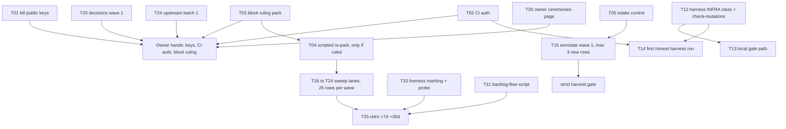

# SUPERB Backlog Masterplan v6: The 1 % Is One Ruling and Two Owner Actions

**Written:** 2026-11-25 00:06 CET (`date`), boot `b4931451`, gen system-1029 live, io PSI some avg10=35.82 / avg60=45.37 / avg300=45.85, branch ahead 2, HEAD `d384660`.
**EXECUTING (instance crush-glm54-full-exec-1125-0818, 2026-11-25 08:18 CET, HEAD `93a0ce7b5`):** executing (see AGENTS.md plan-execution tombstone)
**Status:** PLAN (not executing. `scripts/plan-marker.sh <this file> start <instance>` is owed before any execution session).
**Supersedes:** [v5 (2026-11-07)](./2026-11-07_04-12_SUPERB-backlog-masterplan-v5.md). Predecessors: [v4 (2026-11-05)](./2026-11-05_17-32_SUPERB-backlog-masterplan-v4.md), [v3 (2026-11-03)](./2026-11-03_17-10_SUPERB-backlog-masterplan-v3.md) (its tombstone has read EXECUTING since 2026-11-03 17:33 with no EXECUTED flip: treat it as a dead executor), v2 and v1 (2026-10-23).
**Source sessions:** [status 2026-11-24 22:33](../status/2026-11-24_22-33_backlog-write-only-log-inflow-vs-drain-dead-ci-layer-status.md) (inflow vs drain, the dead CI layer, live failures) and [status 2026-11-24 23:38](../status/2026-11-24_23-38_planning-run-queue-tripled-by-11-07-bulk-harvest-masterplan-lineage-v5-status.md) (the 2026-11-07 bulk harvest; the design this file renders).
**Backlog measured at 2026-11-25 00:06 CET:** queue 2,438 `[ready]` rows of 3,543 open rows; libraries 2,727 `[ready]` of 4,086 open rows; gate backlog 102 unharvested §f reports (v5: 203, then 0 on 2026-11-07 18:35), 133 queue/library drifts (v5: 68). Against v5: queue ready 1,082 then, 2,438 now.

---

## 1. What this is

A two-level plan over the whole open backlog plus this session's items, in the v4/v5 shape:

- **Level 1 (section 5):** 27 tasks of 36 to 96 minutes, 1,560 minutes in total (26 h), sorted by tier, then result per minute.
- **Level 2 (section 6):** 133 micro-tasks, each 12 minutes or less; the minutes of a task's micro-tasks sum to the task's estimate. Nothing in the plan is left unbroken.
- **Completeness (section 7):** every TODO domain has a lane. The 4,086 library rows are not listed one by one: the lanes cover them by domain, in 25-row verify-first waves, and the 2026-11-07 block is handled as one object (T03, T04).
- **Purely additive:** this file changes no TODO row, no script, no module. It is an index and a decision list. The tq pool keeps harvesting `TODO_LIST.md` only; section 10 says which tasks need rows before the pool can see them.

The one fact that shapes the whole plan: the queue did not grow a few rows per session. It grew because one day added 1,538 rows in a bulk harvest (executing v5's T03 and T04), and 1,509 of them are still open, 43 percent of the open queue, with 26 closed in 17 days. The first move of this plan is a ruling on that block.

## 2. Method

**Effort model.** One micro-task is up to 12 minutes, laid out as premise-check, do, verify, record. Owner micro-tasks are 6 to 12 minutes (console clicks, answers). A task is 36 to 96 minutes and is always the exact sum of its micro-tasks, so a task cannot drift from its breakdown.

**Result model.** 100 points across ten outcomes. The weights are judgment, stated here so they can be challenged and re-run:

| Outcome | Weight |
| --- | ---: |
| O1 Public keys dead | 12 |
| O2 CI can go green again (auth + content) | 15 |
| O3 Master honestly green, harness signal trustworthy | 8 |
| O4 Backlog under control (block ruled, intake capped, regrowth annotated) | 22 |
| O5 Gates stay alive locally (liveness marking, probe, flow script) | 8 |
| O6 Live failures cleared | 6 |
| O7 Pool healthy | 5 |
| O8 Ready backlog shrunk by verify-first sweeps | 12 |
| O9 Human-gated backlog triaged | 6 |
| O10 Durability (regression net, ceremonies, ROADMAP, retro) | 6 |

**Sort key.** Tier first (1 %, 4 %, 20 %, tail), then result points per minute (importance and impact against effort), ties by the smaller effort. Owner value is the column that says what the owner gets.

**Measured backlog (the plan's input):**

| Measure | Value |
| --- | --- |
| Queue open rows | 3,543 (2,438 ready, 279 decision, 183 watch, 156 blocked:user, 37 blocked:deploy, 36 blocked:push, 413 untagged, 1 blocked:root) |
| Library open rows | 4,086 (2,727 ready, 480 decision, 366 watch, 315 blocked:user, 101 blocked:push, 78 blocked:deploy) |
| Rows added to the queue on 2026-11-07 | 1,538 (73 percent of the dated ones from reports 7+ days old) |
| Of those, still open / closed since | 1,509 / 26 (1.7 percent in 17 days) |
| Ready-line adds per week since | 284 (week of 11-09), 183 (week of 11-16), 93 in 2 days (week of 11-23) |
| Open rows, 2026-09-19 to now | 660 to 7,614 at 22:20 on 11-24 |
| CI | last green flake check 2026-07-29; negative-test harness never green in 502 runs; secret-history scan never green |

## 3. Step 1: Pareto ladder

### The 1 % that deliver 51 % (6 tasks, 408 min)

Effort 408 min = 26.2 percent of the plan. Result 43 points.

| ID | Task | Pts | Min | Why it is in this tier |
| --- | --- | ---: | ---: | --- |
| T01 | Kill the two public-history keys; annotate the two security rows | 12 | 36 | The only item with exposure outside this host: two keys in a public repository's history, live since February by the repo's own row. 18 owner-minutes. |
| T02 | CI auth: read-only PAT + deploy keys; push; classify remaining reds; tick 4 rows | 11 | 72 | Four of five CI workflows cannot go green without it. Everything that proves the tree has been blind since 2026-07-29. 24 owner-minutes. |
| T03 | Ruling pack for the 2026-11-07 block: inventory, 30-row staleness sample, 3-option memo, ruling row | 6 | 48 | 43 percent of the open queue is one day's bulk harvest. One ruling decides its fate; no other single decision moves the queue that much. |
| T04 | Scripted re-park of the block (dry-run default, gate counts before/after), only if ruled | 8 | 96 | Executes the ruling in one scripted pass, dry-run by default. The largest mechanical lever on the queue that exists. |
| T05 | Intake control: annotate rule in the queue header, bulk-harvest commit guard, WARN-default size ratchet, strict harvest gate last | 4 | 96 | Without it the spike repeats: the gate counts rows, not decisions. Annotate rule, bulk guard, WARN-default ratchet. |
| T06 | NOW block (max 10 bullet pointers) under `## Queue` + one AGENTS.md sentence | 2 | 60 | Every session starts on the same ten items instead of grepping a 1.5 MB file. |

### The 4 % that deliver 64 % (9 more tasks, 624 min)

Effort 624 min = 40.0 percent of the plan. Result 33 points.

| ID | Task | Pts | Min | Why it is in this tier |
| --- | --- | ---: | ---: | --- |
| T07 | `dead-guard-lint` green on master: rescue the 4 captures, rebuild, tick | 4 | 36 | Master fails its own lint in four places, and the hook never builds that lint (eval only). |
| T08 | Live-failure triage: `audiblesync-backup-dir` (CAP_FOWNER), `inboxclean-sync`, `forgejo-github-sync` exit logic, `rust-cache-gc` stamp | 6 | 60 | Four failing units, each with a known cause class. `audiblesync-backup-dir` sits on the backup path. |
| T09 | Pool follow-through: 87 restarts vs the 3 queued rows, dirty-tree refusals, budget ruling | 5 | 60 | The drain side: 30 tasks a day for three repos, 616 dirty-tree refusals in three days, 87 restarts. A decision, not an accident. |
| T10 | AGENTS.md: CI row marked dead with last-green dates; `scripts/session-start-probe.sh` | 4 | 60 | AGENTS.md still advertises a dead CI layer, so every session inherits false assurance. The probe makes dead gates visible at session start. |
| T11 | `scripts/backlog-flow.sh`: open rows at 5 revisions, row events 7/30 d, per-tag flow, block share | 2 | 48 | The flow numbers came from an ad hoc 15 MB diff analysis. One command keeps the Pareto re-measurable. |
| T12 | Harness: INFRA class, abort on pristine fetch failure, live doc-count mutations, fix invalid sed, `--check-mutations` | 4 | 96 | 58 of 60 harness failures are noise or rot. INFRA class, live mutations, and a cheap `--check-mutations` mode. |
| T13 | Local execution path for CI-only gates (pre-commit leg if ≤60 s, else PSI-gated timer) | 3 | 72 | The lint-static checks only ever ran in dead CI. A local path keeps them alive whatever CI does. |
| T14 | First honest harness run; classify all verdicts; fix fallout; tick 2 rows | 3 | 96 | `negative-tested` becomes a current fact: the first honest full run since 2026-07-29. |
| T15 | Unharvested-§f annotate wave 1: 48 of about 100 reports, at most 3 new rows | 2 | 96 | 102 unharvested reports. Annotate instead of row; at most 3 new rows in the whole wave. |

### The 20 % that deliver 80 % (9 lanes, 396 min)

Effort 396 min = 25.4 percent of the plan. Result 20 points.

| ID | Task | Pts | Min | Why it is in this tier |
| --- | --- | ---: | ---: | --- |
| T16 | Pipeline sweep wave 1 (25 rows, verify-first) | 4 | 36 | pipeline: 939 ready library rows, the largest lane. Verify-first: the proven yield is about 30 percent stale. |
| T17 | Services sweep wave 1 | 3 | 36 | services: 628 ready library rows, the lane most live failures come from. |
| T18 | Stability + monitoring sweep wave 1 | 2 | 36 | stability 285 and monitoring 291 ready rows. |
| T19 | Blocked + watch stale-claims sweep wave 1 | 3 | 60 | Human-gated rows re-checked against the live system: blocked:user 315, blocked:deploy 78, blocked:push 101, watch 366. |
| T20 | Decisions triage wave 1 (60 rows: keep / kill / owner-answer) | 3 | 60 | 480 `[decision]` rows; the first 60 answered in one owner pass. |
| T21 | VM-test + eval-guard backlog (2 wirings + 1 fixture leg) | 2 | 48 | Deferred selftest wirings and fixture legs: the regression net behind every eval guard. |
| T22 | Storage sweep wave 1 (PSI-gated du legs) | 1 | 36 | storage: 172 ready rows (du legs only in a PSI-calm window). |
| T23 | Desktop + ai-stack + security + pixel6 wave | 1 | 36 | desktop 83, ai-stack 76, security 19, pixel6 13 ready rows. |
| T24 | Upstream lane batch 1 (prepare 8 patches, owner pushes) | 1 | 48 | upstream: 221 ready rows; the owner pushes, agents prepare. |

### The other 20 % to reach 100 % (3 tasks, 132 min)

Effort 132 min = 8.5 percent of the plan. Result 4 points.

| ID | Task | Pts | Min | Why it is in this tier |
| --- | --- | ---: | ---: | --- |
| T25 | Retro + re-triage at +7 and +30 days | 2 | 48 | Re-measure at +7 and +30 days so this plan stays true or gets replaced. |
| T26 | Owner ceremonies one-pager | 1 | 36 | Every owner-only ask on one ranked page: one sitting instead of 951 rows. |
| T27 | ROADMAP graduation + 2 structural proposal stubs (no implementation) | 1 | 48 | The vague remainder stops occupying the queue; two structural proposals as decision material only. |

### Textbook against measured

| Tier | Textbook | Tasks | Minutes | Effort share | Result | Cumulative effort to reach it |
| --- | --- | --- | ---: | ---: | ---: | ---: |
| 1% | 1 % to 51 % | T01 to T06 (6) | 408 | 26.2 % | 43 pts | 32.3 percent of effort (crossed in T08) |
| 4% | 4 % to 64 % | T07 to T15 (9) | 624 | 40.0 % | 33 pts | 43.1 percent of effort (crossed in T11) |
| 20% | 20 % to 80 % | T16 to T24 (9) | 396 | 25.4 % | 20 pts | 68.5 percent of effort (crossed in T16) |
| tail | rest to 100 % | T25 to T27 (3) | 132 | 8.5 % | 4 pts | n/a |

This ladder is much flatter than the textbook: 51 percent of the result takes 32.3 percent of the effort, 64 percent takes 43.1 percent, 80 percent takes 68.5 percent. Two reasons. The candidate set was already filtered: these 27 tasks are the top of a 4,086-row backlog, so the steep part of the curve was consumed before this plan. And four of the six tasks in the first tier wait on the owner: about 54 owner-minutes (keys, CI auth, block ruling) unlock 37 of the 100 points, and nothing else in the 1,560 minutes moves without them. In owner time the textbook shape does hold: 90 owner-minutes in the whole plan, 54 of them in the first tier.

## 4. Errata vs v5 (do not re-dispatch what shipped)

Evidence classes: DONE and DONE AS BULK HARVEST are backed by named reports or commit lists; NO EVIDENCE means zero matching commit titles since 2026-11-07; NOT VERIFIED means this session did not check.

| v5 item | State | Evidence and where it goes |
| --- | --- | --- |
| T01 recovery deploy + clean wave | DONE | 17 commits since 11-07 with deploy or generation titles; gen-1028 live per the 22:38 report. Not re-verified at code level. |
| T02 owed full `nix flake check` + DRIFT baseline | NOT VERIFIED | 1 commit title mentions a flake check; pairing drift is 133 now against 68 then. |
| T03 unharvested wave 1 | DONE AS BULK HARVEST | 203 to 0 on 2026-11-07 across three reports; about 1,050 rows minted. Superseded by T03, T04, T15 here: the count is 102 again and 1,509 minted rows are still open. |
| T04 unharvested waves 2 and 3 | DONE AS BULK HARVEST | Same event, same supersession. |
| T05 stale-claims sweep (blocked:deploy) | NO EVIDENCE | 0 commit titles. Carried as T19. |
| T06 /data re-baseline | NOT VERIFIED | Carried by T22. |
| T07 df-vs-du gap | NOT VERIFIED | Carried by T22. |
| T08 shared-surface eval habit | NOT VERIFIED | Not carried as a task; the pre-commit eval-relevance predicate is the standing mechanism. |
| T09 vm-top pre-deploy leg | NO EVIDENCE | 0 commit titles. Rides the pipeline lane (T16). |
| T10 SigNoz panel for vm-top | NO EVIDENCE | 0 commit titles. Rides the monitoring lane (T18). |
| T11 prune-script hardening | NO EVIDENCE | 0 commit titles. Rides the pipeline lane (T16). |
| T12 io-psi-crosscheck verdict in deploy.sh | NO EVIDENCE | 0 commit titles. Rides the pipeline lane (T16). |
| T13 post-wave canary battery | NOT VERIFIED | Deploys since then (gen-1012, gen-1028) imply deploy.sh batteries ran; not checked. |
| T14 fastflowlm forensics | NOT VERIFIED | 1 commit title; FastFlowLM is decided-disabled since 2026-11-14 per the queue. |
| T15 Samsung watermark + buildcache cleanup | NO EVIDENCE | 0 commit titles. Rides the storage lane (T22). |
| T16 commit-msg WARN coverage + hook-bypass row | NOT VERIFIED | 1 commit title. |
| T17 to T24 sweep lanes | STANDING LANES | A lane is never finished; first waves re-issued here as T16 to T24. |
| T25 decisions triage wave 1 | STANDING LANE | Re-issued as T20. |
| T26 watch-lane sweep | STANDING LANE | Folded into T19. |
| T27 VM-test + eval-guard backlog | STANDING LANE | Re-issued as T21. |

## 5. Step 2: the 27 tasks (36 to 96 min each)

Sorted by tier, then result points per minute. Pts from the result model in section 2. Micro lists the micro-task ids in section 6.

| ID | Task | Tier | Impact | Pts | Min | Pts/min | Owner value | Depends | Micro |
| --- | --- | --- | --- | ---: | ---: | ---: | --- | --- | --- |
| T01 | Kill the two public-history keys; annotate the two security rows | 1% | Critical | 12 | 36 | 0.333 | the only external exposure closes | owner | M01 to M06 (6) |
| T02 | CI auth: read-only PAT + deploy keys; push; classify remaining reds; tick 4 rows | 1% | Critical | 11 | 72 | 0.153 | 4 of 5 workflows can go green | owner | M07 to M12 (6) |
| T03 | Ruling pack for the 2026-11-07 block: inventory, 30-row staleness sample, 3-option memo, ruling row | 1% | High | 6 | 48 | 0.125 | 43% of the queue gets one decision | owner | M13 to M16 (4) |
| T04 | Scripted re-park of the block (dry-run default, gate counts before/after), only if ruled | 1% | High | 8 | 96 | 0.083 | queue minus up to 1,509 rows in one pass | T03 | M17 to M24 (8) |
| T05 | Intake control: annotate rule in the queue header, bulk-harvest commit guard, WARN-default size ratchet, strict harvest gate last | 1% | High | 4 | 96 | 0.042 | the spike cannot repeat | T15 (last step only) | M25 to M32 (8) |
| T06 | NOW block (max 10 bullet pointers) under `## Queue` + one AGENTS.md sentence | 1% | Medium | 2 | 60 | 0.033 | every session starts on the same 10 items | none | M33 to M37 (5) |
| T07 | `dead-guard-lint` green on master: rescue the 4 captures, rebuild, tick | 4% | High | 4 | 36 | 0.111 | master stops failing its own lint | none | M38 to M40 (3) |
| T08 | Live-failure triage: `audiblesync-backup-dir` (CAP_FOWNER), `inboxclean-sync`, `forgejo-github-sync` exit logic, `rust-cache-gc` stamp | 4% | High | 6 | 60 | 0.100 | failed-unit list shrinks by four | none | M41 to M45 (5) |
| T09 | Pool follow-through: 87 restarts vs the 3 queued rows, dirty-tree refusals, budget ruling | 4% | Medium | 5 | 60 | 0.083 | drain capacity becomes a decision, not an accident | owner | M46 to M50 (5) |
| T10 | AGENTS.md: CI row marked dead with last-green dates; `scripts/session-start-probe.sh` | 4% | Medium | 4 | 60 | 0.067 | sessions stop citing dead gates | none | M51 to M55 (5) |
| T11 | `scripts/backlog-flow.sh`: open rows at 5 revisions, row events 7/30 d, per-tag flow, block share | 4% | Medium | 2 | 48 | 0.042 | the Pareto stays re-measurable | none | M56 to M59 (4) |
| T12 | Harness: INFRA class, abort on pristine fetch failure, live doc-count mutations, fix invalid sed, `--check-mutations` | 4% | High | 4 | 96 | 0.042 | 2 real failures stop hiding behind 58 noise lines | none | M60 to M67 (8) |
| T13 | Local execution path for CI-only gates (pre-commit leg if ≤60 s, else PSI-gated timer) | 4% | Medium | 3 | 72 | 0.042 | lint-static checks run even while CI is dead | T12 | M68 to M73 (6) |
| T14 | First honest harness run; classify all verdicts; fix fallout; tick 2 rows | 4% | Medium | 3 | 96 | 0.031 | "negative-tested" becomes a current fact | T02, T12 | M74 to M81 (8) |
| T15 | Unharvested-§f annotate wave 1: 48 of about 100 reports, at most 3 new rows | 4% | Medium | 2 | 96 | 0.021 | the WARN count drops without growing the queue | none | M82 to M89 (8) |
| T16 | Pipeline sweep wave 1 (25 rows, verify-first) | 20% | Medium | 4 | 36 | 0.111 | queue shrink | none | M90 to M92 (3) |
| T17 | Services sweep wave 1 | 20% | Medium | 3 | 36 | 0.083 | queue shrink | none | M93 to M95 (3) |
| T18 | Stability + monitoring sweep wave 1 | 20% | Medium | 2 | 36 | 0.056 | queue shrink | none | M96 to M98 (3) |
| T19 | Blocked + watch stale-claims sweep wave 1 | 20% | Medium | 3 | 60 | 0.050 | no ghosts | none | M99 to M103 (5) |
| T20 | Decisions triage wave 1 (60 rows: keep / kill / owner-answer) | 20% | Medium | 3 | 60 | 0.050 | owner answers 60 in one pass | owner | M104 to M108 (5) |
| T21 | VM-test + eval-guard backlog (2 wirings + 1 fixture leg) | 20% | Low | 2 | 48 | 0.042 | regression net | CI or PSI-calm | M109 to M112 (4) |
| T22 | Storage sweep wave 1 (PSI-gated du legs) | 20% | Low | 1 | 36 | 0.028 | queue shrink | none | M113 to M115 (3) |
| T23 | Desktop + ai-stack + security + pixel6 wave | 20% | Low | 1 | 36 | 0.028 | completeness | none | M116 to M118 (3) |
| T24 | Upstream lane batch 1 (prepare 8 patches, owner pushes) | 20% | Low | 1 | 48 | 0.021 | upstream debt | owner | M119 to M122 (4) |
| T25 | Retro + re-triage at +7 and +30 days | tail | Low | 2 | 48 | 0.042 | the plan stays true | T10, T11 | M123 to M126 (4) |
| T26 | Owner ceremonies one-pager | tail | Low | 1 | 36 | 0.028 | owner asks in one ranked page | owner | M127 to M129 (3) |
| T27 | ROADMAP graduation + 2 structural proposal stubs (no implementation) | tail | Low | 1 | 48 | 0.021 | the vague remainder stops occupying the queue | none | M130 to M133 (4) |

Totals: 27 tasks, 1,560 minutes (26 h), 100 points. Categories: Security 1, Bug 4, Decision 1, Quality 4, Process 5, Documentation 2, Feature 2, Cleanup 8.

## 6. Step 3: the 133 micro-tasks (each 12 min or less)

Listed in task order. Who: owner means console, sudo or an answer; everything else is agent work.

| ID | Micro-task | Min | Parent | Who |
| --- | --- | ---: | --- | --- |
| M01 | Delete the Google key named in `docs/todo/security.md` row "Secret-history-scan stays red until 2 rotations" in the console project the row names | 6 | T01 | owner |
| M02 | Rotate the Context7 key at its dashboard (the row says no consumer config remains) | 6 | T01 | owner |
| M03 | Reply "both dead" with the date; never paste key material | 6 | T01 | owner |
| M04 | Annotate the two security rows with the rotation date (append, never rewrite); tick the rotation clauses | 6 | T01 | agent |
| M05 | Rely on the owner's console confirmation that the residue classes are now inert; do not allowlist (that decision stays with the owner, and a local full-history scan is a 9-minute blob walk) | 6 | T01 | agent |
| M06 | Record in the session report + CHANGELOG line | 6 | T01 | agent |
| M07 | Create the fine-grained read-only PAT; `gh secret set NIX_GITHUB_RO_TOKEN --repo LarsArtmann/SystemNix` | 12 | T02 | owner |
| M08 | Add read-only deploy keys for the private `git+ssh` inputs missing from the bundle (at least summit-planner and audiblesync) per `docs/agents/go-ecosystem.md` | 12 | T02 | owner |
| M09 | Trigger a run; `gh run list --limit 10`; `gh run view <id> --log-failed` per workflow | 12 | T02 | agent |
| M10 | Classify each remaining red as infra (auth, fetch) or content (lint, test); write the table into the plan errata | 12 | T02 | agent |
| M11 | Tick the 4 owner-gated CI rows by title with run ids as evidence | 12 | T02 | agent |
| M12 | Record first-green-or-why per workflow in the session report | 12 | T02 | agent |
| M13 | Regenerate the block inventory (rows added to `TODO_LIST.md` on 2026-11-07, still open): count, per-domain, per-source-month | 12 | T03 | agent |
| M14 | Staleness read: sample 30 block rows (seeded random), re-grep each premise, record kept / stale / obsolete | 12 | T03 | agent |
| M15 | Write the 3-option memo (keep / re-park library-only / re-park and annotate): row counts, pool effect, rollback | 12 | T03 | agent |
| M16 | Rule; record the ruling in a `[decision]` row in `docs/todo/pipeline.md` citing the memo | 12 | T03 | owner |
| M17 | Freeze the manifest of exact block row titles; record its sha256 in the session report | 12 | T04 | agent |
| M18 | `scripts/repark-harvest-block.sh` skeleton: dry-run default, manifest-driven, refuses rows that changed since the manifest | 12 | T04 | agent |
| M19 | Dry path per the ruled mechanics (remove queue lines or retag library rows), one physical line per row, idempotent | 12 | T04 | agent |
| M20 | Gate counts before/after on a scratch copy of the tree; WARN and FAIL counts must not rise | 12 | T04 | agent |
| M21 | Selftest on a 20-row fixture; shellcheck and hook legs green | 12 | T04 | agent |
| M22 | Dry-run on the live tree; diff stats; removed count equals manifest size | 12 | T04 | agent |
| M23 | Apply in one commit (pathspec: `TODO_LIST.md` + the libraries actually touched) | 12 | T04 | agent |
| M24 | Verify post-state (open queue count, pairing WARN, pool journal); CHANGELOG + session report | 12 | T04 | agent |
| M25 | Read `scan_file` and `selftest` in `scripts/check-todo-system.sh`; place `BACKLOG_MAX_OPEN` + `--ratchet-down`; WARN default, strict by env | 12 | T05 | agent |
| M26 | Implement the open-row count versus ratchet leg in `scan_file` | 12 | T05 | agent |
| M27 | Selftest legs: above cap warns by default and fails in strict mode; at cap clean | 12 | T05 | agent |
| M28 | Bulk guard in `.githooks/pre-commit`: fail when one staged `TODO_LIST.md` diff adds more than 50 rows without an owner override env | 12 | T05 | agent |
| M29 | Selftest for the bulk guard: a seeded 51-row patch must fail | 12 | T05 | agent |
| M30 | Queue header, existing "Routing rules" list: annotate old reports, at most 3 new rows per session, read the NOW block first | 12 | T05 | agent |
| M31 | AGENTS.md "TODO System" paragraph: one sentence naming the ratchet and the bulk guard | 12 | T05 | agent |
| M32 | After T15: switch the harvest gate to strict in the hook; before that confirm the default WARN still prints | 12 | T05 | agent |
| M33 | Design the NOW block: `### NOW (max 10)` under `## Queue`, plain bullet pointers, not `- [ ]` rows (the duplicate-title leg reads rows) | 12 | T06 | agent |
| M34 | Select the first 10 by rule: public exposure, CI enablers, block ruling, cheapest lint and gate fixes | 12 | T06 | agent |
| M35 | Write the block and one header sentence (re-rank at every session start; a bullet leaves when its row closes) | 12 | T06 | agent |
| M36 | Gate run: titles unique, no `- [ ]` shape, pairing unaffected | 12 | T06 | agent |
| M37 | AGENTS.md Session Discipline: one sentence "read the NOW block before claiming work"; commit | 12 | T06 | agent |
| M38 | Re-verify the 4 captures still lack a rescue (grep the lines; rebuild only in a PSI-calm window) | 12 | T07 | agent |
| M39 | Apply the rescue per site: explicit reassignment where an empty value breaks the next guard, else append the shell `\|\| true` rescue | 12 | T07 | agent |
| M40 | Rebuild the check green; confirm no sibling session is editing the 3 files; tick the row by title | 12 | T07 | agent |
| M41 | `audiblesync-backup-dir`: confirm the cause (`User=root`, empty bounding set, directory owned by `audible-sync`); locate the owning module | 12 | T08 | agent |
| M42 | Fix in the owning module (`AmbientCapabilities` for `CAP_FOWNER`, or a tmpfiles rule instead of chmod); upstream patch if the module is upstream | 12 | T08 | agent |
| M43 | `inboxclean-sync`: journal tail, classify, annotate its queued row with the fresh evidence | 12 | T08 | agent |
| M44 | `forgejo-github-sync`: read the re-interval script's exit logic; decide whether one failed PATCH should fail the unit | 12 | T08 | agent |
| M45 | `rust-cache-gc` stamp: journal since 21:51; annotate the rust-cache session's row if clean, else queue | 12 | T08 | agent |
| M46 | Read the 3 queued pool rows (start-limit placement, unstick, gate refusals and start budget) | 12 | T09 | agent |
| M47 | Journal: characterize the 11-23 and 11-24 restarts against those rows; annotate, do not mint | 12 | T09 | agent |
| M48 | Quantify dirty-tree preflight refusals per repo over 3 days | 12 | T09 | agent |
| M49 | Feasibility note: harvest from a clean worktree instead of refusing (`repo: go-taskqueue` ask) | 12 | T09 | agent |
| M50 | Budget one-pager (30 per day shared by 3 repos against measured inflow) and the ruling row | 12 | T09 | agent |
| M51 | AGENTS.md Prevention Layers table, CI cell: dead since dates, re-verify with the probe | 12 | T10 | agent |
| M52 | `scripts/session-start-probe.sh` part 1: last-green age per workflow; WARN when `gh` is unauthenticated | 12 | T10 | agent |
| M53 | Part 2: open-row delta over 7 days (past revisions) and block share | 12 | T10 | agent |
| M54 | Part 3: pool budget line and the failed-unit list; exit 0 always | 12 | T10 | agent |
| M55 | Hook legs green; AGENTS.md Session Discipline: one sentence | 12 | T10 | agent |
| M56 | `scripts/backlog-flow.sh` (bash wrapper, embedded python, the `scan-history-secrets.sh` pattern): rows at 5 revisions, events 7/30 d, per-tag flow | 12 | T11 | agent |
| M57 | Add block share and the unharvested gate count | 12 | T11 | agent |
| M58 | Selftest on a 2-commit fixture repo; shellcheck; hook legs | 12 | T11 | agent |
| M59 | One line in AGENTS.md + CHANGELOG; commit | 12 | T11 | agent |
| M60 | Read `run_case`, `apply_mutations`, the controls loop; write the change list, no edits | 12 | T12 | agent |
| M61 | INFRA class: a pristine control failing on "Failed to fetch git repository" reports INFRA and sets a flag | 12 | T12 | agent |
| M62 | Abort: with the flag set, eval and build cases report INFRA (skipped); the summary prints an infra count | 12 | T12 | agent |
| M63 | Derive the doc-count mutations from the live README and FEATURES text instead of the literals 141 and 46 | 12 | T12 | agent |
| M64 | Fix the invalid sed expression (the `snapshots.nix` case) | 12 | T12 | agent |
| M65 | `--check-mutations` mode: apply every mutation to a temp copy, report HARNESS BUG lines only, no eval or build | 12 | T12 | agent |
| M66 | Run `--check-mutations`: zero HARNESS BUG lines required | 12 | T12 | agent |
| M67 | Wire `--check-mutations` as a pre-commit leg when the harness or its mutation targets are staged | 12 | T12 | agent |
| M68 | Measure in a PSI-calm window: eval and build seconds for one lint-static check | 12 | T13 | agent |
| M69 | Decide by the number: 60 s or less means a pre-commit leg, otherwise a PSI-gated nightly timer | 12 | T13 | agent |
| M70 | Pre-commit leg: reuse `scripts/lib/eval-relevant-paths.sh`, build only the lint-static checks, skip at PSI 80 or more | 12 | T13 | agent |
| M71 | Timer alternative: PSI-gated unit that builds the lint-static checks and runs `--check-mutations`; result into the textfile collector | 12 | T13 | agent |
| M72 | Negative leg: seed one dead-guard capture in a scratch copy; the leg must fail | 12 | T13 | agent |
| M73 | Hook selftest + shellcheck; one clause in the AGENTS.md Prevention Layers cells; commit and record | 12 | T13 | agent |
| M74 | After T02: watch the first `negative-tests` run on a pushed tree | 12 | T14 | agent |
| M75 | Classify all verdicts (PASS, FAIL, INFRA, HARNESS BUG) into a table | 12 | T14 | agent |
| M76 | Fix fallout group 1 (at most 5 new rows) | 12 | T14 | agent |
| M77 | Fix fallout group 2 | 12 | T14 | agent |
| M78 | Fix fallout group 3 | 12 | T14 | agent |
| M79 | If CI is still blocked: one local run in a PSI-calm window only | 12 | T14 | agent |
| M80 | Tick the "Red-CI pair" row and the `dead-guard-lint` control row with run ids | 12 | T14 | agent |
| M81 | Re-baseline the expected counts in the plan errata; commit | 12 | T14 | agent |
| M82 | List the 101 unharvested reports from the gate's WARN lines; sort oldest first | 12 | T15 | agent |
| M83 | Batch 1 (8 reports): skim §f; mark HARVESTED only where every item is already a row; else NOT HARVESTED with a reason; new rows only for new and critical items | 12 | T15 | agent |
| M84 | Batch 2 (8 reports), same rule | 12 | T15 | agent |
| M85 | Batch 3 | 12 | T15 | agent |
| M86 | Batch 4 | 12 | T15 | agent |
| M87 | Batch 5 | 12 | T15 | agent |
| M88 | Batch 6 (48 reports in wave 1) | 12 | T15 | agent |
| M89 | Gate arithmetic: the WARN count drops by exactly the number of marked reports; at most 3 new rows in the whole wave | 12 | T15 | agent |
| M90 | Pipeline wave 1, rows 1 to 8: re-grep each premise; tick, supersede, or keep | 12 | T16 | agent |
| M91 | Rows 9 to 16 | 12 | T16 | agent |
| M92 | Rows 17 to 25; record the yield; never mint more rows than closed | 12 | T16 | agent |
| M93 | Services wave 1, rows 1 to 8: verify-first | 12 | T17 | agent |
| M94 | Rows 9 to 16 | 12 | T17 | agent |
| M95 | Rows 17 to 25; record the yield | 12 | T17 | agent |
| M96 | Stability + monitoring wave 1, rows 1 to 8: verify-first | 12 | T18 | agent |
| M97 | Rows 9 to 16 | 12 | T18 | agent |
| M98 | Rows 17 to 25; record the yield | 12 | T18 | agent |
| M99 | `[blocked:deploy]` rows 1 to 15 against the live generation: tick or re-verify | 12 | T19 | agent |
| M100 | `[blocked:deploy]` rows 16 to 30 | 12 | T19 | agent |
| M101 | `[blocked:user]` rows 1 to 15: is the remaining work truly owner-only; retag leftovers | 12 | T19 | agent |
| M102 | `[blocked:user]` rows 16 to 30 | 12 | T19 | agent |
| M103 | `[watch]` rows 1 to 20: subject landed elsewhere, tick; record the yield | 12 | T19 | agent |
| M104 | Select 60 `[decision]` rows (oldest first, security and data-loss first); answer-sheet skeleton | 12 | T20 | agent |
| M105 | Triage rows 1 to 20: keep, kill, or owner-answer (one line each) | 12 | T20 | agent |
| M106 | Rows 21 to 40 | 12 | T20 | agent |
| M107 | Rows 41 to 60 | 12 | T20 | agent |
| M108 | Owner answers in one pass; record rulings into the rows; apply the kill list | 12 | T20 | owner |
| M109 | Enumerate deferred selftest wirings and fixture legs | 12 | T21 | agent |
| M110 | Wire the first and eval it (PSI-calm window) | 12 | T21 | agent |
| M111 | Wire the second and one fixture leg for an eval-guard | 12 | T21 | agent |
| M112 | Record; the remainder goes to the next wave | 12 | T21 | agent |
| M113 | Storage wave 1, rows 1 to 8 (du legs only in a PSI-calm window) | 12 | T22 | agent |
| M114 | Rows 9 to 16 | 12 | T22 | agent |
| M115 | Rows 17 to 25; record the yield | 12 | T22 | agent |
| M116 | Desktop + ai-stack + security + pixel6 wave, rows 1 to 8 | 12 | T23 | agent |
| M117 | Rows 9 to 16 | 12 | T23 | agent |
| M118 | Rows 17 to 25; record the yield | 12 | T23 | agent |
| M119 | List `[blocked:push]` rows; pick the 12 cheapest | 12 | T24 | agent |
| M120 | Prepare 4 patch or PR bodies, each tagged with its repo | 12 | T24 | agent |
| M121 | Prepare 4 more plus the owner push table (repo, branch, link) | 12 | T24 | agent |
| M122 | Owner pushes; tick merge-by-reference | 12 | T24 | owner |
| M123 | +7 days: `scripts/backlog-flow.sh` and `scripts/session-start-probe.sh`: census, block share, unharvested count | 12 | T25 | agent |
| M124 | +7 days: CI streak, pool refusals, failed units; annotate the plan errata | 12 | T25 | agent |
| M125 | +30 days: the same three probes against this plan's numbers | 12 | T25 | agent |
| M126 | Re-rank; write the errata table; decide v7 if the census moved 200 rows or more | 12 | T25 | agent |
| M127 | Collect every owner-only ask into one page (keys allowlist, history purge, block ruling, pool budget, age key) | 12 | T26 | agent |
| M128 | Order by minutes-to-unlock against points; each item two lines with the exact console step | 12 | T26 | agent |
| M129 | Owner works the page in one sitting; record rulings; tick | 12 | T26 | owner |
| M130 | Vague and long-term remainder to `ROADMAP.md` | 12 | T27 | agent |
| M131 | Single-source backlog proposal stub (library is the store, queue is a view): decision material only | 12 | T27 | agent |
| M132 | AGENTS.md context-tax measurement and proposal: no edit | 12 | T27 | agent |
| M133 | Commit; anything built from these stubs needs its own plan | 12 | T27 | agent |

Per task:

| Task | Minutes | Micro-tasks | 12-minute steps | Shorter steps |
| --- | ---: | --- | ---: | --- |
| T01 | 36 | 6 | 0 | 6 |
| T02 | 72 | 6 | 6 | 0 |
| T03 | 48 | 4 | 4 | 0 |
| T04 | 96 | 8 | 8 | 0 |
| T05 | 96 | 8 | 8 | 0 |
| T06 | 60 | 5 | 5 | 0 |
| T07 | 36 | 3 | 3 | 0 |
| T08 | 60 | 5 | 5 | 0 |
| T09 | 60 | 5 | 5 | 0 |
| T10 | 60 | 5 | 5 | 0 |
| T11 | 48 | 4 | 4 | 0 |
| T12 | 96 | 8 | 8 | 0 |
| T13 | 72 | 6 | 6 | 0 |
| T14 | 96 | 8 | 8 | 0 |
| T15 | 96 | 8 | 8 | 0 |
| T16 | 36 | 3 | 3 | 0 |
| T17 | 36 | 3 | 3 | 0 |
| T18 | 36 | 3 | 3 | 0 |
| T19 | 60 | 5 | 5 | 0 |
| T20 | 60 | 5 | 5 | 0 |
| T21 | 48 | 4 | 4 | 0 |
| T22 | 36 | 3 | 3 | 0 |
| T23 | 36 | 3 | 3 | 0 |
| T24 | 48 | 4 | 4 | 0 |
| T25 | 48 | 4 | 4 | 0 |
| T26 | 36 | 3 | 3 | 0 |
| T27 | 48 | 4 | 4 | 0 |

## 7. Coverage: every TODO domain has a lane

| Domain | Ready library rows now | Covered by |
| --- | ---: | --- |
| pipeline | 939 ready of 1,129 | T16 (wave 1 of 25 rows); T15 for its unharvested reports; T05, T11, T12, T13 for the TODO and gate system itself |
| services | 628 ready of 1,066 | T17 (wave 1); T08 for the four live failures; T09 for the pool |
| stability | 285 ready of 427 | T18 (wave 1, shared with monitoring) |
| monitoring | 291 ready of 361 | T18 (wave 1); T10 for dead-gate visibility |
| upstream | 221 ready of 387 | T24 (batch 1 of 8 patches, owner pushes) |
| storage | 172 ready of 336 | T22 (wave 1; du legs PSI-gated) |
| desktop + ai-stack + security + pixel6 | 191 ready | T23 (first 25 rows); security also by T01 |
| gated rows in every library (decision 480, blocked 495, watch 366) | n/a | T19 (blocked + watch), T20 (decisions) |
| the 2026-11-07 block (1,509 queue rows) | n/a | T03 (ruling), T04 (re-park) |
| this session's 28 items (19 without a row) | n/a | T01 to T15 |

**Coverage honesty.** The first tier and the second tier are fully broken into micro-tasks. Each lane in the third tier is broken into its first wave only (25 rows); later waves repeat the same three micro-steps and are not enumerated. Not enumerated and not owned by any task: the 54 unharvested reports beyond T15's first wave (same annotate rule), the remaining 420 decision rows beyond T20's first 60, and the roughly 80 open queue rows whose shape the census did not classify.

## 8. Execution graph

Sequencing in words:

1. **Wave 0, owner, about 54 minutes:** T01, T02, the ruling half of T03. Everything in the first tier hangs on these.
2. **Wave 1, agent, no owner needed, runs while the owner is away:** T05, T06, the prep half of T03, T07, T08, T10, T11, T12, T15.
3. **Wave 2, after the ruling:** T04. **After CI auth:** T14, then T13 (T13 needs T12).
4. **Wave 3, standing lanes:** T16 to T24, any order, one wave at a time per domain; T19 and T20 only touch rows the live system can confirm.
5. **Wave 4, at +7 and +30 days:** T25; T26 and T27 when the owner has a sitting.

## 9. Guardrails

- **Verschlimmbesserung guard (the owner's rule 5).** This file changes nothing on its own. Every task is additive or verification. The six with rewrite-adjacent risk and their guards:
  - T04: dry-run by default, manifest frozen and hashed before any change, gate WARN and FAIL counts compared before and after, one commit with a pathspec.
  - T05: the size ratchet is WARN by default (a strict default reads the working tree and would freeze every session's commits, the 2026-11-10 class); the bulk guard is overridable only by an owner-set variable; the strict harvest gate is switched on only after T15.
  - T07: a rescue per capture site; never the `# dead-guard-ok` exemption on a line another session wrote.
  - T10 and T06: AGENTS.md edits are one sentence each; no restructuring of that file in this plan.
  - T12 and T13: `--check-mutations` never evals or builds; the pre-commit leg skips at an io PSI of 80 or more.
  - T27: proposals only. Anything built from them gets its own plan.
- **Plan-execution tombstone (AGENTS.md).** Before executing this file: `scripts/plan-marker.sh docs/planning/2026-11-25_00-06_SUPERB-backlog-masterplan-v6.md start <instance>`, committed immediately; flip with `done` when the session ends.
- **Drift rule.** The census moves every hour. Step 1 of every micro-task is the premise-check against the live row or file; a vanished premise closes the micro-task as "nothing to do", recorded, never forced.
- **Box safety.** No eval, build or harness run while `/proc/pressure/io` some avg10 is 80 or more. T14 and T21 wait for a calm window.
- **Sibling sessions.** `modules/nixos/services/cv.nix`, `modules/nixos/services/rust-cache.nix`, `TODO_LIST.md` and the libraries are edited by other sessions continuously: check `git status --short` on the exact paths before each edit, commit with a pathspec, never amend a daemon commit.
- **Intake.** No task may mint more rows than it closes, except T15 (at most 3) and T14 (at most 5).
- **Owner-only list.** T01, T02, the ruling in T03, the answer in T09, T20's answer pass, T24's pushes, T26.

## 10. Harvest and queue policy for this plan

HARVESTED on 2026-11-25, by the standing rule (the ruling question went unanswered):

1. This session's 28 items (the 22:33 report, section f) are settled: 17 new rows covering 18 items, 9 existing rows, 1 declined. The ledger is the "Harvest log" at the end of that report.
2. The 17 rows in terms of this plan: T05, T06, T08, T10, T11, T12 and T13 are the 9 `[ready]` rows, each with a line at the top of its queue section; T03 is the harvest block decision row and T09 the pool decision row; 6 more library-only rows hold the gated items (intake policy, single-source design, secret-scan design, designed refusals, the AGENTS.md context tax, the ci-watchdog extension).
3. Not rowed, on purpose: T01, T02, T07 and T14 already have rows (owner keys, CI auth, the `dead-guard-lint` fix, the honest harness run), and the sweep lanes T16 to T24 are plan-only waves over rows that already exist.
4. Queue delta of this session: +9 `[ready]` rows on about 2,438. That is above the intake this plan proposes (at most 3 new rows per session unless as many are closed); it is recorded here so the first execution of T05 has an honest baseline.

Once T05 lands, this plan's tasks follow the intake rule like everything else.

## 11. Audit notes (authoring-time, honest)

1. **Tables are rendered, not typed.** A throwaway generator (never committed) parsed the verified tables of the 23:38 status report and asserted: 27 tasks, 133 micro-tasks, 1,560 minutes, 100 points, every micro-task 12 minutes or less, every task's minutes equal to the sum of its micro-tasks.
2. **Effort and result weights are judgment.** Minutes are estimates; the ten outcome weights are this session's view. Re-weight and re-render; the order within a tier follows the points-per-minute key mechanically.
3. **Errata for v5 is mostly commit-title evidence.** Only two items are backed by reports. A session that executes this plan should verify each carried item's premise first.
4. **Census at authoring time.** The queue and library counts were read at 2026-11-25 00:06 CET; they drift by tens of rows per hour.
5. **The 1,509-row block count** comes from a title match of rows added on 2026-11-07 against the open rows at 23:10. Rows reworded since are counted as closed; the true block may be slightly larger.
6. **What this plan does not claim.** It does not claim the backlog can be finished. With 26 to 40 ready-line adds per day against a pool budget of 30 tasks a day for three repos, finishing is not the goal; getting the queue back to a size a session can reason about is.

