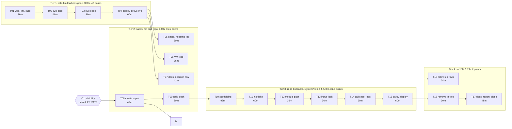

# SUPERB: ai-meter rate-limit relief and Forgejo extraction

**Created:** 2026-11-25 06:04 CET (`date`), boot `b4931451`, HEAD `dc4a8ee69`, branch in sync with origin, tree clean.
**EXECUTING (instance aimeter-exec-0621, 2026-11-25 06:22 CET, HEAD `07b83e5a1`):** executing (see AGENTS.md plan-execution tombstone)
**Status:** EXECUTING (tombstone line below; `scripts/plan-marker.sh <this file> done <instance>` closes it).
**Progress (instance aimeter-exec-0621, 2026-11-27 00:55 CET, SystemNix HEAD `23ed59f99` plus the docs commit after it, ai-meter `f2a21aa` on both remotes):** done in code and docs: T01–T03, T05 (PromQL guards; the Go suite runs in the repository's flake check and CI), T08, T09, T10, T11, T12, T13, T14, T16, T17 (docs; the data-ownership row is open), T07 (runbook section written; the `[decision]` row for the circuit is open). NOT done: **T04 and T15, the deploys.** `max_wait_seconds = 270` is committed (`0792bfa75`) and the host still runs the 30 s binary: every deploy attempt since 07:10 on 2026-11-26 was refused (exit 12, the pressure and guard-trip gates), and the last one demands `DEPLOY_FORCE_PRESSURE=2`, a token the owner has not given. T18 and the 24 h ledger measurement follow the deploy.
**Scope line:** two efforts the owner asked for in one session, in the order that pays soonest: (1) stop the z.ai rate-limit failures that kill Crush turns, (2) move ai-meter out of SystemNix into its own Forgejo repo with a GitHub twin.
**Related:** [v6 backlog masterplan](./2026-11-25_00-06_SUPERB-backlog-masterplan-v6.md) (queue shape), [status 2026-11-25 05:26](../status/2026-11-25_05-26_ai-meter-span-export-live-native-ai-observability-verified-dashboard-rewrite-not-started.md) (the parallel ai-meter work this plan builds on), [runbook](../services/ai-meter.md), [Forgejo runbook, canonical repos](../services/forgejo.md).

---

## 1. What was measured before this plan

Every number below comes from a command run in this session. The plan stands on them.

| Fact | Number | Source |
| --- | --- | --- |
| z.ai calls rejected with HTTP 429, 7 days | 27,649 of 163,158 (16.9%) | ledger `/var/lib/ai-meter/usage.jsonl`, 2026-11-18 04:07 to 2026-11-25 04:07 UTC |
| Rejection probability by calls already in flight | 1 to 4 in flight: 1 to 2%; 5: 3%; 6: 31%; 7 to 8: 6 to 8%; 9: 65%; 10: 78%; 11 and more: 82% and up | same ledger, sweep-line over call start and end times |
| What the 429 says | `Rate limit reached for requests` (z.ai code 1302, the concurrency class) | `.crush/logs` census: 7,504 retry events |
| What Crush does with it | retries after 5 s, 10 s, 20 s (4,253 / 2,421 / 1,491 events), then fails the turn | same logs, `fantasy` `DefaultRetryOptions` |
| Turns that died of it | 800, this project only, about 30 days | same logs, `retry error: too many requests` |
| The second 429 class | 55 distinct 5-hour quota lockouts in 30 days (`Usage limit reached for 5 hour`, code 1308); 35 lockouts of 20 or more calls in 14 days of ledger, 13 minutes to 7.6 hours long | same logs; ledger all-429 runs |
| Official limit | none published: "dynamically adjusts these limits based on resource availability", "Max > Pro > Lite" | docs.z.ai/devpack/usage-policy; the public z.ai/subscribe page rendered headlessly carries no rate row |
| Reset times in quota answers | printed without a zone, they are UTC+8 (two lockout ends in the ledger match the printed time plus 8 h) | logs against ledger |
| Crush HTTP timeout | none by default (openai-go `http.DefaultClient`, no request timeout) | module cache `openai-go` `requestconfig.go`, `fantasy` providers |
| Crush and `Retry-After` | honored when between 0 and 60 s | `fantasy/retry.go` |
| Processes on this host connected to z.ai outside the proxy, at probe time | `quotaboard` only; by its README it polls the quota endpoint, not the model API. A device elsewhere using the same key is invisible to this probe | `ss -tnp` against the z.ai addresses |
| Commits that touch `pkgs/ai-meter` | 31 | `git log --oneline -- pkgs/ai-meter` |

Two conclusions shape everything after:

1. The failures are a concurrency limit that nobody can configure against, so the proxy has to hold calls back until the upstream has room, and it has to learn the room from the rejections.
2. "Delay a bit" cannot fix the second class. A spent 5-hour quota stays spent until its reset; only pacing the credits across the window prevents it. That is a separate decision (section 3, D9).

## 2. What already exists in the tree

The admission control was built this session, before the plan. It is committed (auto-commit daemon) and green: `cd pkgs/ai-meter && go test -race -count=1 ./...` prints `ok`, 66 test functions.

| File | What it holds | State |
| --- | --- | --- |
| `pkgs/ai-meter/admission.go` (new) | `AdmissionSettings` (wire config), `AdmissionConfig` (validated), `classify` (reads the business code), `quotaReset` (reads the reset time), `Gate` (queue, allowance, quota circuit), `pending` (one call's budget, attempts, backoff) | done, 18 unit tests |
| `pkgs/ai-meter/proxy.go` | retry loop in `serveMetered`, `send`, `answer`, `replay`, `notAdmitted`, gates per upstream | done, proxy tests not yet extended |
| `pkgs/ai-meter/metrics.go`, `ledger.go`, `config.go`, `main.go` | new families, ledger fields, `admission` key on an upstream, header comment | done |
| `pkgs/ai-meter/admission_test.go` (new) | gate, pending, classify, config-load tests | done |
| `modules/nixos/services/ai-meter.nix` | no `admission` block yet | open (T01) |
| `tests/test-ai-meter.nix` | 13 subtests, none for admission | open (T06) |
| docs | nothing written | open (T07, T17) |

How it behaves, in one paragraph: a call to a gated upstream takes a slot or waits in arrival order (at most `max_concurrency` in flight). A 429 whose code is retryable (`1302`, `1305`) lowers the allowance by one and is retried by the proxy with jittered backoff (or the upstream's `Retry-After` up to 10 s), so the client never sees it. A 429 that names a reset time opens a circuit: later calls are answered with the upstream's own body and are not sent until the reset. Any other 429 passes through untouched. One call may wait at most `max_wait_seconds` in total; then it gets a 429 with `Retry-After: 1`, and the client's retry re-enters the queue with a whole new budget. With Crush's 4 attempts that is about 2 minutes of patience instead of 35 seconds.

## 3. Decisions

| # | Decision | Why |
| --- | --- | --- |
| D1 | Rate-limit fix first, extraction second | the fix is 85% built and the pain is live (every hour costs failed turns, including during the extraction work). Moving a finished, verified feature is safer than moving work in flight |
| D2 | Queue plus adaptive allowance, not a fixed number | z.ai publishes no number and moves it (rejections start between 5 and 9 in flight depending on the hour). The allowance starts at 8, drops to 2 at the lowest, grows back after 30 quiet seconds, and a failed probe doubles the wait before the next one |
| D3 | The proxy retries the 1302 class itself; the client sees only final answers | Crush gives up after 35 s; the proxy can wait longer and in the right queue position |
| D4 | Quota answers open a circuit instead of being retried | nothing passes before the reset; hammering the upstream in a lockout only adds risk (z.ai's usage policy counts violations) |
| D5 | Extraction moves the Go module and its tests only | the NixOS module, dashboard, gatus checks and VM test are SystemNix host wiring (sops paths, registry, ports). Moving them would be a rewrite with no gain |
| D6 | Forgejo is canonical, GitHub is the twin, both PRIVATE | the quotaboard precedent (push-to-create on Forgejo, private GitHub twin, push mirror from Forgejo). Owner may say otherwise (O1) |
| D7 | SystemNix consumes the repo as a floating `git+ssh` input | owner repos are never pinned (AGENTS.md rule) |
| D8 | History is kept with `git subtree split --prefix=pkgs/ai-meter` | 31 commits, cheap, and it rewrites nothing in SystemNix |
| D9 | No credit pacer in this plan | it changes how fast sessions run every day, it needs a calibrated budget, and it is the owner's call. The data and the proposal go into a `[decision]` row (T07) |
| D10 | The in-tree copy is deleted only after the input build is deployed and verified | "land the replacement before removing the old source" |
| D11 | No stack change: stdlib only stays | this is an extraction, not a new service. `STACK.md` records why the fleet default (go-appkit) is declined |
| D12 | CI lives in `.forgejo/workflows/`, not `.github/workflows/` | the Forgejo sync token lacks the `workflow` scope; a `.github/workflows` file would stall the push mirror (the `webphone-android` precedent in `platforms/nixos/system/configuration.nix`) |
| D13 | Wait budget 270 s, raised from 30 s on 2026-11-26 | owner direction ("set the timeout to like 5 minutes"). At 30 s, 4,454 of 10,535 ledger lines (42%) in the first 11 live hours were the proxy's budget answer. The budget has to end before the client's own clock: crush v0.102.0 abandons a stream with no first part within 5 minutes (`internal/agent/request_guard.go`), cvagent gives one extraction 300 s. 270 leaves 30 s for the time to first token (p99 20 s over 5,836 streamed calls). A literal 300 would race crush's clock |

## 4. Pareto breakdown

The plan is 810 minutes (13.5 h) in 18 tasks. The literal shares the template asks for (1% of work for 51% of result) were spent before this plan: about 6 hours of measurement and the gate itself. The tiers below keep the ordering rule and report what is measured, not the label.

Result model, 100 points, weights are judgment and stated so they can be challenged:

| Outcome | Weight |
| --- | ---: |
| R1 Rate-limit failures no longer reach Crush sessions | 40 |
| R2 Quota lockouts are cheap and clear, and their next step is decided | 6 |
| R3 Own repo: Forgejo canonical, history kept, GitHub twin, builds alone, registered | 24 |
| R4 SystemNix consumes the repo with parity and every gate intact | 18 |
| R5 Docs and backlog tell the truth afterwards | 8 |
| R6 Test and CI safety net (e2e, VM legs, negative legs, repo CI) | 4 |

| Tier | Tasks | Effort | Share of effort | Result | Cumulative result |
| --- | --- | ---: | ---: | ---: | ---: |
| 1: the first slice | T01 to T04 | 180 min | 22% | 46 | 46 |
| 2: the next slice | T05 to T09 | 180 min | 22% | 15.5 | 61.5 |
| 3: the main body | T10 to T15 | 348 min | 43% | 31.5 | 93 |
| 4: the rest, to 100 | T16 to T18 | 102 min | 13% | 7 | 100 |

The first three hours (22% of the effort) take the rate-limit failures out of every Crush session on this host.

## 5. Level 1: 18 tasks, 30 to 96 minutes each

Sorted by tier, then by what each task depends on. `Result/min` is the task's points divided by its minutes. T04 scores highest and still runs fourth: a deploy before its tests exist is how the last two weeks went.

| # | Task | Result | Effort | Result/min | Needs | Done when |
| --- | --- | ---: | ---: | ---: | --- | --- |
| T01 | Wire `admission` on the zai upstream; lint and race the module | 11 | 36 min | 0.31 | section 2 state | `nix eval` of the rendered config shows the block; `buildflow -s "golangci-lint [pkgs/ai-meter]"` prints 0 issues; `go test -race -count=3` green |
| T02 | Proxy e2e tests, core paths | 5 | 48 min | 0.10 | T01 | 4 tests green under race: queue within the allowance, absorb 1302, give up after the last retry, ungated pass-through with `Retry-After` |
| T03 | Proxy e2e tests, edge paths | 3 | 36 min | 0.08 | T02 | 3 tests green: wait budget, quota circuit, cancel and other limits |
| T04 | Deploy and prove it live | 27 | 60 min | 0.45 | T03 | journal shows `admission control enabled`; client-visible 429 share on zai far below the 16.9% baseline over 2 h; ledger carries `attempts` and `admission` |
| T05 | Flake gates and one new negative leg | 1 | 30 min | 0.03 | T04 | `nix fmt --fail-on-change` clean; `checks.ai-meter-guards` and `ai-meter-spend-promql` green; the aimeter group of `scripts/negative-test-lints.sh` green with the new leg |
| T06 | VM test legs for admission | 0.5 | 36 min | 0.01 | T04 | `nix build .#checks.x86_64-linux.ai-meter-vm -L` green with 2 new subtests; a neutered retry loop turns one red |
| T07 | Admission docs and the decision row | 6 | 42 min | 0.14 | T04 | runbook section, CHANGELOG entry, domain terms, `[decision]` row for the credit pacer, alert-rule row |
| T08 | Create the repos and register them | 6 | 42 min | 0.14 | O1 | `gh repo view LarsArtmann/ai-meter --json visibility` says PRIVATE; `ai-meter` is in `forgejo.canonicalRepos`; `meta get --project ai-meter` lists tags |
| T09 | Split the history and push | 2 | 30 min | 0.07 | T08 | split has 31 commits; tree at its tip equals `HEAD:pkgs/ai-meter`; `main` is on both remotes |
| T10 | Repo scaffolding | 8 | 96 min | 0.08 | T09 | LICENSE, README, AGENTS.md, STACK.md (drift check exit 0), CHANGELOG, FEATURES, ROADMAP, TODO_LIST, CONTRIBUTING, SECURITY, tooling files, domain language |
| T11 | Nix flake in the repo | 5 | 60 min | 0.08 | T10 | `nix build .#ai-meter`, `nix flake check`, `nix fmt` and `buildflow --build-mode dev` green in the new repo |
| T12 | Module path, tree cleanup, parity smoke | 3 | 36 min | 0.08 | T11 | `go.mod` reads `github.com/LarsArtmann/ai-meter`; no build artifacts tracked; both builds expose the same metric families |
| T13 | SystemNix input and lock | 2 | 36 min | 0.06 | T12 | lock node rev equals the pushed tip; lock-audit and pin-audit pass; toplevel evals |
| T14 | Switch the call sites; negative legs on a copy | 6.5 | 60 min | 0.11 | T13 | module, packages.nix, VM test and the guards check build from the input; both mutated legs fail, controls pass |
| T15 | Parity proof, deploy, live proof | 7 | 60 min | 0.12 | T14 | old and new derivation pass the same VM subtests; deployed unit serves traffic; the binary's closure references the input source |
| T16 | Remove the in-tree source and fix path references | 1.5 | 30 min | 0.05 | T15 | `pkgs/ai-meter/` gone; `rg 'pkgs/ai-meter'` returns history only; queue rows and library rows agree |
| T17 | SystemNix docs, status report, close | 4.5 | 48 min | 0.09 | T16 | runbook, data-ownership row, CHANGELOG, status report with its follow-ups harvested; plan marker flipped to EXECUTED |
| T18 | Queue the follow-ups | 1 | 24 min | 0.04 | T07 | rows for the CI deploy key, the toolchain floor and the release cut exist in the right files |

Sums: 180 + 180 + 348 + 102 = 810 minutes.

### What each task contains

- **T01** puts this block on the zai upstream of `modules/nixos/services/ai-meter.nix` (re-read the file first, two other sessions edited it tonight):

  ```nix
  admission = {
    max_concurrency = 8;
    min_concurrency = 2;
    max_wait_seconds = 30;
    max_retries = 6;
    grow_after_seconds = 30;
    retryable_codes = [ "1302" "1305" ];
    quota_codes = [ "1308" "1310" "1316" "1317" "1318" "1319" "1320" "1321" ];
    quota_reset_utc_offset_hours = 8;
  };
  ```

  with a comment that carries the table in section 1. 8 is below the 9-in-flight cliff; 2 keeps one probing call alive when the upstream is throttling hard; 30 s stays inside any 60 s client header timeout and, with Crush's four attempts, gives about 2 minutes.
- **T04** deploys through the house protocol: capture-once `nix flake check --no-build`, the existing VM test, `scripts/deploy-when-quiescent.sh --fire`, then the anchor check (`readlink /run/current-system` equals the newest `system-N-link`). The restart of ai-meter cuts calls in flight for every session; fire it between turns.
- **T08** follows the quotaboard precedent exactly: SSH push-to-create on `forgejo@evo-x2.home.lan:lars/ai-meter.git` (private by default), `gh repo create LarsArtmann/ai-meter --private`, entry in `platforms/nixos/system/configuration.nix` `forgejo.canonicalRepos` with its comment (phase 5 of the Forgejo sync attaches the push mirror on the next deploy), `meta set --project ai-meter` with tags `go, http, proxy, ai, metrics, tool, app`.
- **T14** is the one place where the extraction removes an ability: two negative legs (`go-formula-drifted`, `replay-neutered`) sed-mutate `pkgs/ai-meter/*.go` in place. A flake input is a read-only store path, so the legs must copy the source into a derivation and mutate the copy. Deleting the legs instead would be a quiet loss of two gates.
- **T16** uses `trash`, never `rm`, and stages the deletions with `git add -A pkgs/ai-meter`.

## 6. Level 2: 70 micro-tasks, 12 minutes or less each

Each task's minutes are the exact sum of its micro-tasks. A micro-task is laid out as: check the premise, do, verify, record.

| ID | Micro-task | Min | Verify |
| --- | --- | ---: | --- |
| T01.1 | Re-read the module (it changed tonight), add the `admission` block and its comment on the zai upstream | 12 | `git diff` shows one block |
| T01.2 | `nix eval` the rendered config through a throwaway `extendModules` expression (never force-enable in the tree) and compare the block with section 5 | 12 | JSON equals the block |
| T01.3 | Lint and race: `buildflow -s "golangci-lint [pkgs/ai-meter]"`, `go test -race -count=3 ./...`, `gofmt -l` on touched files | 12 | 0 issues, 3 green runs, no file listed |
| T02.1 | Gated test stack helper; queue test: 6 calls against a blocking upstream with allowance 2 | 12 | upstream peak is 2, all 200, wait count is 4 |
| T02.2 | Absorb test: first answer 429 `1302`, then 200 | 12 | client 200; ledger `attempts 2`, `admission absorbed`; rejection series 1 |
| T02.3 | Give-up test: always `1302`, `max_retries 2` | 12 | upstream body verbatim, `attempts 3`, `gave_up`, one client 429 |
| T02.4 | Ungated and `Retry-After`: ungated 429 passes through with `upstream_code`; `Retry-After: 1` honored, `11` deferred; streamed error records `ttft_ms -1` | 12 | 3 assertions green |
| T03.1 | Budget test: slot held, `max_wait_seconds 1` | 12 | 429, `Retry-After: 1`, `timeout`, `attempts 0` |
| T03.2 | Circuit test: `1308` with a reset 1 h ahead, twice | 12 | second call not sent (upstream calls stay 1), `Retry-After` about 3600, `quota_exhausted 1` |
| T03.3 | Cancel and other limits: cancelled queued call; `1113` and `1313` | 12 | `499` and `cancelled`, no slot leak; other limits pass through at 1 attempt |
| T04.1 | Pre-deploy: `nix flake check --no-build 2>&1 \| tee ~/.cache/aimeter/fc.log`, existing VM test, `scripts/pre-deploy-check.sh` | 12 | all exit 0 |
| T04.2 | Deploy window: tree clean and quiescent, `scripts/deploy-when-quiescent.sh --fire`, read `/var/log/systemnix-deploys/<ts>.log` | 12 | exit 0, `deploy exited code=0` |
| T04.3 | Anchor and unit: `readlink /run/current-system` is the newest `system-N-link`; `journalctl -u ai-meter --since <deploy time>` | 12 | `admission control enabled` with `max_concurrency 8` |
| T04.4 | Metrics after 15 minutes from `:8108/metrics` | 12 | limit, inflight, waiting, outcomes, rejections present |
| T04.5 | Proof over 2 hours: client-visible 429 share on zai, Crush WARN retry rate, ledger fields | 12 | share far below 16.9%; numbers recorded |
| T05.1 | `nix fmt -- <touched nix files>` then `--fail-on-change` | 12 | clean; `git status` shows only intended files |
| T05.2 | `checks.ai-meter-guards` and `checks.ai-meter-spend-promql` | 9 | both build |
| T05.3 | New negative leg: config without `retryable_codes` must fail at load; run the aimeter group | 9 | leg fails as specified, controls pass |
| T06.1 | VM test: add a gated fake upstream that answers 429 above 1 in flight | 12 | VM evals |
| T06.2 | Two subtests: queued calls all 200 with upstream peak 1; an absorbed 429 never reaches the client | 12 | both pass |
| T06.3 | Run the VM; then neuter the retry loop in a copy and run again | 12 | first green, second red on the new subtest |
| T07.1 | Runbook: section "Admission control" (what, why, knobs, how to read the new families, traps); extend the metrics and ledger lists | 12 | a reader can answer "why is my call waiting" |
| T07.2 | CHANGELOG entry; `docs/DOMAIN_LANGUAGE.md` terms: admission control, allowance, absorbed, quota circuit | 12 | terms linked from the runbook |
| T07.3 | `docs/todo/ai-stack.md` `[decision]` row for the credit pacer with the 55-lockout number; `docs/todo/monitoring.md` row for an alert on `gave_up` and `timeout` | 9 | both rows carry a `**Source:**` pointer |
| T07.4 | Hand-off note in the runbook for the pending dashboard rewrite: panels for the admission families (do not edit the dashboard JSON, another session owns it) | 9 | note names the families |
| T08.1 | Premises: `gh auth status`, `ssh -T forgejo@evo-x2.home.lan`, name free on both hosts, O1 answered (default PRIVATE) | 12 | all four recorded |
| T08.2 | Create: push-to-create on Forgejo with an empty initial commit, `gh repo create LarsArtmann/ai-meter --private` | 12 | `--json visibility` PRIVATE |
| T08.3 | Add `ai-meter` to `forgejo.canonicalRepos` in `platforms/nixos/system/configuration.nix` with a comment | 9 | entry present |
| T08.4 | `meta set --project ai-meter` with tags and importance 60 | 9 | `meta get` shows them |
| T09.1 | At a quiet IO moment: `git subtree split --prefix=pkgs/ai-meter -b ai-meter-history` | 12 | branch exists |
| T09.2 | Verify the split: commit count, tree at tip against `git archive HEAD:pkgs/ai-meter` | 9 | 31 commits, empty diff |
| T09.3 | Clone to `~/projects/ai-meter` from the split ref, remotes `origin` (Forgejo) and `github`, push `main` to both | 9 | both remotes at the same rev |
| T10.1 | LICENSE (MIT, quotaboard text), `.gitignore`, `.gitattributes`, `.editorconfig` | 12 | `git status` clean after a build |
| T10.2 | README: what it is, config schema, quick start, build and test | 12 | a newcomer can run it from the README alone |
| T10.3 | AGENTS.md: architecture, the four contracts (transparent proxy, facts-only ledger, admission doctrine, span export), commands | 12 | every claim checked against code |
| T10.4 | STACK.md from the stack-selection template; run `stack-drift-check.sh` | 12 | exit 0 |
| T10.5 | CHANGELOG (import entry plus the admission feature), FEATURES.md, ROADMAP.md | 12 | files exist and agree |
| T10.6 | TODO_LIST with the ported rows (ledger report consumer, 502 on client abort), CONTRIBUTING, SECURITY | 12 | rows carry sources |
| T10.7 | Tooling: `.buildflow.yml`, `.golangci.yml`, `dprint.json`, `.github/dependabot.yml`, `.forgejo/workflows/ci.yml` | 12 | CI file names build, vet, `go test -race`, `nix build` |
| T10.8 | `docs/DOMAIN_LANGUAGE.md` and an inception note in `docs/status/` naming the SystemNix rev | 12 | note cites `dc4a8ee69` or later |
| T11.1 | `flake.nix` in the quotaboard shape: `nixpkgs` and `treefmt-nix` only, systems list, `forAllSystems`, treefmt | 12 | `nix flake show` lists outputs |
| T11.2 | `nix/package.nix`: `buildGoModule`, `vendorHash = null`, version `shortRev or "dev"`, same ldflags, `doCheck = false` | 12 | `nix build .#ai-meter` |
| T11.3 | `nix/checks.nix`: build, vet, `go test -race`, gofmt check; devShell with go and buildflow | 12 | `nix flake check` green |
| T11.4 | `nix flake lock`; treefmt with nixfmt and gofmt; `nix fmt --fail-on-change` | 12 | lock committed, format clean |
| T11.5 | `buildflow --build-mode dev` in the new repo; commit; push both remotes | 12 | green run, remotes equal |
| T12.1 | Module path to `github.com/LarsArtmann/ai-meter`; build, vet, race test | 12 | green |
| T12.2 | Remove build artifacts from the new repo (binary, `reports/coverage.out`); ignore rules cover them | 12 | `git ls-files` lists none |
| T12.3 | Parity smoke: run both builds on a fixture config; compare the family names of `/metrics` | 12 | identical list |
| T13.1 | Input block in `flake.nix` with the doctrine comment; follows for `nixpkgs` and `treefmt-nix` | 12 | block matches quotaboard's |
| T13.2 | `nix flake update ai-meter` (the modern form; `--update-input` is a silent no-op here); read the node with python3 | 12 | node rev equals the pushed tip |
| T13.3 | Eval the toplevel drvPath; confirm lock-audit and pin-audit pass | 12 | one drvPath, no eval error |
| T14.1 | Module takes `{ inputs, ... }` and builds with the input source as `src`; `flake/parts/packages.nix` call site | 12 | `nix build .#ai-meter` |
| T14.2 | `tests/test-ai-meter.nix` call site; `flake/parts/checks/ai-meter-guards.nix` copies from the input | 12 | both build |
| T14.3 | Rework `go-formula-drifted` and `replay-neutered` to mutate a copy inside a derivation | 12 | neither touches a store path |
| T14.4 | Run the aimeter group of the negative harness | 12 | every leg fails as before, controls pass |
| T14.5 | `nix flake check --no-build` and the VM test on the input build | 12 | both green |
| T15.1 | Parity: old and new derivation side by side, same VM subtests, same `-help` and version string | 12 | table recorded |
| T15.2 | Pre-deploy gates, quiescence, `deploy-when-quiescent.sh --fire` | 12 | exit 0 |
| T15.3 | Anchor, unit start, startup lines (admission, span export) | 12 | same lines as T04.3 |
| T15.4 | Live 15 minutes: requests, spans exported, ledger appends, gatus checks | 12 | all moving, all green |
| T15.5 | Provenance: `nix-store -q --references` on the deployed binary names the input source | 12 | the input's store path is in the list |
| T16.1 | `trash pkgs/ai-meter`, stage with `git add -A pkgs/ai-meter`; keep `pkgs/ai-meter.nix` only if a call site still needs it | 12 | directory gone, evals still pass |
| T16.2 | Comments that name `pkgs/ai-meter`: module, `signoz-coverage.nix`, `_ai-meter-dashboard.nix`, `packages.nix`, `pkgs/ai-meter.nix` header | 9 | `rg 'pkgs/ai-meter'` hits history and planning only |
| T16.3 | Queue rows 1634, 2593, 3005, 3043 and their library twins: re-point or tick with evidence, both surfaces | 9 | no queue-library drift |
| T17.1 | Runbook header and build/test sections: repo, flake commands, how SystemNix consumes it | 12 | no stale "in-tree" claim |
| T17.2 | CHANGELOG entry; `docs/agents/data-ownership.md` row for the new canonical repo; AGENTS.md note where in-tree packages are described | 12 | three edits landed |
| T17.3 | Status report in `docs/status/` with an evidence table; harvest its own follow-ups | 12 | report and rows exist |
| T17.4 | Final regression: `nix flake check --no-build`, anchor, gatus; `scripts/plan-marker.sh <plan> done` | 12 | marker reads EXECUTED |
| T18.1 | Queue row: add an `ai-meter` read-only deploy key to `NIX_DEPLOY_KEYS_BUNDLE` (CI is red today for other reasons; `[blocked:user]` if the secret needs the owner) | 12 | row in TODO_LIST and the library |
| T18.2 | Queue rows: toolchain floor alignment (optional), release cut `v0.2.0` (owner's call) | 12 | rows in the library |

## 7. Execution graph



Tier 1 and the repo lane of Tier 2 (T08, T09) do not depend on each other; one session can run Tier 1 while another creates the repo.

## 8. Owner gates

| # | Gate | Where it bites | Default if unanswered |
| --- | --- | --- | --- |
| O1 | Visibility of the Forgejo repo and the GitHub twin | T08.2 | PRIVATE, the quotaboard precedent; reversible later |
| O2 | Credit pacer for the 5-hour quota | outside this plan | the `[decision]` row from T07.3 |
| O3 | Cut `v0.2.0` after the extraction | after T15 | no tag; SystemNix floats `master` |

No owner action is needed for the push mirror. Its credential is the sops `GITHUB_TOKEN` with the `repo` scope, which covers every private repo of the owner (docs/services/forgejo.md, "Staged-primary"); the one constraint is D12.

## 9. Guardrails

1. The proxy stays transparent by contract: only a 429 that arrives before any byte reached the client is retried, and only for a gated upstream.
2. Never pin the `ai-meter` input. A broken tip is fixed in the repo and the input is floated again.
3. `pkgs/ai-meter/` is not deleted before T15 is deployed and proven (D10).
4. The two negative legs are reworked, not deleted (T14.3).
5. Deploys go through `scripts/deploy-when-quiescent.sh --fire`; no manual `switch-to-configuration`.
6. Commits use a pathspec; the auto-commit daemon batches other sessions' files. Before any amend: `git show --stat HEAD` and `git log -1`.
7. `nix flake update <input>`, never `nix flake lock --update-input` (silent no-op on this nix). Read the lock with python3 or grep, never with a jq file argument in a direnv shell.
8. Heavy evals are captured once (`tee ~/.cache/aimeter/fc.log`) and grepped from the file.
9. No `.github/workflows/` in the new repo (D12).
10. The quota class is not claimed fixed. T04's success is measured on the 1302 class; the 1308 class keeps failing turns until O2 is decided.
11. The dashboard JSON and `_ai-meter-dashboard.nix` belong to the session doing the dashboard rewrite; this plan leaves them alone and hands over a list of families (T07.4).
12. Nothing in the new repo needs a secret: client keys are minted at runtime, upstream keys live in SystemNix sops.

## 10. Rollback

| Change | Undo |
| --- | --- |
| Admission control live | delete the `admission` block from the module and deploy; the proxy is then byte-for-byte its old behavior for that upstream |
| Pushed input with a broken tip | `nix flake lock --override-input ai-meter git+ssh://git@github.com/LarsArtmann/ai-meter?ref=refs/heads/master&rev=<last good>` for the duration of the upstream fix, then float again |
| SystemNix on the input | revert the T13 and T14 commits while `pkgs/ai-meter/` still exists (before T16); after T16, revert T16 as well |
| New repo | private repos can be deleted or made private again; the history branch `ai-meter-history` also stays in SystemNix until T17 |

## 11. Errata and backlog

Found while preparing, not changed here (this file is additive):

- `pkgs/ai-meter.nix` says "homelab-specific infrastructure, deliberately NOT a separate LarsArtmann repo". Superseded by the owner's direction of 2026-11-25; T16.2 rewrites it.
- TODO_LIST rows 1634 (ledger report consumer), 2593 (golangci-lint pass), 3005 (junk audit), 3043 (502 on client abort) name `pkgs/ai-meter/...`. They move with the code (T16.3). Row 2593 may already be done: the 05:26 status report records `0 issues` from a real lint run; tick it only after re-running the lint in T01.3.
- No row existed for the rate-limit problem or the extraction; both start here.
- The T01 block (section 5) and the comment it asked for were written for a 30 s budget. D13 raised it to 270 s on 2026-11-26; the module comment carries the reasoning.
- Section 1's row "Crush HTTP timeout: none by default" is true for the HTTP client and incomplete: crush v0.102.0 wraps every model call in a request guard whose stream watchdog gives up after 5 minutes without a first part (`internal/agent/request_guard.go`, `defaultFirstPartTimeout`; `options.request_timeout` is unset here, so the 2-minute `DefaultRequestTimeout` applies only to non-streaming calls). Found 2026-11-26 while setting D13.
- `usage_test.go` is unformatted since 2026-11-11 (not this session's file). It gets formatted with the first `nix fmt` in the new repo (T11.4).

Harvest at execution time, not now: T18.1 and T18.2 are the only tasks that should become `[ready]` queue rows; everything else is done inline by the executor, and adding it to the queue now would send a second session into the same files.

- **2026-11-26 17:27, T04's done bar was wrong for this host.** "Client-visible 429 share on zai far below 16.9%" is met by a count that includes the proxy's own budget answer; at 30 s that answer was 42% of z.ai lines (4,454 of 10,535, 2026-11-25 18:36Z to 2026-11-26 05:54Z). The measure that matters is budget answers per call and failed client turns; D13 sets the budget to 270 s.
- **2026-11-27 00:55, T14 deviates from its micro-tasks.** The two negative legs that edited Go sources (`go-formula-drifted`, `replay-neutered`) were removed, not reworked to mutate a copy: the Go source is a locked store path the harness cannot edit. The `aimeter` group has 13 legs, all passing in the repointed tree. The Go price fixture stays pinned by the repository's `TestEstimateCost`, which `checks.ai-meter-spend-promql` runs from the input.
- **2026-11-27 00:55, T16 ran before T15.** The in-tree copy is removed although the input-built binary was never run on the host. Reason: after T14 no evaluation reads the copy, and two sources invite a fix landing in the dead one. The host keeps its current generation until the deploy; rollback is `git revert 23ed59f99`.

## 12. Done bar for the whole plan

- `cd pkgs/ai-meter` no longer exists; `rg 'pkgs/ai-meter'` returns history and planning files only.
- `~/projects/ai-meter` builds, tests and formats on its own; `main` is on Forgejo and GitHub.
- SystemNix's `ai-meter` derivation takes its source from the input; the VM test, the guards check and the negative legs pass.
- The deployed proxy answers `admission control enabled`, and a two-hour window shows the client-visible 429 share on zai far below 16.9%.
- Runbook, CHANGELOG, domain language and status report say all of this, with the commands that proved it.
