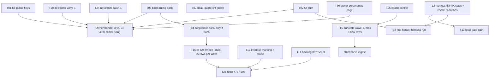

# Planning Run, Interrupted Before Writing: The Queue Tripled by One Day's Bulk Harvest (2026-11-07), the Live Masterplan Is v5, and v6 Is Designed but Not on Disk

**2026-11-24 23:38 CET · Crush agent (GLM-5.4) · trigger: owner ask "full status update, then WAIT HERE" during the planning task (Pareto plan over all TODOs, plan file with graph, commit, push)**

---

## Scope

**Verified here** (fresh commands between 22:45 and 23:38 CET; tree pinned at `8e3d7da`, the daemon commit of 22:44 that swept the 22:33 report):

- **Masterplan lineage**: `git log --since=2026-11-07 --oneline | grep -i -E 'superb-v3|masterplan'`, `git show --stat 06667fd c95aa40`, `ls docs/planning | grep -i masterplan`, and the files read: v3 (3,656 lines), v5 (181 lines, read in full), v4 by commit message only.
- **Queue inflow by day**: python over the cached `git log -p --unified=0` dump of `TODO_LIST.md` + `docs/todo/*.md` (the same dump the 22:33 report used; 3,419 `[ready]` add events since 2026-09-19).
- **The 2026-11-07 block**: titles of rows added to `TODO_LIST.md` on that day, matched by title against the current open rows.
- **Attribution**: commit list for 2026-11-07 on `TODO_LIST.md` (88 commits) and the heads of three status reports of that day (`2026-11-07_07-17_crowdsec-hm-recovery-t03-harvest-status.md`, `2026-11-07_09-14_t03-harvest-waves-2-4-provider-collapse-status.md`, `2026-11-07_18-35_t03-complete-zero-unharvested-status.md`).
- **Gate counts**: `scripts/check-todo-system.sh` at 23:29 (rc=0): 133 queue/library drifts, 101 unharvested §f reports.
- **Queue tag census**: `grep -oE '^- \[ \] \[[a-z:]+\]' TODO_LIST.md | sort | uniq -c`.
- **Premise re-checks**: unit file `/etc/systemd/system/audiblesync-backup-dir.service` (capability lines), `stat` of the two directories, `busctl … ListUnitsFiltered as 1 failed`, journal tails for `audiblesync-backup-dir` and `rust-cache-gc`, restart count for `tq-agent-pool` since 22:30.
- **Task-site reads** (for the plan's micro-steps): the 4 `dead-guard-lint` capture lines, `scripts/negative-test-lints.sh` (`run_case`, `apply_mutations`, controls loop, the literal lines `:779`, `:845`, `:847`, `:851`), `scripts/check-todo-system.sh` (`check`, `selftest`, `duplicate_check`, `scan_file`, `pairing_check`, `harvest_check`, dispatch), the section headers of `TODO_LIST.md`.
- **Skills read**: `pareto-planning`, `docs-health` (HARVEST section) and its harvest guide.

**NOT verified here** (and why):

- Whether v5's other 25 tasks shipped. Evidence is commit-title grep only (12 patterns). No row-level or code-level verification was done for them.
- Whether v5 has an active executor. Its header carries no tombstone line; nothing says whether a session is on it.
- Why `audiblesync-backup-dir` succeeded before the 21:33 switch and fails after. The cause of the failure is identified; the change that introduced it is not.
- Which module owns the `audiblesync-backup-dir` unit (upstream `audiblesync` module or the fleet wrapper).
- `rust-cache-gc`: no journal entries since 22:00 means "not retried yet" or "fixed"; which one is unknown.
- Everything from the 22:33 report that this run did not re-check (CI state, key status, `dead-guard-lint` build). The four capture lines were re-read, the check was not rebuilt.
- The v6 numbers (tasks, minutes, result points) are a design, not a measurement: effort estimates and the outcome weights are judgment, stated so they can be challenged.

---

## Verdict

The planning task is one third done: research finished, the plan is designed in full (27 tasks, 133 micro-tasks, 1,560 minutes) but no plan file exists. The research overturned my own 22:33 diagnosis: the backlog did not grow because sessions add a few rows each. It tripled because one day, 2026-11-07, added 1,538 rows to the queue in a single bulk harvest, and 1,509 of them are still open. Nothing in the repo was changed by this run other than this report. Nothing was committed or pushed by me.

---

## 0) Self-Critique (what I forgot, could have done better, can still improve)

### Forgot, or got wrong

1. **The 22:33 report's cause is wrong.** It says the backlog grows because "every rule pushes sessions to add rows". Measured now, one day explains most of it: 2026-11-07 added 1,538 rows; the weeks around it added 222 and 284. The organic inflow is real but small (183 to 284 ready-line adds per week). The corrected surfaces are the 22:33 report §d.1 and my chat answer of that hour. The 22:33 report is NOT annotated yet (WAIT instruction); the correction text is §d.1 below.
2. **"Latest plan" was wrong for about 15 tool calls.** I took v3 for the newest plan because `ls -t` put it first (newest mtime). v4 (2026-11-05) and v5 (2026-11-07) exist and supersede it. I found them through a commit-title grep, not by looking for them. The next plan is v6, not v4.
3. **Scope assumption.** I first read "include ALL TODOs" as this session's 28 items. The repo's own precedent (v1 to v5) is the whole backlog, by lanes.
4. **A `nix build` without a PSI check.** At about 22:30 I built one check (seconds, small) on a box whose calm-gate had refused at 21:46. I did not look at `/proc/pressure` first. The habit is wrong even when the build is small.
5. **The 22:33 report was swept by the daemon** into `8e3d7da` under a heuristic message ("chore: auto-commit 4 changed file(s)"). I did not see that coming and have no detailed commit for it.

### Could have done better

6. **Cut the flow by day first.** The per-day table that exposes the spike is one command over the dump I already had. I ran it last, after building a theory.
7. **Find plans by commit date, not mtime.** `ls docs/planning | grep masterplan` plus `git log` would have shown v5 in the first minute.
8. **Persist earlier.** About 50 minutes of research and design existed only in this conversation until this report. A 10-line checkpoint file under `~/.cache` after the lineage read would have cost nothing.

### Can still improve (open work)

9. Write plan v6 with its graph; build the generator so every table is arithmetic-checked instead of hand-assembled.
10. Errata for v5 by evidence, not by commit titles.
11. Reconcile the harvest of this session's 19 new items with the finding that harvesting is what inflated the queue (question 3).

---

## a) FULLY DONE

All read-only. No file in the repo was created or edited in this run other than this report.

1. **Masterplan lineage identified.** v1 (`2026-10-23_09-53`), v2 (`2026-10-23_15-00`), v3 (`2026-11-03_17-10`, all 2,092 open rows enumerated), v4 (`2026-11-05_17-32`, commit `06667fd`, 27 tasks + 96 micro-tasks), v5 (`2026-11-07_04-12`, commit `c95aa40`, 27 tasks + 96 micro-tasks). Evidence: file names, commit stats.
2. **The 2026-11-07 bulk harvest measured and attributed** (§d.1).
3. **Steady-state inflow measured** (§d.1, weekly table).
4. **Metric regrowth measured**: unharvested §f reports 203 (v5, 11-07 04:12) → 0 (11-07 18:35) → 101 (gate run 23:29); pairing drift 68 (v5) → 133.
5. **Queue file contract violation measured** (§d.3).
6. **Premise re-checks for the live failures** (§b item 4, §d.4).
7. **Task sites read**, so the plan's micro-steps name real lines (Scope).
8. **v6 design complete**: Appendix A (Pareto ladder, result model, 27 tasks, 133 micro-tasks).

---

## b) PARTIALLY DONE

1. **The planning task.** Done: research (step 1), Pareto ladder, 27 tasks, 133 micro-tasks, result model. Open: generator, plan file with mermaid graph, errata table in the plan, commit, push, table report in chat. Effort: M. Blocker: WAIT instruction.
2. **Errata vs v5.** Done: the deploy item (17 matching commit titles since 11-07; gen-1028 live per the 22:38 report) and the harvest item (three reports of 11-07). Open: the other 25 tasks, commit-title evidence only. Effort: M. Blocker: none, not attempted.
3. **The 4 `dead-guard-lint` captures.** Done: content read, rescue shape chosen per site (`modules/nixos/services/cv.nix` `expiry=` and `d=`; `modules/nixos/services/journal-import.nix` `MAPPED=`; `modules/nixos/services/rust-cache.nix` `pct=`; the three files were clean in `git status` at 23:05). Open: fix not applied, check not rebuilt. Effort: S. Blocker: sibling sessions edit `cv.nix` and `rust-cache.nix`; needs a quiet window.
4. **`audiblesync-backup-dir.service`.** Done: root cause identified (§d.4), still failing at 22:33:49, no row in the TODO corpus. Open: owning module not located, no fix, no row. Effort: S. Blocker: none, not attempted.

---

## c) NOT STARTED

1. `docs/planning/<date>_SUPERB-backlog-masterplan-v6.md` and its generator (the design is in Appendix A).
2. Harvest of the 19 new items from the 22:33 report into the queue and the libraries, with a ledger.
3. The correction appendix for the 22:33 report.
4. A note on v3's tombstone (§d.5).
5. Commit and push from the earlier instruction. `master` is 1 commit ahead of `origin/master` (`8e3d7da`, the daemon commit).
6. Execution of any of the 27 plan tasks.

---

## d) TOTALLY FUCKED UP

### 1. One day's bulk harvest is 43% of the open queue, and it is 98% untouched

Severity: high. It is the real backlog problem, and it was caused by executing a plan item as written.

| Measure | Value | Source |
| --- | --- | --- |
| Rows added to `TODO_LIST.md` on 2026-11-07 | 1,538 distinct open rows (1,114 `[ready]` add events) | diff dump by commit date |
| Share of the dated ones from reports 7+ days old | 802 of 1,096 (73%) | first `docs/status/<date>` in the row vs commit date |
| Still open in the queue now | 1,509 (43% of the 3,540 open queue rows) | title match against the current file |
| Closed since | 26 (1.7% in 17 days) | same |
| Still-open block by source month | Sep 195 · Oct 895 · Nov 402 · no date 17 | same |
| Queue `[ready]` before, per v5 (11-07 04:12) | 1,082 | v5 header |
| Queue `[ready]` now | 2,436 | census 23:38 |

Ready-line adds per week (Mon): week of 10-26: 222 · 11-02: 1,350 · 11-09: 284 · 11-16: 183 · 11-23 (2 days): 93. Since 2026-09-19: 3,419 ready add events, 34% from reports 7+ days old, 12% from reports 30+ days old.

Root cause (attribution by the reports' own words): v5's 1% move V3 / tasks T03 and T04 ("drain the unharvested-§f backlog, month-batched harvest-or-annotate waves") were executed on 11-07 as harvest, not annotate. The 18:35 report states it: "T03 HARVEST COMPLETE: unharvested §f backlog 203 → 0 … ~1050 rows minted this session". The session ran under the owner's standing directive "the whole TODO list, verified". Mitigation: none today. The lever is one ruling plus one scripted pass (Appendix A, T03 and T04), not 1,509 sprints.

The metric it served has regrown: 0 on 11-07 18:35, 101 at 23:29 (+6 per day).

**Correction to the 22:33 report, §d.1:** its counts stand (660 → 7,614 open rows, +4,369 in 30 days); its stated cause ("every rule pushes sessions to add rows") does not. The correct statement: a single bulk harvest on 2026-11-07 accounts for roughly 1,500 of the queue's rows; the organic inflow is 26 to 40 ready-line adds per day net of nothing being closed at scale.

### 2. The unharvested-§f gate rewards the wrong behavior

Severity: medium. A report counts as "harvested" when its items are rows or when it carries a marker. Rowing 203 reports dropped the WARN from 203 to 0 and cost 1,538 rows; annotating them would have cost zero rows. Nothing in the gate distinguishes the two. Mitigation: none; proposed in §e item 2.

### 3. The queue file is not a queue

Severity: medium. Its header says blocked, watch and decision items "are deliberately NOT here". The file held 3,540 open rows at 23:10. The 23:38 census classifies 3,459 of them: 2,436 `[ready]`, 279 `[decision]`, 183 `[watch]`, 156 `[blocked:user]`, 37 `[blocked:deploy]`, 36 `[blocked:push]`, and 332 untagged rows of the `**Title** →` shape. The remaining roughly 80 open rows have a shape I did not classify. Root cause: not researched (append-time routing). Mitigation: the pool filters by tag.

### 4. `audiblesync-backup-dir.service`: cause identified, still failing, unqueued

Severity: high for the AudibleSync backup path (unverified whether `audiblesync-backup` depends on it). The unit runs `User=root` with `CapabilityBoundingSet=` (empty) and `ProtectSystem=full`. `/mnt/pool/backups/audiblesync` is `audible-sync:audible-sync 0755`. Root without `CAP_FOWNER` cannot `chmod` a directory it does not own: "Operation not permitted", failing since 21:36:57, last failure 22:33:49. This is the class in `docs/agents/systemd.md:20` (ambient capabilities grant, the bounding set only limits). Mitigation: none. Not in the TODO corpus (0 mentions at 22:3x).

### 5. Plan tombstones are stale or missing

Severity: low, but it defeats the twin-executor guard. v3 has read `EXECUTING (instance superb-v3-exec-1, 2026-11-03 17:33 CET, HEAD 7241d5d7)` for 21 days with no `EXECUTED` flip. v4 and v5 carry no tombstone at all, although v5's T03 and T04 were executed the same day. Mitigation: none.

### 6. Unchanged since the 22:33 report, not re-verified here

Public keys unrotated (by the repo's row); 4 of 5 CI workflows with zero green runs in retained history; `dead-guard-lint` red on master; `tq-agent-pool` restarts (0 since 22:30, 87 on 11-23 and 11-24 together).

---

## e) WHAT WE SHOULD IMPROVE

1. **Rule on the 11-07 block first.** Impact: 43% of the queue with one decision. Fix: a ruling pack (keep as is / re-park to the libraries with a non-dispatch tag / re-park and annotate), then one scripted pass with dry-run default and gate counts before and after.
2. **Intake control at both ends.** Impact: stops a repeat. Fix: old reports get a harvest marker (annotate), new rows only for new and critical items; a commit-time guard that refuses more than 50 added queue rows unless the owner exports an override; a size ratchet that is WARN by default (a strict default would freeze every session, the 2026-11-10 class); strict harvest gate only after the 101 are annotated.
3. **Plan lineage hygiene.** Impact: no more v3-style stale "executing". Fix: one `Supersedes` line per plan, flip tombstones to `EXECUTED` when an execution session ends, and find plans by commit date.
4. **The 22:33 list stands**: owner keys and CI auth (minutes), `dead-guard-lint`, harness signal, liveness marking, local gate path.
5. **PSI check before any nix command** in an agent session, written into my own procedure; a one-line rule already exists in the repo (`--keep-going`, capture once), this is the missing third.

---

## f) Next (38 items; not padded to 50)

Impact: Critical / High / Medium / Low. Effort: S (48 min or less) / M (49 to 72 min) / L (84 min or more).

**A. To finish the interrupted task (6)**

| # | Task | Impact | Effort | Category | Status |
| --- | --- | --- | --- | --- | --- |
| 1 | Write plan v6 (`docs/planning/<date>_SUPERB-backlog-masterplan-v6.md`) with the mermaid execution graph | High | M | Documentation | NOT STARTED (design in Appendix A) |
| 2 | Build the table generator so task and micro minutes are checked by arithmetic | Medium | S | Quality | NOT STARTED |
| 3 | Owner ruling on harvest for this session's 19 items (question 3), then land them with a ledger | High | S | Process | NOT STARTED |
| 4 | Append the correction (§d.1) to the 22:33 report | Medium | S | Documentation | NOT STARTED |
| 5 | Commit with a detailed message (pathspec: this report, the plan) and push; `master` is 1 ahead | Medium | S | Process | NOT STARTED |
| 6 | Report the two table views in chat | Medium | S | Process | NOT STARTED |

**B. The plan's own tasks (27; full table and micro-tasks in Appendix A)**

| # | Task | Tier | Impact | Effort | Category |
| --- | --- | --- | --- | --- | --- |
| 7 | T01 Owner: kill the two public-history keys | 1% | Critical | S | Security |
| 8 | T02 Owner: CI auth (read-only PAT + deploy keys), then classify the remaining reds | 1% | Critical | M | Bug |
| 9 | T03 Ruling pack for the 2026-11-07 block (1,509 rows) | 1% | High | S | Decision |
| 10 | T04 Scripted re-park of the block, only if ruled | 1% | High | L | Cleanup |
| 11 | T05 Backlog intake control (annotate rule, bulk guard, WARN-default ratchet) | 1% | High | L | Quality |
| 12 | T06 NOW block (max 10) at the top of the queue | 1% | Medium | M | Process |
| 13 | T07 `dead-guard-lint` green on master (4 captures) | 4% | High | S | Bug |
| 14 | T08 Live-failure triage (`audiblesync-backup-dir`, `inboxclean-sync`, `forgejo-github-sync` exit, `rust-cache-gc` stamp) | 4% | High | M | Bug |
| 15 | T09 Pool follow-through (restart loop vs the 3 queued rows, dirty-tree preflight, budget) | 4% | Medium | M | Bug |
| 16 | T10 AGENTS.md dead-gate marking + `scripts/session-start-probe.sh` | 4% | Medium | M | Documentation |
| 17 | T11 `scripts/backlog-flow.sh` (one command for the inflow/drain tables) | 4% | Medium | S | Feature |
| 18 | T12 Harness: INFRA verdict class, abort on pristine fetch failure, live doc-count mutations, `--check-mutations` | 4% | High | L | Quality |
| 19 | T13 Local execution path for the CI-only gates (pre-commit leg or PSI-gated timer) | 4% | Medium | M | Feature |
| 20 | T14 First honest harness run and re-baseline | 4% | Medium | L | Quality |
| 21 | T15 Unharvested-§f: annotate wave 1 (48 of 101 reports), at most 3 new rows | 4% | Medium | L | Process |
| 22 | T16 Pipeline sweep wave 1 (25 rows, verify-first) | 20% | Medium | S | Cleanup |
| 23 | T17 Services sweep wave 1 | 20% | Medium | S | Cleanup |
| 24 | T18 Stability + monitoring sweep wave 1 | 20% | Medium | S | Cleanup |
| 25 | T19 Blocked + watch stale-claims sweep wave 1 | 20% | Medium | M | Cleanup |
| 26 | T20 Decisions triage wave 1 (60 of 279 queue `[decision]` rows) | 20% | Medium | M | Process |
| 27 | T21 VM-test + eval-guard backlog | 20% | Low | S | Quality |
| 28 | T22 Storage sweep wave 1 (PSI-gated du legs) | 20% | Low | S | Cleanup |
| 29 | T23 Desktop + ai-stack + security + pixel6 wave | 20% | Low | S | Cleanup |
| 30 | T24 Upstream lane batch 1 (prepare, owner pushes) | 20% | Low | S | Cleanup |
| 31 | T25 Retro + re-triage at +7 and +30 days | tail | Low | S | Process |
| 32 | T26 Owner ceremonies one-pager | tail | Low | S | Process |
| 33 | T27 ROADMAP graduation + structural proposal stubs | tail | Low | S | Documentation |

**C. Noticed, outside the 27 (5)**

| # | Task | Impact | Effort | Category | Status |
| --- | --- | --- | --- | --- | --- |
| 34 | Annotate v3's stale `EXECUTING` tombstone; add tombstone lines to v4 and v5 | Low | S | Documentation | NEW |
| 35 | Make `TODO_LIST.md` match its own header (691 tagged non-ready rows + 332 untagged rows live in the queue file) | Medium | M | Cleanup | NEW (likely covered by T04/T05 once ruled) |
| 36 | Annotate the three queued `tq-agent-pool` rows with the 87 restarts, if the same class | Medium | S | Bug | PARTLY QUEUED (`docs/todo/services.md`, 3 rows) |
| 37 | `nextd-refresh` (user unit): fix lives in the `nextd` repo | Low | S | Bug | QUEUED (watch), `docs/todo/services.md` |
| 38 | Decide whether a designed refusal (`post-crash-calm-gate` REFUSE) should count as a failed unit | Low | S | Design | NEW |

Coverage: items 7 to 33 are the whole plan. The 7,614 open rows are not listed one by one; the sweep lanes (T16 to T24) cover them by domain, and T03/T04 cover the 11-07 block as one object.

---

## g) Questions I can not answer myself

1. **Scope of "ALL TODOS" for plan v6:** the whole backlog by lanes in the v4/v5 shape (27 tasks, 133 micro-tasks, every domain covered by a sweep lane), or only this session's items written out row by row? I assumed the first, because v1 to v5 did it that way; I can not tell whether you want a sixth plan of that shape or something smaller.
2. **The 2026-11-07 block (1,509 rows, 43% of the queue, 1.7% closed in 17 days):** keep it, re-park it into the libraries under a non-dispatch tag, or re-park and annotate the 203 source reports? This moves half of your dispatch surface in one scripted pass; I will not choose that for you.
3. **Harvest now or not:** the rules say a status report harvests its new items (19 here). The measurement says harvesting is what inflated the queue. Land them as rows now, or keep them plan-only until the intake guard (T05) exists?

---

## Harvest

NOT HARVESTED. Deliberate, recorded here per the AGENTS.md escape clause:

1. The owner instruction for this report ends with "WAIT HERE".
2. The 19 new items of the 22:33 report are unchanged and still row-less; question 3 asks for the ruling.
3. The plan's 27 tasks are not rows either. The pool cannot dispatch them until they are.

---

## Appendix A: Plan v6 as designed (not written to `docs/planning/`)

### A.1 Result model (judgment, weights sum to 100)

| Outcome | Weight |
| --- | ---: |
| O1 Public keys dead | 12 |
| O2 CI can go green again (auth + content) | 15 |
| O3 Master honestly green, harness signal trustworthy | 8 |
| O4 Backlog under control (block ruled, intake capped, regrowth annotated) | 22 |
| O5 Gates stay alive locally (liveness marking, probe, flow script) | 8 |
| O6 Live failures cleared | 6 |
| O7 Pool healthy | 5 |
| O8 Ready backlog shrunk by verify-first sweeps | 12 |
| O9 Human-gated backlog triaged | 6 |
| O10 Durability (regression net, ceremonies, ROADMAP, retro) | 6 |

### A.2 Pareto ladder: textbook against measured

| Tier | Textbook | Tasks | Minutes | Effort share | Result share (measured) |
| --- | --- | --- | ---: | ---: | ---: |
| 1% | 1% of effort → 51% | T01 to T06 | 408 | 26.2% | 43% |
| 4% | 4% → 64% | T07 to T15 | 624 | 40.0% | 33% (76% cumulative) |
| 20% | 20% → 80% | T16 to T24 | 396 | 25.4% | 20% (96% cumulative) |
| other 20% | rest → 100% | T25 to T27 | 132 | 8.5% | 4% (100%) |
| Total | | 27 tasks, 133 micro-tasks | 1,560 (26 h) | 100% | 100% |

The ladder is much flatter than the textbook: 51% of the result is reached at 32.3% of the effort, 64% at 43.1%, 80% at 68.5%. Two reasons. The candidate set was already filtered (it is the top of a 7,614-row backlog). And four of the six 1%-tier tasks wait on the owner: about 54 owner-minutes (keys 18, CI auth 24, block ruling 12) unlock 37 of the 100 points, and nothing else in the 1,560 minutes moves without them.

### A.3 Step 2: the 27 tasks (36 to 96 min each)

Pts = result points from A.1. Depends lists plan tasks; "owner" marks tasks that need owner hands.

| ID | Task | Tier | Pts | Min | Owner value | Depends |
| --- | --- | --- | ---: | ---: | --- | --- |
| T01 | Kill the two public-history keys; annotate the two security rows | 1% | 12 | 36 | the only external exposure closes | owner |
| T02 | CI auth: read-only PAT + deploy keys; push; classify remaining reds; tick 4 rows | 1% | 11 | 72 | 4 of 5 workflows can go green | owner |
| T03 | Ruling pack for the 2026-11-07 block: inventory, 30-row staleness sample, 3-option memo, ruling row | 1% | 6 | 48 | 43% of the queue gets one decision | owner |
| T04 | Scripted re-park of the block (dry-run default, gate counts before/after), only if ruled | 1% | 8 | 96 | queue minus up to 1,509 rows in one pass | T03 |
| T05 | Intake control: annotate rule in the queue header, bulk-harvest commit guard, WARN-default size ratchet, strict harvest gate last | 1% | 4 | 96 | the spike cannot repeat | T15 (last step only) |
| T06 | NOW block (max 10 bullet pointers) under `## Queue` + one AGENTS.md sentence | 1% | 2 | 60 | every session starts on the same 10 items | none |
| T07 | `dead-guard-lint` green on master: rescue the 4 captures, rebuild, tick | 4% | 4 | 36 | master stops failing its own lint | none |
| T08 | Live-failure triage: `audiblesync-backup-dir` (CAP_FOWNER), `inboxclean-sync`, `forgejo-github-sync` exit logic, `rust-cache-gc` stamp | 4% | 6 | 60 | failed-unit list shrinks by four | none |
| T09 | Pool follow-through: 87 restarts vs the 3 queued rows, dirty-tree refusals, budget ruling | 4% | 5 | 60 | drain capacity becomes a decision, not an accident | owner |
| T10 | AGENTS.md: CI row marked dead with last-green dates; `scripts/session-start-probe.sh` | 4% | 4 | 60 | sessions stop citing dead gates | none |
| T11 | `scripts/backlog-flow.sh`: open rows at 5 revisions, row events 7/30 d, per-tag flow, block share | 4% | 2 | 48 | the Pareto stays re-measurable | none |
| T12 | Harness: INFRA class, abort on pristine fetch failure, live doc-count mutations, fix invalid sed, `--check-mutations` | 4% | 4 | 96 | 2 real failures stop hiding behind 58 noise lines | none |
| T13 | Local execution path for CI-only gates (pre-commit leg if ≤60 s, else PSI-gated timer) | 4% | 3 | 72 | lint-static checks run even while CI is dead | T12 |
| T14 | First honest harness run; classify all verdicts; fix fallout; tick 2 rows | 4% | 3 | 96 | "negative-tested" becomes a current fact | T02, T12 |
| T15 | Unharvested-§f annotate wave 1: 48 of 101 reports, at most 3 new rows | 4% | 2 | 96 | the WARN count drops without growing the queue | none |
| T16 | Pipeline sweep wave 1 (25 rows, verify-first) | 20% | 4 | 36 | queue shrink | none |
| T17 | Services sweep wave 1 | 20% | 3 | 36 | queue shrink | none |
| T18 | Stability + monitoring sweep wave 1 | 20% | 2 | 36 | queue shrink | none |
| T19 | Blocked + watch stale-claims sweep wave 1 | 20% | 3 | 60 | no ghosts | none |
| T20 | Decisions triage wave 1 (60 rows: keep / kill / owner-answer) | 20% | 3 | 60 | owner answers 60 in one pass | owner |
| T21 | VM-test + eval-guard backlog (2 wirings + 1 fixture leg) | 20% | 2 | 48 | regression net | CI or PSI-calm |
| T22 | Storage sweep wave 1 (PSI-gated du legs) | 20% | 1 | 36 | queue shrink | none |
| T23 | Desktop + ai-stack + security + pixel6 wave | 20% | 1 | 36 | completeness | none |
| T24 | Upstream lane batch 1 (prepare 8 patches, owner pushes) | 20% | 1 | 48 | upstream debt | owner |
| T25 | Retro + re-triage at +7 and +30 days | tail | 2 | 48 | the plan stays true | T10, T11 |
| T26 | Owner ceremonies one-pager | tail | 1 | 36 | owner asks in one ranked page | owner |
| T27 | ROADMAP graduation + 2 structural proposal stubs (no implementation) | tail | 1 | 48 | the vague remainder stops occupying the queue | none |

### A.4 Step 3: the 133 micro-tasks (each ≤ 12 min; minutes per task sum to A.3)

| ID | Micro-task | Min | Parent | Who |
| --- | --- | ---: | --- | --- |
| M01 | Delete the Google key named in `docs/todo/security.md` row "Secret-history-scan stays red until 2 rotations" in the console project the row names | 6 | T01 | owner |
| M02 | Rotate the Context7 key at its dashboard (the row says no consumer config remains) | 6 | T01 | owner |
| M03 | Reply "both dead" with the date; never paste key material | 6 | T01 | owner |
| M04 | Annotate the two security rows with the rotation date (append, never rewrite); tick the rotation clauses | 6 | T01 | agent |
| M05 | Rely on the owner's console confirmation that the residue classes are now inert; do not allowlist (that decision stays with the owner, and a local full-history scan is a 9-minute blob walk) | 6 | T01 | agent |
| M06 | Record in the session report + CHANGELOG line | 6 | T01 | agent |
| M07 | Create the fine-grained read-only PAT; `gh secret set NIX_GITHUB_RO_TOKEN --repo LarsArtmann/SystemNix` | 12 | T02 | owner |
| M08 | Add read-only deploy keys for the private `git+ssh` inputs missing from the bundle (at least summit-planner and audiblesync) per `docs/agents/go-ecosystem.md` | 12 | T02 | owner |
| M09 | Trigger a run; `gh run list --limit 10`; `gh run view <id> --log-failed` per workflow | 12 | T02 | agent |
| M10 | Classify each remaining red as infra (auth, fetch) or content (lint, test); write the table into the plan errata | 12 | T02 | agent |
| M11 | Tick the 4 owner-gated CI rows by title with run ids as evidence | 12 | T02 | agent |
| M12 | Record first-green-or-why per workflow in the session report | 12 | T02 | agent |
| M13 | Regenerate the block inventory (rows added to `TODO_LIST.md` on 2026-11-07, still open): count, per-domain, per-source-month | 12 | T03 | agent |
| M14 | Staleness read: sample 30 block rows (seeded random), re-grep each premise, record kept / stale / obsolete | 12 | T03 | agent |
| M15 | Write the 3-option memo (keep / re-park library-only / re-park and annotate): row counts, pool effect, rollback | 12 | T03 | agent |
| M16 | Rule; record the ruling in a `[decision]` row in `docs/todo/pipeline.md` citing the memo | 12 | T03 | owner |
| M17 | Freeze the manifest of exact block row titles; record its sha256 in the session report | 12 | T04 | agent |
| M18 | `scripts/repark-harvest-block.sh` skeleton: dry-run default, manifest-driven, refuses rows that changed since the manifest | 12 | T04 | agent |
| M19 | Dry path per the ruled mechanics (remove queue lines or retag library rows), one physical line per row, idempotent | 12 | T04 | agent |
| M20 | Gate counts before/after on a scratch copy of the tree; WARN and FAIL counts must not rise | 12 | T04 | agent |
| M21 | Selftest on a 20-row fixture; shellcheck and hook legs green | 12 | T04 | agent |
| M22 | Dry-run on the live tree; diff stats; removed count equals manifest size | 12 | T04 | agent |
| M23 | Apply in one commit (pathspec: `TODO_LIST.md` + the libraries actually touched) | 12 | T04 | agent |
| M24 | Verify post-state (open queue count, pairing WARN, pool journal); CHANGELOG + session report | 12 | T04 | agent |
| M25 | Read `scan_file` and `selftest` in `scripts/check-todo-system.sh`; place `BACKLOG_MAX_OPEN` + `--ratchet-down`; WARN default, strict by env | 12 | T05 | agent |
| M26 | Implement the open-row count versus ratchet leg in `scan_file` | 12 | T05 | agent |
| M27 | Selftest legs: above cap warns by default and fails in strict mode; at cap clean | 12 | T05 | agent |
| M28 | Bulk guard in `.githooks/pre-commit`: fail when one staged `TODO_LIST.md` diff adds more than 50 rows without an owner override env | 12 | T05 | agent |
| M29 | Selftest for the bulk guard: a seeded 51-row patch must fail | 12 | T05 | agent |
| M30 | Queue header, existing "Routing rules" list: annotate old reports, at most 3 new rows per session, read the NOW block first | 12 | T05 | agent |
| M31 | AGENTS.md "TODO System" paragraph: one sentence naming the ratchet and the bulk guard | 12 | T05 | agent |
| M32 | After T15: switch the harvest gate to strict in the hook; before that confirm the default WARN still prints | 12 | T05 | agent |
| M33 | Design the NOW block: `### NOW (max 10)` under `## Queue`, plain bullet pointers, not `- [ ]` rows (the duplicate-title leg reads rows) | 12 | T06 | agent |
| M34 | Select the first 10 by rule: public exposure, CI enablers, block ruling, cheapest lint and gate fixes | 12 | T06 | agent |
| M35 | Write the block and one header sentence (re-rank at every session start; a bullet leaves when its row closes) | 12 | T06 | agent |
| M36 | Gate run: titles unique, no `- [ ]` shape, pairing unaffected | 12 | T06 | agent |
| M37 | AGENTS.md Session Discipline: one sentence "read the NOW block before claiming work"; commit | 12 | T06 | agent |
| M38 | Re-verify the 4 captures still lack a rescue (grep the lines; rebuild only in a PSI-calm window) | 12 | T07 | agent |
| M39 | Apply the rescue per site: explicit reassignment where an empty value breaks the next guard, else append the shell `\|\| true` rescue | 12 | T07 | agent |
| M40 | Rebuild the check green; confirm no sibling session is editing the 3 files; tick the row by title | 12 | T07 | agent |
| M41 | `audiblesync-backup-dir`: confirm the cause (`User=root`, empty bounding set, directory owned by `audible-sync`); locate the owning module | 12 | T08 | agent |
| M42 | Fix in the owning module (`AmbientCapabilities` for `CAP_FOWNER`, or a tmpfiles rule instead of chmod); upstream patch if the module is upstream | 12 | T08 | agent |
| M43 | `inboxclean-sync`: journal tail, classify, annotate its queued row with the fresh evidence | 12 | T08 | agent |
| M44 | `forgejo-github-sync`: read the re-interval script's exit logic; decide whether one failed PATCH should fail the unit | 12 | T08 | agent |
| M45 | `rust-cache-gc` stamp: journal since 21:51; annotate the rust-cache session's row if clean, else queue | 12 | T08 | agent |
| M46 | Read the 3 queued pool rows (start-limit placement, unstick, gate refusals and start budget) | 12 | T09 | agent |
| M47 | Journal: characterize the 11-23 and 11-24 restarts against those rows; annotate, do not mint | 12 | T09 | agent |
| M48 | Quantify dirty-tree preflight refusals per repo over 3 days | 12 | T09 | agent |
| M49 | Feasibility note: harvest from a clean worktree instead of refusing (`repo: go-taskqueue` ask) | 12 | T09 | agent |
| M50 | Budget one-pager (30 per day shared by 3 repos against measured inflow) and the ruling row | 12 | T09 | agent |
| M51 | AGENTS.md Prevention Layers table, CI cell: dead since dates, re-verify with the probe | 12 | T10 | agent |
| M52 | `scripts/session-start-probe.sh` part 1: last-green age per workflow; WARN when `gh` is unauthenticated | 12 | T10 | agent |
| M53 | Part 2: open-row delta over 7 days (past revisions) and block share | 12 | T10 | agent |
| M54 | Part 3: pool budget line and the failed-unit list; exit 0 always | 12 | T10 | agent |
| M55 | Hook legs green; AGENTS.md Session Discipline: one sentence | 12 | T10 | agent |
| M56 | `scripts/backlog-flow.sh` (bash wrapper, embedded python, the `scan-history-secrets.sh` pattern): rows at 5 revisions, events 7/30 d, per-tag flow | 12 | T11 | agent |
| M57 | Add block share and the unharvested gate count | 12 | T11 | agent |
| M58 | Selftest on a 2-commit fixture repo; shellcheck; hook legs | 12 | T11 | agent |
| M59 | One line in AGENTS.md + CHANGELOG; commit | 12 | T11 | agent |
| M60 | Read `run_case`, `apply_mutations`, the controls loop; write the change list, no edits | 12 | T12 | agent |
| M61 | INFRA class: a pristine control failing on "Failed to fetch git repository" reports INFRA and sets a flag | 12 | T12 | agent |
| M62 | Abort: with the flag set, eval and build cases report INFRA (skipped); the summary prints an infra count | 12 | T12 | agent |
| M63 | Derive the doc-count mutations from the live README and FEATURES text instead of the literals 141 and 46 | 12 | T12 | agent |
| M64 | Fix the invalid sed expression (the `snapshots.nix` case) | 12 | T12 | agent |
| M65 | `--check-mutations` mode: apply every mutation to a temp copy, report HARNESS BUG lines only, no eval or build | 12 | T12 | agent |
| M66 | Run `--check-mutations`: zero HARNESS BUG lines required | 12 | T12 | agent |
| M67 | Wire `--check-mutations` as a pre-commit leg when the harness or its mutation targets are staged | 12 | T12 | agent |
| M68 | Measure in a PSI-calm window: eval and build seconds for one lint-static check | 12 | T13 | agent |
| M69 | Decide by the number: 60 s or less means a pre-commit leg, otherwise a PSI-gated nightly timer | 12 | T13 | agent |
| M70 | Pre-commit leg: reuse `scripts/lib/eval-relevant-paths.sh`, build only the lint-static checks, skip at PSI 80 or more | 12 | T13 | agent |
| M71 | Timer alternative: PSI-gated unit that builds the lint-static checks and runs `--check-mutations`; result into the textfile collector | 12 | T13 | agent |
| M72 | Negative leg: seed one dead-guard capture in a scratch copy; the leg must fail | 12 | T13 | agent |
| M73 | Hook selftest + shellcheck; one clause in the AGENTS.md Prevention Layers cells; commit and record | 12 | T13 | agent |
| M74 | After T02: watch the first `negative-tests` run on a pushed tree | 12 | T14 | agent |
| M75 | Classify all verdicts (PASS, FAIL, INFRA, HARNESS BUG) into a table | 12 | T14 | agent |
| M76 | Fix fallout group 1 (at most 5 new rows) | 12 | T14 | agent |
| M77 | Fix fallout group 2 | 12 | T14 | agent |
| M78 | Fix fallout group 3 | 12 | T14 | agent |
| M79 | If CI is still blocked: one local run in a PSI-calm window only | 12 | T14 | agent |
| M80 | Tick the "Red-CI pair" row and the `dead-guard-lint` control row with run ids | 12 | T14 | agent |
| M81 | Re-baseline the expected counts in the plan errata; commit | 12 | T14 | agent |
| M82 | List the 101 unharvested reports from the gate's WARN lines; sort oldest first | 12 | T15 | agent |
| M83 | Batch 1 (8 reports): skim §f; mark HARVESTED only where every item is already a row; else NOT HARVESTED with a reason; new rows only for new and critical items | 12 | T15 | agent |
| M84 | Batch 2 (8 reports), same rule | 12 | T15 | agent |
| M85 | Batch 3 | 12 | T15 | agent |
| M86 | Batch 4 | 12 | T15 | agent |
| M87 | Batch 5 | 12 | T15 | agent |
| M88 | Batch 6 (48 reports in wave 1) | 12 | T15 | agent |
| M89 | Gate arithmetic: the WARN count drops by exactly the number of marked reports; at most 3 new rows in the whole wave | 12 | T15 | agent |
| M90 | Pipeline wave 1, rows 1 to 8: re-grep each premise; tick, supersede, or keep | 12 | T16 | agent |
| M91 | Rows 9 to 16 | 12 | T16 | agent |
| M92 | Rows 17 to 25; record the yield; never mint more rows than closed | 12 | T16 | agent |
| M93 | Services wave 1, rows 1 to 8: verify-first | 12 | T17 | agent |
| M94 | Rows 9 to 16 | 12 | T17 | agent |
| M95 | Rows 17 to 25; record the yield | 12 | T17 | agent |
| M96 | Stability + monitoring wave 1, rows 1 to 8: verify-first | 12 | T18 | agent |
| M97 | Rows 9 to 16 | 12 | T18 | agent |
| M98 | Rows 17 to 25; record the yield | 12 | T18 | agent |
| M99 | `[blocked:deploy]` rows 1 to 15 against the live generation: tick or re-verify | 12 | T19 | agent |
| M100 | `[blocked:deploy]` rows 16 to 30 | 12 | T19 | agent |
| M101 | `[blocked:user]` rows 1 to 15: is the remaining work truly owner-only; retag leftovers | 12 | T19 | agent |
| M102 | `[blocked:user]` rows 16 to 30 | 12 | T19 | agent |
| M103 | `[watch]` rows 1 to 20: subject landed elsewhere, tick; record the yield | 12 | T19 | agent |
| M104 | Select 60 `[decision]` rows (oldest first, security and data-loss first); answer-sheet skeleton | 12 | T20 | agent |
| M105 | Triage rows 1 to 20: keep, kill, or owner-answer (one line each) | 12 | T20 | agent |
| M106 | Rows 21 to 40 | 12 | T20 | agent |
| M107 | Rows 41 to 60 | 12 | T20 | agent |
| M108 | Owner answers in one pass; record rulings into the rows; apply the kill list | 12 | T20 | owner |
| M109 | Enumerate deferred selftest wirings and fixture legs | 12 | T21 | agent |
| M110 | Wire the first and eval it (PSI-calm window) | 12 | T21 | agent |
| M111 | Wire the second and one fixture leg for an eval-guard | 12 | T21 | agent |
| M112 | Record; the remainder goes to the next wave | 12 | T21 | agent |
| M113 | Storage wave 1, rows 1 to 8 (du legs only in a PSI-calm window) | 12 | T22 | agent |
| M114 | Rows 9 to 16 | 12 | T22 | agent |
| M115 | Rows 17 to 25; record the yield | 12 | T22 | agent |
| M116 | Desktop + ai-stack + security + pixel6 wave, rows 1 to 8 | 12 | T23 | agent |
| M117 | Rows 9 to 16 | 12 | T23 | agent |
| M118 | Rows 17 to 25; record the yield | 12 | T23 | agent |
| M119 | List `[blocked:push]` rows; pick the 12 cheapest | 12 | T24 | agent |
| M120 | Prepare 4 patch or PR bodies, each tagged with its repo | 12 | T24 | agent |
| M121 | Prepare 4 more plus the owner push table (repo, branch, link) | 12 | T24 | agent |
| M122 | Owner pushes; tick merge-by-reference | 12 | T24 | owner |
| M123 | +7 days: `scripts/backlog-flow.sh` and `scripts/session-start-probe.sh`: census, block share, unharvested count | 12 | T25 | agent |
| M124 | +7 days: CI streak, pool refusals, failed units; annotate the plan errata | 12 | T25 | agent |
| M125 | +30 days: the same three probes against this plan's numbers | 12 | T25 | agent |
| M126 | Re-rank; write the errata table; decide v7 if the census moved 200 rows or more | 12 | T25 | agent |
| M127 | Collect every owner-only ask into one page (keys allowlist, history purge, block ruling, pool budget, age key) | 12 | T26 | agent |
| M128 | Order by minutes-to-unlock against points; each item two lines with the exact console step | 12 | T26 | agent |
| M129 | Owner works the page in one sitting; record rulings; tick | 12 | T26 | owner |
| M130 | Vague and long-term remainder to `ROADMAP.md` | 12 | T27 | agent |
| M131 | Single-source backlog proposal stub (library is the store, queue is a view): decision material only | 12 | T27 | agent |
| M132 | AGENTS.md context-tax measurement and proposal: no edit | 12 | T27 | agent |
| M133 | Commit; anything built from these stubs needs its own plan | 12 | T27 | agent |

### A.5 Guard (the owner's rule 5)

The tasks with rewrite-adjacent risk and their guards: T04 (dry-run default, manifest frozen and hashed, gate counts before and after, one commit), T05 (WARN default so no session's commit freezes; bulk guard overridable only by the owner), T05 last step and T15 (strict harvest gate only after the backlog is annotated), T07 (rescue per site, never the `# dead-guard-ok` exemption on someone else's line), T10 and T06 (AGENTS.md edits are one sentence each), T12 (no eval in `--check-mutations`; never add IO to a storm), T27 (proposals only).

### A.6 Execution graph (mermaid, for the plan file)



---

## Reproduce

```bash
git log --since=2026-11-07 --oneline | grep -i -E 'superb-v3|masterplan'
ls docs/status | grep '^2026-11-07' | grep -i 't03'
grep -oE '^- \[ \] \[[a-z:]+\]' TODO_LIST.md | sort | uniq -c | sort -rn
scripts/check-todo-system.sh 2>&1 | grep -E '^(WARN|FAIL)'
grep -E '^(User|CapabilityBoundingSet)=' /etc/systemd/system/audiblesync-backup-dir.service
stat -c '%U:%G %a %n' /mnt/pool/backups/audiblesync
```
